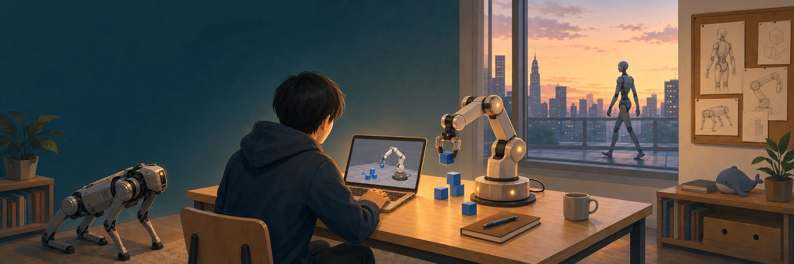
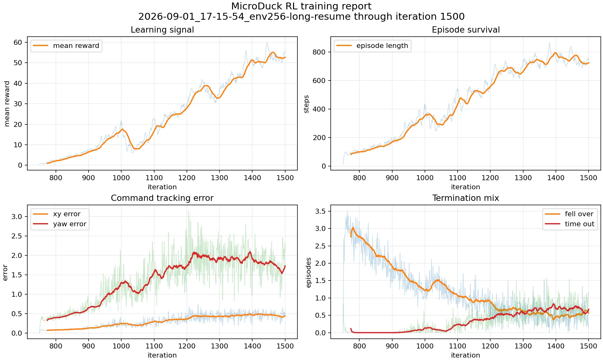
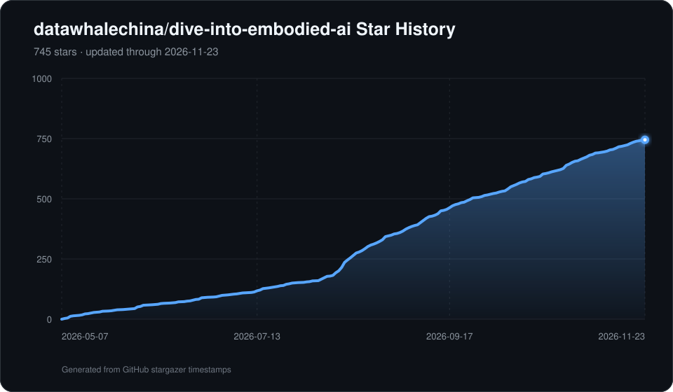

<div align="center">
    
</div>

<h1 align="center">Dive into Embodied AI</h1>
<p align="center"><b>An open course for learning embodied AI through hands-on projects</b></p>
<p align="center"><a href="README.md" lang="zh-Hans">中文</a> · <b>English</b> · <a href="README.it.md" lang="it">Italiano</a></p>

> [!TIP]
> **📖 Read online: [Open the course →](https://datawhalechina.github.io/dive-into-embodied-ai/en/)**
>
> Browse quadruped, biped, robot-arm, and AMD tutorials in the illustrated [Projects](https://datawhalechina.github.io/dive-into-embodied-ai/en/practices) directory. [Foundations](https://datawhalechina.github.io/dive-into-embodied-ai/en/foundations) groups topics by decision-making, control, perception, and engineering. Both pages include interactive point clouds, section navigation, direct tutorial links, a pause control, and reduced-motion support.
>
> The website offers full-text search, chapter navigation, and interactive demos. **[Get started with the introduction →](https://datawhalechina.github.io/dive-into-embodied-ai/en/docs/introduction/intro)**.
>
> Use **Copy as Markdown** at the top of tutorial and playground pages to copy their content, or open the dropdown to preview it. Code, tables, and LaTeX equations are preserved, with a link to the original page for interactive demos.
>
> For unfamiliar notation, use the [terms and formulas quick reference](i18n/en/docusaurus-plugin-content-docs/current/foundations/rl-for-robotics/quick-reference.md). The MDP and temporal-difference chapters include expandable explanations, step-by-step derivations, and small numerical examples beside key formulas.
>
> The README, homepage and navigation, introduction (including interactive demos and resources), learning map, project overview, and terms and formulas quick reference are available in English and Italian. Some other chapters, including MDPs and temporal difference, are also available in English; untranslated chapters and standalone playgrounds show a Chinese-content notice. Use the language menu to switch between 中文, English, and Italiano on the same page.

<p align="center">
  <a href="http://creativecommons.org/licenses/by-nc-sa/4.0/"></a>
  
</p>

<h3 align="center">🤝 Supported by</h3>

<p align="center">
  <a href="docs/practices/amd/intro.md">
    <picture>
      <source media="(prefers-color-scheme: dark)" srcset="assets/logo/logo_amd_wht.svg" />
      <source media="(prefers-color-scheme: light)" srcset="assets/logo/logo_amd.svg" />
      
    </picture>
  </a>
</p>

> [!CAUTION]
> **Alpha release:** Migration and restructuring are ongoing, and some chapters are placeholders. Please open an issue with feedback or suggestions.

## 🎯 About this project

Build an embodied AI robot from scratch. Explore practical implementations of reinforcement learning, world models, and vision-language-action models (VLA), alongside simulation, controllers, motion planning, and perception. Connect decision making, control, and perception in real projects.

🧭 **Get started: [Introduction](i18n/en/docusaurus-plugin-content-docs/current/introduction/intro.md)** — explore embodied AI concepts, tasks, platforms, and methods.

<a id="course-outline"></a>

## 🗂️ Course outline

The website has four sections: **Introduction**, **Foundations**, **Projects**, and **[Simulation](https://datawhalechina.github.io/dive-into-embodied-ai/en/simulation)**. The introduction covers the field and resources, foundations explain principles, and projects offer chapter sequences and standalone experiments, grouped into AMD, simulation, and real robot projects. Simulation offers game-style free control and automatic policy showcases.

The library includes Go2 and Pupper v3 PPO locomotion, a Quaddle periodic gait reference, and MicroDuck head/joint controls (no walking weights yet). Use keyboard or on-screen controls, pause, reset, slow motion, and camera tracking. Go2 uses simplified visuals of the original collision model. See the [model integration guide](simulation/README.en.md).

<a id="introduction"></a>

### 🧭 Introduction

Start with the [introduction to embodied AI](i18n/en/docusaurus-plugin-content-docs/current/introduction/intro.md) to see the big picture, then move on to the foundations and projects for specific techniques:

| Chapter | Contents |
| :--- | :--- |
| [1. What is embodied AI](i18n/en/docusaurus-plugin-content-docs/current/introduction/1.what-is-embodied-ai.md) | Definition, the perception–decision–action loop, and why the body matters |
| [2. A brief history](i18n/en/docusaurus-plugin-content-docs/current/introduction/2.history.md) | Four periods: programmed rules, model-based control, deep reinforcement learning, and foundation models |
| [3. Robot skills](i18n/en/docusaurus-plugin-content-docs/current/introduction/3.tasks-and-skills.md) | Defining tasks; grasping, manipulation, locomotion, and navigation |
| [4. Embodied AI platforms](i18n/en/docusaurus-plugin-content-docs/current/introduction/4.embodiments.md) | Humanoids, arms, wheeled and legged robots, mobile manipulators, and simulated bodies |
| [5. Key challenges](i18n/en/docusaurus-plugin-content-docs/current/introduction/5.challenges.md) | Data, sim-to-real transfer, generalization, real-time execution, safety, and evaluation |
| [6. Technology stack](i18n/en/docusaurus-plugin-content-docs/current/introduction/6.tech-stack.md) | Introductions and learning links for VLMs, VLAs, world models, manipulation, motion control, navigation, and more |
| [7. Career roles](i18n/en/docusaurus-plugin-content-docs/current/introduction/7.careers.md) | Responsibilities and interview preparation for brain algorithms, motion control, perception and navigation, engineering platforms, and hardware |

The introduction's [resources](i18n/en/docusaurus-plugin-content-docs/current/introduction/resources/index.md) collect public learning and research materials:

- [Papers and research](i18n/en/docusaurus-plugin-content-docs/current/introduction/resources/papers.md): original papers, project pages, and explanations.
- [Embodied AI datasets](i18n/en/docusaurus-plugin-content-docs/current/introduction/resources/datasets.md): robot demonstrations and evaluation benchmarks.
- [Open source projects](i18n/en/docusaurus-plugin-content-docs/current/introduction/resources/open-source.md): model code and training frameworks.
- [Simulation and tools](i18n/en/docusaurus-plugin-content-docs/current/introduction/resources/tools.md): simulation engines, learning environments, and official documentation.

### 🛠️ Projects

Use the [project overview](i18n/en/docusaurus-plugin-content-docs/current/practices/intro.md) to choose a project organized into chapters or a standalone experiment, then work through implementation and evaluation.

| Category | Project | Description |
| :--- | :--- | :--- |
| AMD | [AUP Learning Cloud](docs/practices/amd/aup-learning-cloud.md) | Ryzen AI APUs, ROCm, JupyterHub, and Code Server |
| AMD | [MicroDuck RL · AMD ROCm](docs/practices/amd/microduck-rl/index.md) | R9700, ROCm MuJoCo Warp, dynamic-contact regression tests, and biped PPO |
| AMD | [Explore the Pupper quadruped](docs/practices/amd/pupper-control/intro.md) | RL locomotion policies and VLA experiments on AMD hardware |
| Simulation | [Build a quadruped from scratch](docs/practices/quadruped/cs123/0.intro.md) | MuJoCo, PD control, kinematics, policy training, language control, and perception |
| Simulation | [Quaddle optimization and bottlenecks](i18n/en/docusaurus-plugin-content-docs/current/practices/quadruped/quaddle-mujoco/optimization.md) | 3.34 Hz cadence comparison, replay code, and terrain/running limits |
| Simulation | [MicroDuck RL biped](docs/practices/humanoid/microduck-rl/index.md) | mjlab + MuJoCo Warp: parallel PPO and biped gait training on GPUs |
| Simulation | [MuJoCo robot arms and DDPG](docs/practices/robot-arm/mujoco-arm-pick-place/index.md) | MuJoCo environments and continuous-control experiments |
| Simulation | [ACT bimanual training](docs/practices/vla/act/index.md) | ACT + ALOHA: training, evaluation, and reproduction |
| Real robots | [LeRobot course notes in Chinese](docs/practices/robot-arm/data-collection/lerobot-course/index.md) | Units 0–2: robot learning, datasets, toolchains, and classical robotics as preparation for hardware projects |
| Real robots | [SO-101 + LeRobot hardware tutorial](docs/practices/robot-arm/data-collection/so101-lerobot-real/index.md) | Hardware connectivity, safety tests, and action playback |

### 🦆 Latest demo: MicroDuck RL

<p align="center">
  <a href="docs/practices/humanoid/microduck-rl/index.md">
    
  </a>
  <br/>
  <sub><b><a href="docs/practices/humanoid/microduck-rl/index.md">MicroDuck RL · Stable biped locomotion</a></b><br/>mjlab + MuJoCo Warp · Parallel PPO training on GPUs (iteration 1500)</sub>
</p>

<table align="center">
  <tr>
    <td align="center" width="33%">
      <a href="https://datawhalechina.github.io/dive-into-embodied-ai/en/docs/practices/quadruped/cs123/intro">
        
      </a>
      <br/><sub><b><a href="https://datawhalechina.github.io/dive-into-embodied-ai/en/docs/practices/quadruped/cs123/intro">Build a quadruped from scratch</a></b><br/>CS123 simulation course · MuJoCo + PPO + LLM control</sub>
    </td>
    <td align="center" width="33%">
      
      <br/><sub><b>ReBot-Act · ACT training results</b><br/>Visual imitation learning on hardware · Block pick-and-place</sub>
    </td>
    <td align="center" width="33%">
      <a href="docs/practices/vla/act/index.md">
        
      </a>
      <br/><sub><b><a href="docs/practices/vla/act/index.md">ACT · ALOHA bimanual transfer</a></b><br/>50k training · 50% success over 20 MuJoCo episodes</sub>
    </td>
  </tr>
</table>

### 📐 Foundations

The foundations follow the four groups in the site navigation: decision making, motion control, perception, and engineering foundations.

#### Decision making

| Topic | Description |
| :--- | :--- |
| [Reinforcement learning for decisions](docs/foundations/rl-for-robotics/1.intro.md) | MDPs, DQN, PPO, SAC, DDPG/TD3, and imitation learning |
| [Vision-language-action models (VLA)](docs/foundations/vla/vla-intro.md) | RT-1/RT-2, OpenVLA, ACT, Diffusion Policy, and the π family |
| [World models](docs/foundations/world-model/0.intro.md) | Applying world models to embodied tasks; [DreamerV3 reaching experiment and video](i18n/en/docusaurus-plugin-content-docs/current/foundations/world-model/2.dreamerv3-reacher.md); [CarDreamer cross-traffic and future prediction](i18n/en/docusaurus-plugin-content-docs/current/foundations/world-model/3.cardreamer-right-turn.md) |

#### Motion control

| Topic | Description |
| :--- | :--- |
| [Reinforcement learning for control](docs/foundations/rl-for-robotics/10.ppo.md) | Connecting policy learning to continuous control and robotics |
| [Controllers](docs/foundations/controllers/intro.md) | PID, LQR, MPC, impedance control, and system integration |
| [Motion planning](docs/foundations/robotics-and-ros2/10.moveit2_basics.md) | Motion planning and closed-loop planning with MoveIt 2 |

#### Perception

Robots need to estimate their position, orientation, velocity, and stability. Relevant observations come from cameras, LiDAR, touch, motor currents, IMUs, foot contacts, body pose, and end-effector position.

| Topic | Description |
| :--- | :--- |
| [Visual perception and VLMs](docs/foundations/vlm/0.intro.md) | Transformers, ViT, vision encoders, and multimodal fusion |
| [Sensor calibration and sim2real](docs/foundations/perception/1.sensor-calibration-sim2real.md) | Coordinate frames, synchronization, extrinsic-error amplification, and online calibration monitoring |

#### Engineering foundations

| Topic | Description |
| :--- | :--- |
| [Simulation tools](docs/foundations/simulation/1.intro.md) | Getting started with Isaac Sim, MuJoCo, Gymnasium, and PyBullet |
| [ROS2](docs/foundations/robotics-and-ros2/0.intro.md) · [companion code](codes/foundations/robotics-and-ros2/README.en.md) | Coordinate transforms, FK/IK, tf2, URDF, and MoveIt 2 |
| [Data engineering and imitation learning](docs/foundations/rl-for-robotics/12.imitation-learning.md) | Teleoperation data, imitation learning, LeRobot toolchains, and policy training |

## 👥 Study groups

Datawhale organizes study groups around this course. Past and upcoming study plans will be collected in `docs/team-learning/` (under construction), including learning paths, check-in requirements, and chapter introductions.

- Registration for the next group: under construction
- Previous study materials: under construction

## 💻 Local preview

```bash
sh local-build.sh
```

Open the URL printed in the terminal to preview the site; press `Ctrl+C` to stop. See the [contributing guide](CONTRIBUTING.md#本地预览) (in Chinese) for details.

## ⭐ Star history

<p align="center">
  <a href="assets/star-history.svg">
    
  </a>
</p>

## 🤝 Contributors

### Core contributors

* Jiang Ji (江季) [@johnjim0816](https://github.com/johnjim0816), author of [Easy RL](https://github.com/datawhalechina/easy-rl), reinforcement learning researcher.
* Huang Xiao (黄潇) [@huang-xiao-01](https://github.com/huang-xiao-01), Tongji University graduate, intelligent-driving algorithm engineer.
* Sun Chengchao (孙成超) [@scchy](https://github.com/scchy), contributor to Quaddle VLA navigation training and simulation tutorials.

### Other contributors

* Kang Bo (康博) [@bokang-ugent](https://github.com/bokang-ugent), co-founder of nobl.ai and visiting professor at Ghent University, Belgium.
* Luo Ruyi (罗如意) [@ruyiluo](https://github.com/ruyiluo), national award winner in the smart car competition and lead of the FunRec open source project.
* YirongZheng [@Yirzzzz](https://github.com/Yirzzzz), contributor to RECAP reproduction on LIBERO long-horizon tasks and reward-function visualization.
* Ariestar [@Ariestar](https://github.com/Ariestar), contributor to MDP formula formatting and Docusaurus admonition fixes.

## 📣 Follow us

<div align="center">
  <p>Scan the QR code to follow Datawhale on WeChat.</p>
  
</div>

## 📄 License

<a rel="license" href="http://creativecommons.org/licenses/by-nc-sa/4.0/"></a>

This work is licensed under the [Creative Commons Attribution-NonCommercial-ShareAlike 4.0 International License](http://creativecommons.org/licenses/by-nc-sa/4.0/).
