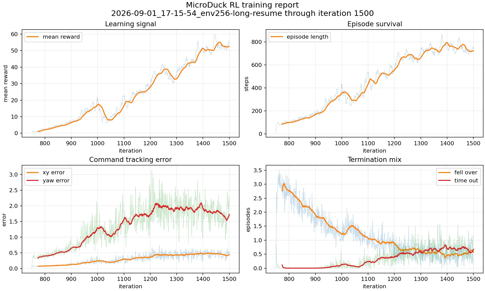

<div align="center"></div>

<h1 align="center">Dive into Embodied AI</h1>
<p align="center"><b>Un corso aperto per imparare l'IA incarnata con progetti pratici</b></p>
<p align="center"><a href="README.md" lang="zh-Hans">中文</a> · <a href="README.en.md" lang="en">English</a> · <b>Italiano</b></p>

> [!TIP]
> **📖 [Apri il corso in italiano →](https://datawhalechina.github.io/dive-into-embodied-ai/it/)**
>
> Ricerca nel testo, navigazione per capitoli e demo interattive. **[Inizia dall'introduzione →](https://datawhalechina.github.io/dive-into-embodied-ai/it/docs/introduction/intro)**.
>
> Usa **Copia come Markdown** all'inizio di tutorial ed esperimenti o apri l'anteprima. Conserva codice, tabelle ed equazioni LaTeX, con un link all'originale per le demo interattive.
>
> Per simboli o termini sconosciuti, consulta la [guida rapida a termini e formule](i18n/it/docusaurus-plugin-content-docs/current/foundations/rl-for-robotics/quick-reference.md). I capitoli su MDP e differenza temporale offrono spiegazioni espandibili, derivazioni passo per passo ed esempi numerici accanto alle formule; questi due capitoli sono disponibili in cinese e inglese.
>
> README, home e navigazione, introduzione con demo e risorse, mappa di apprendimento, panoramica dei progetti e guida rapida a termini e formule sono disponibili in inglese e italiano. Alcuni altri capitoli sono disponibili anche in inglese; quelli non tradotti e gli esperimenti autonomi mostrano un avviso sul contenuto in cinese. Il menu permette di passare tra 中文, English e Italiano sulla stessa pagina.

<p align="center">
  <a href="http://creativecommons.org/licenses/by-nc-sa/4.0/"></a>
  
</p>

### 🤝 Con il supporto di

<p align="center">
  <a href="docs/practices/amd/intro.md">
    <picture>
      <source media="(prefers-color-scheme: dark)" srcset="assets/logo/logo_amd_wht.svg" />
      <source media="(prefers-color-scheme: light)" srcset="assets/logo/logo_amd.svg" />
      
    </picture>
  </a>
</p>

> [!CAUTION]
> **Versione alfa:** migrazione e riorganizzazione proseguono e alcuni capitoli attendono contenuti. Condividi problemi e suggerimenti aprendo una segnalazione.

## 🎯 Il progetto

Costruisci un robot di IA incarnata da zero. Esplora rinforzo, modelli del mondo e modelli visione-linguaggio-azione (VLA), con simulazione, controllori, pianificazione e percezione. Collega decisione, controllo e percezione in progetti reali.

🧭 **[Introduzione](i18n/it/docusaurus-plugin-content-docs/current/introduction/intro.md)**: concetti, compiti, piattaforme e metodi.

<a id="course-outline"></a>

## 🗂️ Contenuti del corso

Quattro sezioni: **Introduzione**, **Fondamenti**, **Progetti** e **[Simulazione](https://datawhalechina.github.io/dive-into-embodied-ai/it/simulation)**. L'introduzione offre panoramica e risorse; i fondamenti spiegano i principi; i progetti includono percorsi a capitoli, demo e riproduzioni, suddivisi in AMD, simulazione e robot reali. La simulazione offre controllo libero in stile videogioco e dimostrazioni automatiche.

La libreria include locomozione PPO Go2 e Pupper v3, un'andatura periodica Quaddle e controllo di testa e articolazioni MicroDuck (senza pesi di camminata). Sono disponibili tastiera e pulsanti direzionali, pausa, ripristino, rallentatore e inseguimento della telecamera. Go2 mostra una grafica semplificata delle collisioni originali. Consulta la [guida per aggiungere modelli](simulation/README.it.md).

<a id="introduction"></a>

### 🧭 Introduzione

Parti dall'[introduzione](i18n/it/docusaurus-plugin-content-docs/current/introduction/intro.md), poi passa a fondamenti e progetti per tecniche specifiche.

| Capitolo | Contenuto |
| --- | --- |
| [1. Che cos'è l'IA incarnata](i18n/it/docusaurus-plugin-content-docs/current/introduction/1.what-is-embodied-ai.md) | Definizione, ciclo percezione-decisione-azione e importanza del corpo |
| [2. Breve storia](i18n/it/docusaurus-plugin-content-docs/current/introduction/2.history.md) | Regole, controllo basato su modelli, rinforzo profondo e modelli fondazionali |
| [3. Abilità robotiche](i18n/it/docusaurus-plugin-content-docs/current/introduction/3.tasks-and-skills.md) | Definizione dei compiti; presa, manipolazione, locomozione e navigazione |
| [4. Piattaforme](i18n/it/docusaurus-plugin-content-docs/current/introduction/4.embodiments.md) | Umanoidi, bracci, ruote, zampe, manipolazione mobile e simulazione |
| [5. Sfide principali](i18n/it/docusaurus-plugin-content-docs/current/introduction/5.challenges.md) | Dati, sim-to-real, generalizzazione, tempo reale, sicurezza e valutazione |
| [6. Tecnologie e moduli](i18n/it/docusaurus-plugin-content-docs/current/introduction/6.tech-stack.md) | VLM, VLA, modelli del mondo, manipolazione, controllo, navigazione e ingegneria |
| [7. Profili professionali](i18n/it/docusaurus-plugin-content-docs/current/introduction/7.careers.md) | Responsabilità e colloqui per algoritmi, controllo, percezione, piattaforme e hardware |

Le [risorse](i18n/it/docusaurus-plugin-content-docs/current/introduction/resources/index.md) raccolgono:

- [Articoli e ricerca](i18n/it/docusaurus-plugin-content-docs/current/introduction/resources/papers.md): fonti originali e spiegazioni.
- [Dataset](i18n/it/docusaurus-plugin-content-docs/current/introduction/resources/datasets.md): dimostrazioni e benchmark.
- [Progetti aperti](i18n/it/docusaurus-plugin-content-docs/current/introduction/resources/open-source.md): modelli e framework di addestramento.
- [Simulazione e strumenti](i18n/it/docusaurus-plugin-content-docs/current/introduction/resources/tools.md): motori, ambienti e documentazione.

### 🛠️ Progetti

La [panoramica dei progetti](i18n/it/docusaurus-plugin-content-docs/current/practices/intro.md) aiuta a scegliere tra un percorso completo e un esperimento autonomo.

| Categoria | Progetto | Descrizione |
| --- | --- | --- |
| AMD | [AUP Learning Cloud](docs/practices/amd/aup-learning-cloud.md) | APU Ryzen AI, ROCm, JupyterHub e Code Server |
| AMD | [MicroDuck RL · AMD ROCm](docs/practices/amd/microduck-rl/index.md) | R9700, ROCm MuJoCo Warp, test dei contatti dinamici e PPO bipede |
| AMD | [Esplora Pupper](docs/practices/amd/pupper-control/intro.md) | Politiche di locomozione RL ed esperimenti VLA |
| Simulazione | [Quadrupede da zero](docs/practices/quadruped/cs123/0.intro.md) | MuJoCo, PD, cinematica, politiche, controllo linguistico e percezione |
| Simulazione | [MicroDuck RL](docs/practices/humanoid/microduck-rl/index.md) | mjlab + MuJoCo Warp, PPO parallelo e camminata bipede su GPU |
| Simulazione | [MuJoCo e DDPG](docs/practices/robot-arm/mujoco-arm-pick-place/index.md) | Ambienti ed esperimenti di controllo continuo |
| Simulazione | [ACT bimanuale](docs/practices/vla/act/index.md) | ACT + ALOHA: addestramento, valutazione e riproduzione |
| Robot reali | [LeRobot in cinese](docs/practices/robot-arm/data-collection/lerobot-course/index.md) | Unità 0–2: apprendimento, dati, strumenti e robotica classica |
| Robot reali | [SO-101 + LeRobot](docs/practices/robot-arm/data-collection/so101-lerobot-real/index.md) | Connettività, test di sicurezza e riproduzione delle azioni |

### 🦆 Demo recente: MicroDuck RL

<p align="center">
  <a href="docs/practices/humanoid/microduck-rl/index.md">
    
  </a>
  <br/>
  <sub><b><a href="docs/practices/humanoid/microduck-rl/index.md">MicroDuck RL · Locomozione bipede stabile</a></b><br/>mjlab + MuJoCo Warp · Addestramento PPO parallelo su GPU (iterazione 1500)</sub>
</p>

<table align="center">
  <tr>
    <td align="center" width="33%">
      <a href="https://datawhalechina.github.io/dive-into-embodied-ai/it/docs/practices/quadruped/cs123/intro">
        
      </a>
      <br/><sub><b><a href="https://datawhalechina.github.io/dive-into-embodied-ai/it/docs/practices/quadruped/cs123/intro">Costruisci un quadrupede da zero</a></b><br/>Corso di simulazione CS123 · MuJoCo + PPO + controllo LLM</sub>
    </td>
    <td align="center" width="33%">
      
      <br/><sub><b>ReBot-Act · Risultati di addestramento ACT</b><br/>Imitazione visiva su hardware · Prelievo e posa di blocchi</sub>
    </td>
    <td align="center" width="33%">
      <a href="docs/practices/vla/act/index.md">
        
      </a>
      <br/><sub><b><a href="docs/practices/vla/act/index.md">ACT · Trasferimento bimanuale ALOHA</a></b><br/>Addestramento 50k · 50% di successo su 20 episodi MuJoCo</sub>
    </td>
  </tr>
</table>

### 📐 Fondamenti

Le quattro aree corrispondono alla navigazione del sito.

#### Decisioni

| Argomento | Descrizione |
| --- | --- |
| [Rinforzo per le decisioni](docs/foundations/rl-for-robotics/1.intro.md) | MDP, DQN, PPO, SAC, DDPG/TD3 e imitazione |
| [VLA](docs/foundations/vla/vla-intro.md) | RT-1/RT-2, OpenVLA, ACT, Diffusion Policy e famiglia π |
| [Modelli del mondo](docs/foundations/world-model/0.intro.md) | Applicazioni ai compiti incarnati; [esperimento DreamerV3 e video](i18n/it/docusaurus-plugin-content-docs/current/foundations/world-model/2.dreamerv3-reacher.md); [CarDreamer: traffico e previsione del futuro](i18n/it/docusaurus-plugin-content-docs/current/foundations/world-model/3.cardreamer-right-turn.md) |

#### Controllo del movimento

| Argomento | Descrizione |
| --- | --- |
| [Rinforzo per il controllo](docs/foundations/rl-for-robotics/10.ppo.md) | Politiche, controllo continuo e robotica |
| [Controllori](docs/foundations/controllers/intro.md) | PID, LQR, MPC, impedenza e integrazione |
| [Pianificazione](docs/foundations/robotics-and-ros2/10.moveit2_basics.md) | Movimento e pianificazione ad anello chiuso con MoveIt 2 |

#### Percezione

Il robot stima posizione, orientamento, velocità e stabilità con telecamere, LiDAR, tatto, correnti motore, IMU, contatti dei piedi, postura e posizione dell'effettore.

| Argomento | Descrizione |
| --- | --- |
| [Percezione visiva e VLM](docs/foundations/vlm/0.intro.md) | Transformer, ViT, codificatori visivi e fusione multimodale |
| [Calibrazione e sim2real](docs/foundations/perception/1.sensor-calibration-sim2real.md) | Riferimenti, sincronizzazione, amplificazione degli errori estrinseci e monitoraggio della calibrazione |

#### Basi ingegneristiche

| Argomento | Descrizione |
| --- | --- |
| [Simulazione](docs/foundations/simulation/1.intro.md) | Isaac Sim, MuJoCo, Gymnasium e PyBullet |
| [ROS2](docs/foundations/robotics-and-ros2/0.intro.md) · [codice di supporto](codes/foundations/robotics-and-ros2/README.it.md) | Trasformazioni, FK/IK, tf2, URDF e MoveIt 2 |
| [Dati e imitazione](docs/foundations/rl-for-robotics/12.imitation-learning.md) | Teleoperazione, imitazione, strumenti LeRobot e politiche |

## 👥 Gruppi di studio

Datawhale organizza gruppi attorno al corso. I programmi saranno raccolti in `docs/team-learning/` (in preparazione), con percorsi, requisiti di partecipazione e introduzioni.

- Iscrizione al prossimo gruppo: in preparazione.
- Materiali dei gruppi precedenti: in preparazione.

## 💻 Anteprima locale

```bash
sh local-build.sh
```

Apri l'URL mostrato nel terminale per visualizzare il sito; premi `Ctrl+C` per fermare il server. Consulta la [guida ai contributi](CONTRIBUTING.md#本地预览) (in cinese) per i dettagli.

## ⭐ Storico delle stelle

<p align="center"><a href="assets/star-history.svg"></a></p>

## 🤝 Collaboratori

In ciascun gruppo, i collaboratori sono elencati in ordine decrescente per il totale delle righe aggiunte ed eliminate nei commit inclusi in `master`, esclusi i commit di merge. Gli alias dello stesso autore sono raggruppati; i file binari non hanno un conteggio delle righe.

### Collaboratori principali

* Jiang Ji (江季) [@johnjim0816](https://github.com/johnjim0816), autore di [Easy RL](https://github.com/datawhalechina/easy-rl), ricercatore sul rinforzo.
* Huang Xiao (黄潇) [@huang-xiao-01](https://github.com/huang-xiao-01), laureato a Tongji, ingegnere di algoritmi per la guida intelligente.
* Sun Chengchao (孙成超) [@scchy](https://github.com/scchy), collaboratore ai tutorial di simulazione e addestramento alla navigazione VLA con Quaddle.

### Altri collaboratori

* Kang Bo (康博) [@bokang-ugent](https://github.com/bokang-ugent), cofondatore di nobl.ai e professore ospite all'Università di Gand, Belgio.
* Luo Ruyi (罗如意) [@ruyiluo](https://github.com/ruyiluo), premio nazionale nella competizione di veicoli intelligenti e responsabile di FunRec.
* YirongZheng [@Yirzzzz](https://github.com/Yirzzzz), collaboratore alla riproduzione di RECAP su attività a lungo orizzonte in LIBERO e alla visualizzazione della funzione di ricompensa.
* Ariestar [@Ariestar](https://github.com/Ariestar), collaboratore alle correzioni della formattazione delle formule MDP e dei blocchi di avviso di Docusaurus.

## 📣 Seguici

<div align="center"><p>Scansiona il codice QR per seguire Datawhale su WeChat.</p></div>

## 📄 Licenza

Quest'opera è distribuita con licenza [Creative Commons Attribuzione-NonCommerciale-CondividiAlloStessoModo 4.0 Internazionale](http://creativecommons.org/licenses/by-nc-sa/4.0/).
