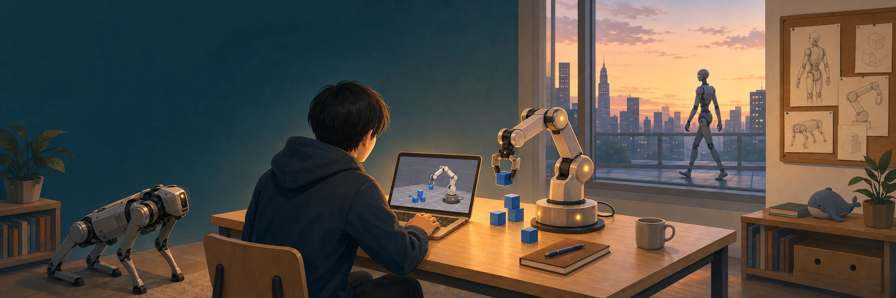
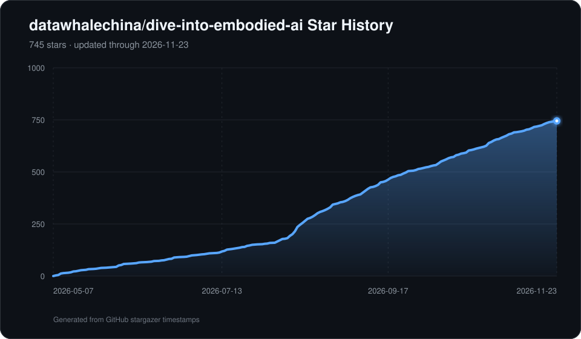

<div align="center"></div>

<h1 align="center">Dive into Embodied AI</h1>
<p align="center"><b>Un corso aperto per imparare l'IA incarnata con progetti pratici</b></p>
<p align="center"><a href="README.md" lang="zh-Hans">中文</a> · <a href="README.en.md" lang="en">English</a> · <b>Italiano</b></p>

README, home e navigazione, introduzione con demo e risorse, mappa di apprendimento, panoramica dei progetti e guida rapida a termini e formule sono disponibili in inglese e italiano. Alcuni altri capitoli sono disponibili anche in inglese; quelli non tradotti e gli esperimenti autonomi mostrano un avviso sul contenuto in cinese. Il menu permette di passare tra 中文, English e Italiano sulla stessa pagina.

<p align="center">
  <a href="http://creativecommons.org/licenses/by-nc-sa/4.0/"></a>
</p>

### 🤝 Con il supporto di

<p align="center">
  <a href="docs/practices/amd/intro.md">
    <picture>
      <source media="(prefers-color-scheme: dark)" srcset="assets/logo/logo_amd_wht.svg" />
      <source media="(prefers-color-scheme: light)" srcset="assets/logo/logo_amd.svg" />
      
    </picture>
  </a>
</p>

> [!TIP]
> **📖 [Apri il corso in italiano →](https://datawhalechina.github.io/dive-into-embodied-ai/it/)**

## 🎯 Il progetto

Un corso aperto per accompagnare dallo studio introduttivo all'ingegneria applicata dell'IA incarnata. Costruito attorno al ciclo reale **percezione–decisione–controllo**, collega percezione e localizzazione, RL / VLA / modelli del mondo, pianificazione e controllo del movimento, simulazione, dati e messa in opera, portando i principi in codice eseguibile su robot simulati e reali.

## 🧭 Da dove iniziare

L'IA incarnata unisce molte discipline: **non serve completare tutta la teoria prima di iniziare**. Segui tre passi pratici:

1. **Costruisci una mappa**: scorri rapidamente l'[Introduzione](i18n/it/docusaurus-plugin-content-docs/current/introduction/intro.md) per capire concetti, abilità, piattaforme e tecnologie (oppure prova subito la [Simulazione](https://datawhalechina.github.io/dive-into-embodied-ai/it/simulation) nel browser).
2. **Approfondisci la teoria con domande mirate**: parti dall'area che ti interessa e consulta i [Fondamenti](https://datawhalechina.github.io/dive-into-embodied-ai/it/foundations) quando serve.
3. **Risolvi problemi reali con i progetti**: completa un percorso nei [Progetti](https://datawhalechina.github.io/dive-into-embodied-ai/it/practices) tra simulazione e hardware, imparando tramite riproduzione, taratura e debug.

## 🎬 Demo in evidenza

<table align="center">
  <tr>
    <td align="center" width="33%">
      <a href="docs/practices/amd/microduck-rl/index.md">
        
      </a>
      <br/><sub><b><a href="docs/practices/amd/microduck-rl/index.md">MicroDuck RL · Camminata bipede stabile</a></b><br/>mjlab + MuJoCo Warp · PPO parallelo (ROCm / CUDA)</sub>
    </td>
    <td align="center" width="33%">
      <a href="docs/practices/humanoid/flamingo-isaaclab/0.intro.md">
        
      </a>
      <br/><sub><b><a href="docs/practices/humanoid/flamingo-isaaclab/0.intro.md">Flamingo · RL parallelo ruote-zampe</a></b><br/>Isaac Lab · Equilibrio dinamico e PPO / CaT</sub>
    </td>
    <td align="center" width="33%">
      <a href="docs/practices/quadruped/cs123/0.intro.md">
        
      </a>
      <br/><sub><b><a href="docs/practices/quadruped/cs123/0.intro.md">Quadrupede da zero</a></b><br/>MuJoCo + andature RL + inseguimento visivo</sub>
    </td>
  </tr>
  <tr>
    <td align="center" width="33%">
      <a href="docs/practices/vla/recap/index.md">
        
      </a>
      <br/><sub><b><a href="docs/practices/vla/recap/index.md">π₀.₅ + RECAP · VLA a lungo orizzonte</a></b><br/>Benchmark LIBERO · Valore e post-addestramento RL</sub>
    </td>
    <td align="center" width="33%">
      <a href="docs/practices/vla/act/index.md">
        
      </a>
      <br/><sub><b><a href="docs/practices/vla/act/index.md">ACT · Trasferimento bimanuale ALOHA</a></b><br/>Imitazione a blocchi · Valutazione MuJoCo</sub>
    </td>
    <td align="center" width="33%">
      
      <br/><sub><b>ReBot-Act · Imitazione su robot reale</b><br/>Braccio fisico · Prelievo e posa visivi</sub>
    </td>
  </tr>
</table>

> Scopri altri progetti su quadrupedi, bipedi, bracci e AMD ROCm nei **[Progetti →](https://datawhalechina.github.io/dive-into-embodied-ai/it/practices)**, oppure prova Go2, Pupper v3, Quaddle e MicroDuck nel browser nella **[Simulazione →](https://datawhalechina.github.io/dive-into-embodied-ai/it/simulation)**.

<a id="course-outline"></a>

## 🗂️ Contenuti del corso

Il corso è organizzato nelle quattro sezioni principali del sito (usa la versione web per ricerca, demo interattive e copia in Markdown):

| Sezione | Quando usarla | Contenuti principali | Link |
| :--- | :--- | :--- | :--- |
| **🧭 Introduzione** | All'inizio, per la visione d'insieme | Concetti, storia, abilità, piattaforme, sfide, tecnologie, profili professionali e risorse | [Leggi online](https://datawhalechina.github.io/dive-into-embodied-ai/it/docs/introduction/intro) · [Indice repo](i18n/it/docusaurus-plugin-content-docs/current/introduction/intro.md) |
| **📐 Fondamenti** | Per chiarire i principi quando serve | Cervello (RL / VLA / modelli del mondo), Cervelletto (controllo / pianificazione), Percezione (VLM / calibrazione), Ingegneria (simulazione / ROS 2 / imitazione) | [Hub fondamenti](https://datawhalechina.github.io/dive-into-embodied-ai/it/foundations) · [Mappa](docs/foundations/intro.md) |
| **🛠️ Progetti** | Per eseguire codice e risolvere compiti reali | Quadrupedi, bipedi e ruote-zampe, bracci e VLA, LeRobot + SO-101 reale e sezione AMD ROCm | [Hub progetti](https://datawhalechina.github.io/dive-into-embodied-ai/it/practices) · [Panoramica](i18n/it/docusaurus-plugin-content-docs/current/practices/intro.md) |
| **🎮 Simulazione** | Per provare subito senza configurazione | Andature PPO Go2 e Pupper v3, riferimento Quaddle, controllo MicroDuck (vedi [guida modelli](simulation/README.it.md)) | [Apri nel browser](https://datawhalechina.github.io/dive-into-embodied-ai/it/simulation) |

<details>
<summary>Mostra collegamenti rapidi ai capitoli principali</summary>

- **Introduzione**: [1. Che cos'è l'IA incarnata](i18n/it/docusaurus-plugin-content-docs/current/introduction/1.what-is-embodied-ai.md) · [2. Breve storia](i18n/it/docusaurus-plugin-content-docs/current/introduction/2.history.md) · [3. Abilità robotiche](i18n/it/docusaurus-plugin-content-docs/current/introduction/3.tasks-and-skills.md) · [4. Piattaforme](i18n/it/docusaurus-plugin-content-docs/current/introduction/4.embodiments.md) · [5. Sfide principali](i18n/it/docusaurus-plugin-content-docs/current/introduction/5.challenges.md) · [6. Tecnologie e moduli](i18n/it/docusaurus-plugin-content-docs/current/introduction/6.tech-stack.md) · [7. Profili professionali](i18n/it/docusaurus-plugin-content-docs/current/introduction/7.careers.md) · [Risorse](i18n/it/docusaurus-plugin-content-docs/current/introduction/resources/index.md)
- **Fondamenti**: [Rinforzo](docs/foundations/rl-for-robotics/1.intro.md) · [VLA](docs/foundations/vla/vla-intro.md) · [Modelli del mondo](docs/foundations/world-model/0.intro.md) · [Controllori](docs/foundations/controllers/intro.md) · [Percezione visiva e VLM](docs/foundations/vlm/0.intro.md) · [Calibrazione e sim2real](docs/foundations/perception/1.sensor-calibration-sim2real.md) · [Simulazione](docs/foundations/simulation/1.intro.md) · [ROS 2](docs/foundations/robotics-and-ros2/0.intro.md) ([codice](codes/foundations/robotics-and-ros2/README.it.md))
- **Progetti**: [MicroDuck RL](docs/practices/humanoid/microduck-rl/index.md) · [Flamingo ruote-zampe](docs/practices/humanoid/flamingo-isaaclab/0.intro.md) · [CS123 quadrupede](docs/practices/quadruped/cs123/0.intro.md) · [Quaddle: miglioramenti e limiti](i18n/it/docusaurus-plugin-content-docs/current/practices/quadruped/quaddle-mujoco/optimization.md) · [π₀.₅ + RECAP](docs/practices/vla/recap/index.md) · [ACT bimanuale](docs/practices/vla/act/index.md) · [SO-101 + LeRobot](docs/practices/robot-arm/data-collection/so101-lerobot-real/index.md) · [Sezione AMD](docs/practices/amd/intro.md)

</details>

## 👥 Gruppi di studio

Datawhale organizza gruppi attorno al corso. I programmi saranno raccolti in `docs/team-learning/` (in preparazione), con percorsi, requisiti di partecipazione e introduzioni.

- Iscrizione al prossimo gruppo: in preparazione.
- Materiali dei gruppi precedenti: in preparazione.

## 💻 Anteprima locale

```bash
sh local-build.sh
```

Apri l'URL mostrato nel terminale per visualizzare il sito; premi `Ctrl+C` per fermare il server. Consulta la [guida ai contributi](CONTRIBUTING.md#本地预览) (in cinese) per i dettagli.

## ⭐ Storico delle stelle

<p align="center"><a href="assets/star-history.svg"></a></p>

## 🙌 Come contribuire

Qualsiasi contributo è benvenuto, sia da chi sta iniziando sia da chi lavora su simulazione, algoritmi o hardware:

- **Correzioni e suggerimenti**: se trovi errori in formule, codice, link o testo, apri una [Issue](https://github.com/datawhalechina/dive-into-embodied-ai/issues) o una PR.
- **Tutorial e progetti**: completa capitoli in preparazione o proponi nuovi esperimenti di simulazione, riproduzioni di articoli, guide su robot reali o modelli per la simulazione online.
- **Traduzioni**: aiuta a mantenere allineate le versioni inglese (`i18n/en/`) e italiana (`i18n/it/`).

### Procedura di invio

1. Fai fork e clona il repository, poi installa Git LFS e scarica i file multimediali (`git lfs install && git lfs pull`).
2. Usa la versione di Node.js indicata in `.nvmrc` e verifica le modifiche in locale con `sh local-build.sh` o `npm run dev`.
3. Converti le nuove immagini raster in WebP (`npm run assets:webp`) ed esegui `npm run assets:webp:check` e `npm run build` prima del commit.
4. Apri una Pull Request verso `master` descrivendo modifiche e verifiche. Consulta [CONTRIBUTING.md](CONTRIBUTING.md) (in cinese) per i dettagli.

## 🤝 Collaboratori

### Collaboratori principali

* Jiang Ji (江季) [@johnjim0816](https://github.com/johnjim0816), autore di [Easy RL](https://github.com/datawhalechina/easy-rl), ricercatore sul rinforzo.
* Huang Xiao (黄潇) [@huang-xiao-01](https://github.com/huang-xiao-01), laureato a Tongji, ingegnere di algoritmi per la guida intelligente.
* Sun Chengchao (孙成超) [@scchy](https://github.com/scchy), collaboratore ai tutorial di simulazione e addestramento alla navigazione VLA con Quaddle.

### Altri collaboratori

* Kang Bo (康博) [@bokang-ugent](https://github.com/bokang-ugent), cofondatore di nobl.ai e professore ospite all'Università di Gand, Belgio.
* Luo Ruyi (罗如意) [@ruyiluo](https://github.com/ruyiluo), premio nazionale nella competizione di veicoli intelligenti e responsabile di FunRec.
* YirongZheng [@Yirzzzz](https://github.com/Yirzzzz), collaboratore alla riproduzione di RECAP su attività a lungo orizzonte in LIBERO e alla visualizzazione della funzione di ricompensa.
* Ariestar [@Ariestar](https://github.com/Ariestar), collaboratore alle correzioni della formattazione delle formule MDP e dei blocchi di avviso di Docusaurus.

## 📣 Seguici

<div align="center"><p>Scansiona il codice QR per seguire Datawhale su WeChat.</p></div>

## 📄 Licenza

Quest'opera è distribuita con licenza [Creative Commons Attribuzione-NonCommerciale-CondividiAlloStessoModo 4.0 Internazionale](http://creativecommons.org/licenses/by-nc-sa/4.0/).
