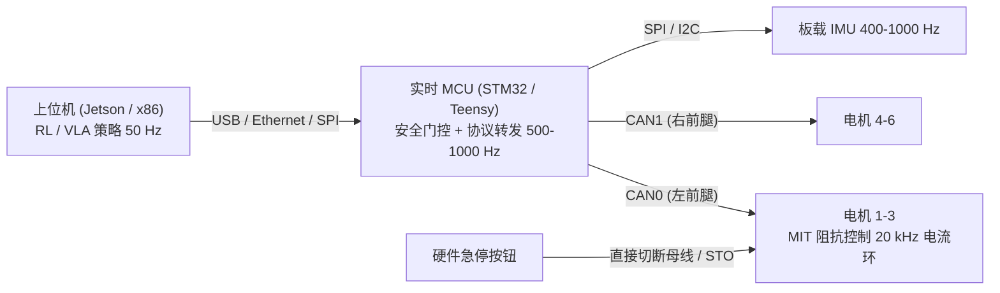

# CAN 与 MCU 通信

在具身智能系统中，高层策略（VLA / RL）通常运行在主控计算平台（Jetson / x86 工控机 / 树莓派）上，而关节电机、IMU、力矩传感器与电源管理芯片分布在机器人全身。负责把 50–1000 Hz 的控制指令可靠送达每一个执行器、并把编码器与状态反馈按时传回主控的，就是**底层通信总线与 MCU（微控制器）链路**。

## 1. 常见机器人底层总线对比 \{#bus-comparison}

不同形态的机器人对带宽、延迟、抗干扰和线束复杂度的要求差异很大，选型时应先算清**单帧字节数 × 关节数 × 控制频率**的总带宽需求：

| 通信方式 | 典型速率 | 拓扑结构 | 典型代表 | 核心优势与局限 |
| :--- | :--- | :--- | :--- | :--- |
| **UART / RS-485（半双工）** | 1–4 Mbps | 菊花链总线 | Dynamixel XL330 / Feetech STS3215（MicroDuck / SO-101） | 接线极简、成本低；半双工轮询延迟随舵机数量线性增长，抗共模干扰依赖差分 RS-485 |
| **经典 CAN 2.0B** | 1 Mbps（单帧 ≤ 8 字节） | 差分双绞总线 | MIT Mini-Cheetah、达妙（DM）、宇树早期电机、RoboMaster C620 | 差分抗电磁干扰强、硬件仲裁与 CRC 校验完善；单条总线通常建议挂载 ≤ 4–6 个高频（500 Hz）关节 |
| **CAN-FD** | 仲裁 1 Mbps / 数据 5–8 Mbps（单帧 ≤ 64 字节） | 差分双绞总线 | 新一代四足/人形关节模组、多关节打包控制 | 兼容 CAN 物理层与仲裁机制，单帧负载扩大 8 倍，显著降低总线占有率与延迟抖动 |
| **EtherCAT** | 100 Mbps（实时帧穿透） | 菊花链 / 环形 | 工业机械臂、全尺寸人形机器人（20+ DoF） | 微秒级分布式时钟（DC）同步、1–4 kHz 确定性闭环；硬件从站芯片与协议栈成本较高 |
| **UDP / 实时以太网** | 100–1000 Mbps | 星型（经交换机） | 宇树 Go2 / G1 上位机 SDK、多传感器同步 | 带宽充足、开发方便；Linux 需配 `PREEMPT_RT` 内核与独立网卡以控制网络抖动 |

### 带宽估算示例（经典 CAN 1 Mbps）

以标准 CAN 2.0A（11 位 ID，8 字节负载）为例，包含帧头、填充位与帧间隔，单帧约 **130 bit**（耗时约 `0.13 ms`）。若一条总线上挂 3 个关节，每个关节一问一答（指令帧 + 反馈帧 = 2 帧），控制频率 `500 Hz`：

$$\text{总线占有率} \approx \frac{3 \times 2 \times 130\text{ bit} \times 500\text{ Hz}}{1{,}000{,}000\text{ bit/s}} = 39\%$$

:::tip[总线负载与拓扑建议]
工程上经典 CAN 总线占有率建议控制在 **50%–60% 以内**，预留总线仲裁与错误重传余量。因此 12 自由度四足机器人常拆成 **4 条独立 CAN 总线**（每条腿 1 路，每路 3 个电机），而不是全部串联到一条线上。
:::

## 2. 上位机—MCU—执行器分层架构 \{#layered-architecture}

绝大多数足式与灵巧操作机器人采用**“上位机算策略 + MCU 做实时桥接与硬安全保护”**的双层架构：



为什么不直接让 Python 脚本在普通 Linux 上以 1 kHz 轮询电机？

1. **确定性延迟**：Linux 非实时调度和 Python GC 偶尔会造成 `5–30 ms` 停顿，在高频力矩闭环中会瞬间引发关节剧烈振荡；MCU 的硬件定时器中断可将周期抖动控制在微秒级。
2. **断连安全兜底（Watchdog）**：当上位机程序崩溃或无线遥控断连超过阈值（如 `100–200 ms`），MCU 自动切换为纯阻尼模式（`kp = 0, kd = d_safe`）让机器人缓慢卸力落地，而不是维持最后一帧高压指令打飞关节。
3. **硬实时传感器时间戳**：MCU 可在同一时钟域同时采样 IMU 与编码器反馈，避免 USB 串口缓冲带来的时序错位（详见 [时间戳与状态估计](/docs/foundations/perception/odo-timestamps-state-estimation)）。

## 3. MIT 风格关节电机控制协议解析 \{#mit-protocol}

目前开源四足/人形准直驱（QDD）关节模组（MIT Mini-Cheetah、达妙、灵足时代、小米 CyberGear 等）广泛采用统一的 **MIT 5 参数混合控制协议**。上位机只需在 8 字节 CAN 数据帧内打包 5 个定点数：

$$\tau_{\text{ref}} = K_p (q_{\text{des}} - q) + K_d (\dot{q}_{\text{des}} - \dot{q}) + \tau_{\text{ff}}$$

| 参数 | 典型位宽 | 物理含义 | 常见用法 |
| :--- | :---: | :--- | :--- |
| $q_{\text{des}}$ | 16 bit | 目标关节角 `[rad]` | 策略输出动作经 `default + scale * action` 转换 |
| $\dot{q}_{\text{des}}$ | 12 bit | 目标角速度 `[rad/s]` | 常规位置/RL 跟踪设为 `0` |
| $K_p$ | 12 bit | 比例刚度 `[N·m/rad]` | 与仿真中验证过的刚度严格对齐 |
| $K_d$ | 12 bit | 阻尼系数 `[N·m·s/rad]` | 安全卸力模式下置为小阻尼并令 $K_p=0$ |
| $\tau_{\text{ff}}$ | 12 bit | 前馈力矩 `[N·m]` | 重力补偿、动力学前馈或纯力矩控制 |

合计 `16 + 12 + 12 + 12 + 12 = 64 bit = 8 bytes`，恰好塞满一帧经典 CAN 负载。电机内部驱动板以 `10–20 kHz` 执行上述 PD+前馈控制并闭环 FOC 电流环，回传一帧包含 `ID / 实际位置 / 实际速度 / 实际电流（力矩）/ 温度与故障码` 的状态帧。

:::warning[上电安全校验]
不同厂商电机的定点数上下界（`P_MAX`, `V_MAX`, `KP_MAX`, `KD_MAX`, `T_MAX`）各不相同！上电前务必核对数据手册并在**悬空限幅状态**下做单关节微幅正弦验证，避免编码范围错位导致满额力矩暴冲。
:::

## 4. Linux SocketCAN 快速上手与排查 \{#socketcan}

在 Ubuntu / Jetson 上通过 USB-to-CAN 适配器（如 CANable / gs_usb / PEAK PCAN）或板载 CAN 控制器调试时，Linux 原生 **SocketCAN** 把总线抽象为网络接口（`can0`, `can1`）：

```bash
# 1. 启动 1 Mbps 经典 CAN 接口（若为 CAN-FD 可加 dbitrate 5000000 fd on）
sudo ip link set can0 type can bitrate 1000000 restart-ms 100
sudo ip link set can0 up

# 2. 查看接口统计（重点检查 RX/TX error、dropped 与 bus-off 计数）
ip -details -statistics link show can0

# 3. 安装 can-utils 抓包与发送测试帧
sudo apt-get install -y can-utils
candump -t z can0              # 实时打印带相对时间戳的总线帧
cansend can0 001#FF.FF.FF.FF.FF.FF.FF.FC   # 示例：发送 MIT 模式使能帧
```

Python 端推荐使用 `python-can`（底层直连 SocketCAN，零额外驱动）：

```python
import can

bus = can.interface.Bus(channel="can0", interface="socketcan")
msg = can.Message(arbitration_id=0x01, data=bytes([0xFF]*7 + [0xFC]), is_extended_id=False)
bus.send(msg)
reply = bus.recv(timeout=0.01)
if reply is not None:
    print(f"ID=0x{reply.arbitration_id:02X} data={reply.data.hex(' ')}")
```

## 5. 硬件接线与工程排障清单 \{#troubleshooting}

80% 的真机通信故障来自物理层与接地，而非协议代码：

| 现象 | 最常见根因 | 排查与修复 |
| :--- | :--- | :--- |
| **`BUS-OFF` 或大量错误帧** | 总线缺少终端电阻或电阻值错误 | 断电测量 `CAN_H` 与 `CAN_L` 间电阻，标准应为 **60 Ω**（总线两端各一个 `120 Ω` 并联） |
| **单电机正常，多电机同时发力掉线** | 电机母线地与信号地形成地环路，或 CAN 线紧贴三相动力线 | 使用带屏蔽层的双绞线、通信地单点共地，必要时加磁耦隔离 CAN 模块 |
| **USB 串口 / CAN 周期出现 `16 ms` 阶梯抖动** | FTDI / USB-Serial 驱动默认聚合延迟定时器（`latency_timer = 16`） | 将 `/sys/bus/usb-serial/devices/ttyUSB0/latency_timer` 设为 `1`，或优先选用原生 `gs_usb` / 板载 CAN |
| **重启后 `can0 / can1` 或 `ttyUSB0 / ttyUSB1` 编号互换** | USB 枚举顺序非确定性 | 通过 `udev` 规则按硬件序列号（`ATTRS{serial}`）绑定固定符号链接（如 `/dev/arm_left`） |
| **高频运行时偶尔丢帧** | Linux `txqueuelen` 默认仅 10 帧，突发批量发送溢出 | 执行 `sudo ip link set can0 txqueuelen 1000` 并开启 `restart-ms 100` |

## 6. 与站内实战衔接 \{#next-steps}

- **硬件与执行器选型**：[机械结构与执行器选型](/docs/foundations/hardware/placeholder)
- **串口舵机真机实操**：[SO-101 + LeRobot 真机教程](/docs/practices/robot-arm/data-collection/so101-lerobot-real)（含 USB 串口权限、供电排查与安全回零）
- **真机策略上线**：[Sim2Real 工程部署指南](/docs/practices/quadruped/sim2real-guide/placeholder)（看门狗、阻尼卸力与逐级上电清单）
- **时间同步与标定**：[时间戳与状态估计](/docs/foundations/perception/odo-timestamps-state-estimation)
