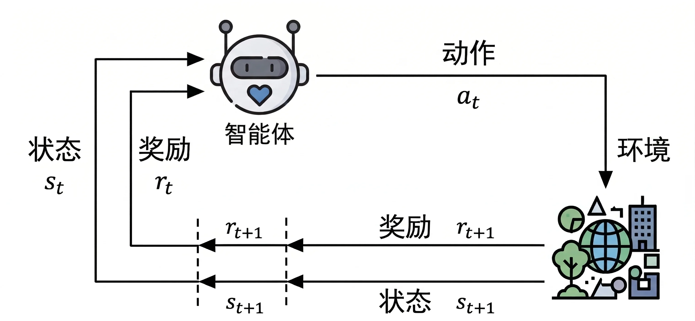

import Figure from '@site/src/components/Figure';

# 2. 马尔可夫决策过程

[马尔可夫决策过程（MDP）](/docs/foundations/rl-for-robotics/quick-reference#mdp) 是强化学习的核心问题模型。无论是训练四足机器人行走，还是让机械臂完成抓取任务，第一步都是将问题建模为 MDP，明确状态空间、动作空间、状态转移概率和奖励函数等要素。

遇到陌生符号，可查看 [术语与公式速查](/docs/foundations/rl-for-robotics/quick-reference#notation)；本章公式旁的“通俗解释”可以原地展开。

> **具身智能视角**：以机械臂抓取为例，状态 $s$ 可以是关节角度 + 物体位姿，动作 $a$ 是各关节的目标力矩，奖励 $r$ 是抓取成功与否的信号。将这些要素明确后，就可以用 RL 算法来求解最优策略。

## 2.1 智能体与环境交互

如下图所示，智能体（Agent）与环境（Environment）在一系列离散的时步中交互。在每个时步 $t$，智能体接收环境的状态 $s_t$，并根据该状态选择一个动作 $a_t$。执行该动作后，智能体会收到一个奖励 $r_{t+1}$，同时环境会转移到下一个状态 $s_{t+1}$。

:::note[奖励的时间下标约定]

第 2–6 章（MDP、动态规划、蒙特卡洛、时序差分与 DQN）统一按**收到奖励的时步**编号：执行 $A_t$ 后，收到 $R_{t+1}$ 并进入 $S_{t+1}$。**$R_{t+1}$ 就是当前动作 $A_t$ 的即时奖励，并没有跳过一次奖励。**

大写 $S_t,A_t,R_{t+1}$ 表示随机变量，小写 $s_t,a_t,r_{t+1}$ 表示一次交互中观测到的样本；大小写不会改变时间下标。下面交互图中，智能体在时步 $t$ 已收到的 $r_t$ 来自上一个动作 $a_{t-1}$，环境对当前动作 $a_t$ 的反馈是 $r_{t+1}$。

后续策略梯度、Actor-Critic 和 SAC 章节保留按**产生奖励的动作时步**编号的记法。两种记法的样本对应关系是 $r_t^{\mathrm{action}} = r_{t+1}^{\mathrm{arrival}}$，因此 $\sum_{k=0}^{\infty}\gamma^k r_{t+k}^{\mathrm{action}} = \sum_{k=0}^{\infty}\gamma^k r_{t+k+1}^{\mathrm{arrival}}$，表示同一个回报。PPO 中的 $r_t(\theta)$ 则是策略概率比，不是奖励。

:::

<Figure caption="智能体与环境的交互过程">

</Figure>

这个过程不断重复，形成一条**轨迹**：

$$
\begin{equation}
s_0,a_0,r_1,s_1,a_1,r_2,\ldots,s_{T-1},a_{T-1},r_T,s_T
\end{equation}
$$

完成一条完整的轨迹（从初始状态到终止状态）也称为一个**回合**（episode），通常在有限的时步 $T$ 后结束。

**如果要用强化学习来解决问题，首先需要将问题建模为马尔可夫决策过程，即明确状态空间、动作空间、状态转移概率和奖励函数等要素**。通常用一个五元组来定义：

$$
\begin{equation}
\mathrm{MDP} = (S, A, P, R, \gamma)
\end{equation}
$$

其中 $S$ 是状态空间，$A$ 是动作空间，$P$ 是状态转移概率矩阵，$R$ 是奖励函数，$\gamma$ 是折扣因子（取值范围 $0$ 到 $1$）。

## 2.2 马尔可夫性质

马尔可夫决策过程的核心假设是**马尔可夫性质**，即系统未来状态的概率分布只依赖于当前的状态和动作，而与过去的状态和动作无关：

$$
\begin{equation}
P(s_{t+1}|s_t,a_t, s_{t-1},a_{t-1},\cdots,s_0,a_0) = P(s_{t+1}|s_t,a_t)
\end{equation}
$$

通俗解释：马尔可夫性质为什么只看“现在”？

关键是“现在的状态包含了足够的信息”，不是“机器人必须忘掉过去”。只知道球的位置，通常不能判断它下一刻往哪边走；如果状态还包括速度，预测就有了更多依据。公式中的竖线表示“在这些信息已知的条件下”，左右相等表示：补充过去的记录不会改变下一状态的条件分布。

更多说明：[状态与观测的区别](/docs/foundations/rl-for-robotics/quick-reference#mdp)。

真实机器人通常只能获得部分观测。例如在机器人导航中，当前的激光雷达扫描可能不足以完全描述环境状态（存在遮挡）。这类问题可以建模为**部分可观测马尔可夫决策过程（POMDP）**。叠加历史帧可以帮助近似马尔可夫状态，但不保证恢复完整状态。

## 2.3 状态转移矩阵

对于有限状态空间，可以用状态流向图表示状态之间的转移关系。如下图所示：

<Figure caption="马尔可夫链">

</Figure>

状态之间的切换概率可以用矩阵表示：

$$
\begin{equation}
P_{ss'}=\begin{pmatrix}
p_{11} & p_{12} & \cdots & p_{1n}\\
p_{21} & p_{22} & \cdots & p_{2n}\\
\vdots & \vdots & \ddots & \vdots \\
\end{pmatrix}
\end{equation}
$$

其中 $n$ 表示状态数，从同一个状态出发转移到其他状态的概率之和等于 $1$。状态转移矩阵是环境的一部分，描述了环境状态之间的转移关系。

## 2.4 目标与回报

智能体的目标是**通过与环境的交互，学习一个最优策略，使得在每个状态下选择的动作能够最大化期望累积奖励**。这个累积的奖励称为[**回报（Return）**](/docs/foundations/rl-for-robotics/quick-reference#return)：

$$
\begin{equation}
G_t = R_{t+1}+\gamma R_{t+2}+\gamma^2 R_{t+3} + \cdots = \sum_{k=0}^{\infty} \gamma^k R_{t+k+1}
\end{equation}
$$

折扣因子 $\gamma$ 控制未来奖励在当前决策中的重要性。当 $\gamma$ 接近 $0$ 时，智能体更关注当前的奖励；当 $\gamma$ 接近 $1$ 时，更加重视未来的奖励。

对于在 $S_T$ 终止的回合，求和只到 $R_T$，并约定 $G_T=0$。例如从 $s_0$ 执行 $a_0$ 得到 $r_1=2$，再执行 $a_1$ 得到 $r_2=3$ 并终止，取 $\gamma=0.9$，这条轨迹的回报就是 $G_0=2+0.9\times3=4.7$、$G_1=3$。当前动作的奖励 $r_1$ 是 $G_0$ 的第一项。

折扣因子可以用来衡量智能体对长期回报的关注度，称之为**有效视界**：

$$
\begin{equation}
H_{\mathrm{eff}} = \frac{1}{1-\gamma}
\end{equation}
$$

当 $\gamma=0.99$ 时，$H_{\mathrm{eff}}=100$，可粗略理解为约 $100$ 步的时间尺度，并不是第 $100$ 步之后的奖励被丢弃。这个表达式来自 $0\leq\gamma<1$ 时折扣权重的几何级数之和。在机器人行走任务中，通常需要较大的 $\gamma$ 来关注长期的运动稳定性。

回报的递归定义：

$$
\begin{equation}
G_t = R_{t+1}+\gamma G_{t+1}
\end{equation}
$$

通俗推导：为什么能把一长串奖励写成两项？

1. 先留下第一项 $R_{t+1}$，它是当前动作刚产生的奖励。
2. 后面的每一项都至少带一个 $\gamma$，把这个公共因子提出来。
3. 括号里恰好是“从下一时刻开始的回报” $G_{t+1}$：

$$
\begin{aligned}
G_t &= R_{t+1}+\gamma R_{t+2}+\gamma^2R_{t+3}+\cdots \\
&=R_{t+1}+\gamma\bigl(R_{t+2}+\gamma R_{t+3}+\cdots\bigr) \\
&=R_{t+1}+\gamma G_{t+1}.
\end{aligned}
$$

所以这一步只是提取公因子，没有删掉未来的奖励。用前面的两步例子检查：$G_1=3$，$G_0=2+0.9G_1=4.7$。

符号速查：[$\sum$、幂与时间下标](/docs/foundations/rl-for-robotics/quick-reference#notation)。

## 2.5 策略与价值

### 2.5.1 策略

[策略（Policy）](/docs/foundations/rl-for-robotics/quick-reference#value) 表示智能体在每个状态下选择动作的规则，用 $\pi$ 表示：

$$
\begin{equation}
\pi(a|s) = P(A_t = a | S_t = s)
\end{equation}
$$

策略可以是**确定性的**（在每个状态下总是选择同一个动作）或**随机性的**（根据概率分布选择动作）。在具身智能中，随机性策略更为常用，因为它能提供更好的探索能力和鲁棒性。

### 2.5.2 状态价值

状态价值函数表示在给定状态下，按照策略 $\pi$ 进行决策所能获得的回报期望值：

$$
\begin{equation}
V_\pi(s)=\mathbb{E}_{\pi}[G_t|S_t=s ]
\end{equation}
$$

通俗解释：期望符号和条件竖线怎么读？

把整式读成：“从状态 $s$ 出发，之后一直按策略 $\pi$ 行动，回报的平均值是多少？”$\mathbb{E}$ 表示按概率加权平均，$\mid S_t=s$ 表示已经确定起点为 $s$。即使起点相同，动作采样或环境变化也可能带来不同结果；价值不等于某一条轨迹的实际回报。

例如两种回报 $2$ 和 $8$ 各有一半概率，则期望为 $0.5\times2+0.5\times8=5$，但一次运行并不一定得到 $5$。

术语速查：[期望与价值](/docs/foundations/rl-for-robotics/quick-reference#value)。

### 2.5.3 动作价值

动作价值函数表示在给定状态 $s$ 和动作 $a$ 下的回报期望值：

$$
\begin{equation}
Q_\pi(s, a)=\mathbb{E}_\pi\left[G_t \mid S_t=s, A_t=a\right]
\end{equation}
$$

### 2.5.4 状态价值与动作价值的关系

$$
\begin{equation}
V_\pi(s)=\sum_{a \in A} \pi(a \mid s) Q_\pi(s, a)
\end{equation}
$$

通俗解释：为什么 V 是 Q 的加权平均？

$Q_\pi(s,a)$ 先指定第一个动作，后续按 $\pi$ 行动；$V_\pi(s)$ 连第一个动作也交给 $\pi$ 选择。于是要把“每个动作的分数”乘以“策略选它的概率”，再全部相加。

若左右两个动作的 $Q$ 值分别为 $2,6$，策略各以 $0.5$ 的概率选择，则 $V_\pi(s)=0.5\times2+0.5\times6=4$。取最大值 $6$ 会变成总选高分动作的另一条策略，不能替代这里的平均。

状态价值是对所有可能的动作价值的加权平均。状态价值反映了策略本身的好坏，动作价值则更具体地反映了在特定状态下选择某个动作的好坏。

## 2.6 有模型与无模型

- **有模型方法（Model-Based）**：利用环境模型（状态转移概率和奖励函数）来进行规划和决策，如动态规划。在仿真环境中，有时可以获得环境模型来加速学习。
- **无模型方法（Model-Free）**：不依赖于环境模型，通过与环境的直接交互来学习，如 PPO、SAC 等。在真实机器人场景中应用更广泛，因为真实环境的动力学模型通常难以精确获取。

## 2.7 预测与控制

- **预测**：在给定策略下，评估该策略的好坏，即计算价值函数。
- **控制**：寻找最优策略，使得累积回报最大化。

复杂问题中通常需要同时解决预测和控制问题，即在学习最优策略的过程中，同时评估当前策略的好坏（这正是 Actor-Critic 框架的思想）。
