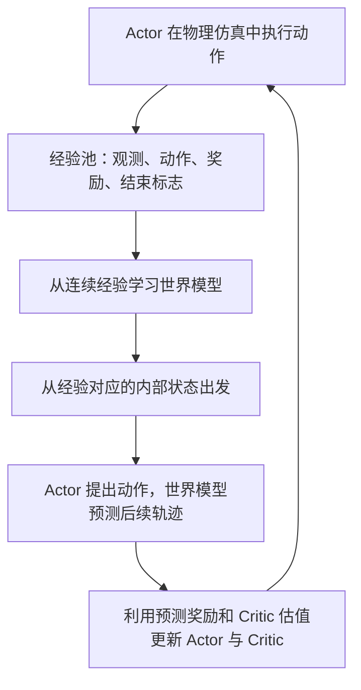
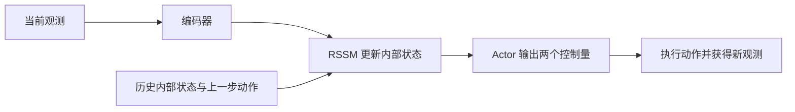

# DreamerV3 实验：让机械臂到点并停住

**先看效果：右边的机械臂会靠近红色目标，再保持在附近。** 这是一组实际训练后的物理仿真回放，任务是 DMControl `reacher_easy`，使用两个关节的状态输入。

## 看视频：到底学会了什么？ \{#watch}

<video controls playsInline preload="metadata" poster={require('./figs/dreamerv3/reacher-comparison.webp').default} src={require('./figs/dreamerv3/reacher-comparison.mp4').default} style={{width: '100%', borderRadius: 12}} />

**左：随机动作；右：DreamerV3 训练后。** 同一起点，画面为原始前 5 秒，以 **0.5 倍速**播放，约 10 秒看完。点击播放后，先看黄色折杆的**橙色末端**如何靠近**红色目标**。

- **到达**：本例末端起初距目标中心约 28.7 cm，在仿真 0.66 秒时首次进入奖励区域，对应慢放视频约 1.32 秒。
- **保持**：后半段动得很少，是因为留在目标区域也在持续获得奖励。任务没有要求不停摆动。
- **对照**：随机动作也可能偶然经过目标，区别是能否有目的地到达，并持续停留。

这段 1280×800 视频由保存的动作重新物理回放、以高清渲染生成；前 250 步的关节位置、速度和目标相对位置与原记录逐步核对，最大误差小于 `4e-7`。没有手工改动作。视频使用预先指定的第 200 号评估初态，不是从最终十组中挑最好的一组。

:::tip[没有显卡，也能做一个小实验]

把进度条拖回开头，暂停在慢放 1.3 秒附近：右边已经进入目标区域了吗？继续播放，判断它是在穿过目标，还是在附近保持。然后看后面的整回合指标，检查短视频是否支持“学会了”的说法。

:::

## 输入、动作和奖励 \{#task}

| 项目 | 本次设置 |
| --- | --- |
| 观测 | 两个关节位置、两个关节速度、末端到目标的二维相对位置，共 6 维 |
| 动作 | 两个连续关节控制量 |
| 奖励 | 末端进入目标区域时为 1，否则为 0 |
| 一回合 | 1000 个控制步，仿真 20 秒；累计回报最高 1000 |
| 学习目标 | 尽早到达目标区域，并在其中保持 |

**模型没有看视频。** 本次是状态输入实验；MuJoCo 负责物理仿真，视频只是展示。它能帮助理解世界模型控制，但不是视觉机械臂或真机验证。

## 是两个网络，还是一个世界模型？ \{#networks}

DreamerV3 是一套基于世界模型的强化学习方法。按功能分成 **世界模型、Actor、Critic** 三部分；实现上包含多个神经网络模块。

| 部分 | 回答的问题 | 固定版本代码中的模块 |
| --- | --- | --- |
| 世界模型 | 当前处在什么状态？采取动作后会怎样？ | 编码器 `enc`、循环状态空间模型 `dyn`（RSSM）、观测解码器 `dec`、奖励头 `rew`、继续概率头 `con` |
| Actor 策略 | 现在应该采取什么动作？ | `pol` |
| Critic 价值 | 从这个状态继续行动，预计能拿到多少累计奖励？ | `val`；另有慢速更新的价值目标 `slowval` |

这里的“世界模型”本身就不是一个简单的预测层。编码器提取观测特征，RSSM 将特征、历史状态与上一步动作结合；训练时还要预测观测、奖励和任务是否继续。RSSM 包含循环的确定性状态和随机隐变量，此处统称为**内部状态**。

**一个 checkpoint 可以同时保存这些模块的参数，文件数不等于网络数。**

## 训练和推理，分别做什么？ \{#training-inference}

### 训练：收集经验、学习模型、改进策略，反复交替 \{#training-loop}

世界模型使用实际交互片段学习；Actor 和 Critic 利用模型展开的“想象轨迹”学习行为。模型预测有误时，策略也可能被误导，因此必须回到物理仿真验证。

**不是先把世界模型彻底训练完、冻结，再一次性训练策略。** 本实验在训练循环中不断收集经验并更新各部分；早期模型和策略都不成熟。

### 推理：不再更新参数，但仍使用世界模型的一部分 \{#inference-loop}

独立评估时固定参数，反复执行这条控制链。**不是仅凭 Actor 读取原始状态，也不是让世界模型直接输出动作。** Critic、奖励头和想象轨迹主要服务训练；选择当前动作不需要每次搜索大量候选轨迹。固定版本的策略调用可能同时计算辅助输出，但决策主链就是“编码与状态更新 → Actor”。

这与 MPC 的区别是：MPC 通常在每个控制时刻搜索候选动作序列；Dreamer 在训练时通过想象学习策略，运行时由策略直接输出动作。

## 我们实际训练出了什么？ \{#results}

单张 RTX 4090、一个训练种子 `seed=0`，采用作者 `dmc_proprio` 的小模型配置，实际可训练参数约 **63.8 万**。以下是本次日志结果，不是硬件性能承诺。

| 配置 | 环境步数 | 每步训练比例 | 相同 5 个开发初态的平均回报 |
| --- | ---: | ---: | ---: |
| 第一轮：快速验证流程 | 100,008 | 128 | 1.4 |
| 第二轮：恢复作者 DMC 更新比例 | 100,008 | 1024 | 734.6 |
| 第二轮：继续训练 | 300,000 | 1024 | 969.0 |
| 随机动作对照 | 不训练 | — | 32.6 |

`train_ratio` 表示相对新增环境步的训练样本量；**1024 不是每步进行 1024 次梯度更新，也不是预测 1024 步未来。** 第二轮约用 5 小时完成训练及中途阶段评估，最终十初态评估另需时间。

最终另取 **10 个新初态**，各完整评估 1000 步：

| 指标 | 随机动作 | 第二轮最终策略 |
| --- | ---: | ---: |
| 平均回报 | 11.7 | **954.8** |
| 平均目标区域占用比例 | 1.17% | **95.48%** |
| 最低单回合回报 | 0 | **851** |

每组最后 100 步的目标占用比例为 91%–100%。这支持“在这十个初态上学会到达并保持”，并不证明任意初态、多训练种子、视觉输入或真机可靠。这里奖励是二值的，所以占用比例与回报直接对应，并非两份独立证据。

### 第一轮为什么值得保留？ \{#failed-run}

第一轮保存了模型、损失也是有限值，但新初态表现低于随机动作；补测四个训练环境的首次初态，回报也都是 0。**流程跑通不等于任务学会。**

第二轮在相同约 10 万步预算下明显改善，支持“增加更新量对本次实验有帮助”。30 万步又增加了交互预算；仅一个训练种子，不能把全部提升都归因于某个单独因素，更不能保证所有任务增大比例都会变好。

| 现象 | 优先检查 |
| --- | --- |
| 回报低，但损失正常 | 是否有足够的奖励经验？是否进行了足够更新？ |
| 训练日志好，独立回放差 | checkpoint、动作包装、观测、reset 与历史状态是否一致？ |
| 短视频看起来不动 | 分辨率、播放速度、首次到达时间，以及任务是否要求保持 |
| 模型预测好，控制仍差 | 奖励预测、价值估计和策略学习；重建误差不是控制成功率 |

## 动手复跑与小练习 \{#reproduce}

[配套代码与原始评估表](https://github.com/datawhalechina/dive-into-embodied-ai/tree/master/codes/foundations/world-model/dreamerv3-reacher)包含固定版本补丁、独立评估脚本和逐初态回报。安装和命令见其中 README。新手可以先看视频和读结果，不必立即进行五小时训练。

复跑固定作者源码 `e01491fad6434b2245a3b8ca201dd7faedcc458c`，补丁只增加环境种子、实验配置和最终 checkpoint 保存，没有改算法损失。依赖验证组合为 Python 3.11、JAX 0.4.33、DMControl 1.0.34、MuJoCo 3.3.6。需要单独配置 GPU 环境；网站依赖不提供训练环境。

完成基础复跑后，只改一个变量：将 `train_ratio` 从 1024 改为 128，保持任务、种子、模型与环境步数相同，比较整回合回报与末段占用比例。更完整的结论需要多个训练种子，不能只挑最好的一次回放。

## 参考与下一步 \{#references}

- [DreamerV3 作者项目页](https://danijar.com/project/dreamerv3/)：算法与论文入口。
- [本次固定版本的 Agent 实现](https://github.com/danijar/dreamerv3/blob/e01491fad6434b2245a3b8ca201dd7faedcc458c/dreamerv3/agent.py)：对应 `enc/dyn/dec/rew/con/pol/val`。
- [世界模型导读](0.intro.md)和[综述地图](1.survey-and-map.md)：把这个实验放回模型化强化学习的整体路线中。

后续可以尝试像素输入或更复杂任务，但应先保留本例作为可回归的状态输入基线。
