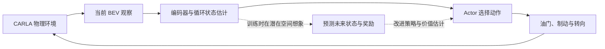

import Tabs from '@theme/Tabs';
import TabItem from '@theme/TabItem';

# CarDreamer 路口实验：来车时还能右转吗？

同一条右转路线，空路口能通过，加入横向车流后会怎样？这个实验比较两份作者公开权重，并把世界模型预测的未来与真实回放放在一起看。

建议先读[DreamerV3 机械臂到点实验](./2.dreamerv3-reacher.md)。本页的目标是：跑通公开权重评估，读懂实际交互与想象训练的区别，并用视频判断预测的局限。先看驾驶结果，再读代码、看未来预测，最后改一个变量做对照；不要求先从零训练汽车。

## 切换场景，看车如何应对 \{#watch}

**本轮结论：** 空路口用 simple 权重 3/3 到达；有车流仍用 simple 权重 1/3 到达、2 次碰撞；改用 medium 权重后 3/3 到达。全部来自实际闭环仿真，没有新增训练。

| 场景 | 公开权重 | 3 回合试跑 | 可以说明什么 |
| --- | --- | --- | --- |
| 空路口右转 | simple | 3 到达，0 碰撞 | 具备本场景的基础右转能力 |
| 横向来车，生成间距 8–16 m | simple | 1 到达，2 碰撞 | 空路口能走通，不代表能适应车流 |
| 同一车流配置 | medium | 3 到达，0 碰撞 | 对应任务权重在这组条件下表现更好 |

下面固定展示各组**第 1 回合**，没有挑最好的一段。左边是跟车画面，右边是当前真实 BEV 输入。

<Tabs groupId="cardreamer-driving">
<TabItem value="empty" label="① 空路口">

simple 权重完成右转。看车接近路口、改变航向，再沿目标路线驶出。

<video controls playsInline preload="metadata" poster={require('@site/docs/foundations/world-model/figs/cardreamer/poster.webp').default} src={require('@site/docs/foundations/world-model/figs/cardreamer/simple-audited.mp4').default} style={{width: '100%', borderRadius: 12}} />

</TabItem>
<TabItem value="transfer" label="② 加入车流">

同一份 simple 权重面对横向车辆。这个回合报告与 `vehicle.audi.etron` 碰撞；录像和传感器能确认接触，不能单凭它判定事故责任。

<video controls playsInline preload="metadata" poster={require('@site/docs/foundations/world-model/figs/cardreamer/traffic.webp').default} src={require('@site/docs/foundations/world-model/figs/cardreamer/traffic-transfer.mp4').default} style={{width: '100%', borderRadius: 12}} />

</TabItem>
<TabItem value="matched" label="③ 换对应权重">

medium 权重在车流中完成本回合。这里没有加入人为刹车规则或改策略动作。

<video controls playsInline preload="metadata" poster={require('@site/docs/foundations/world-model/figs/cardreamer/traffic-matched.webp').default} src={require('@site/docs/foundations/world-model/figs/cardreamer/traffic-matched.mp4').default} style={{width: '100%', borderRadius: 12}} />

</TabItem>
</Tabs>

这 3 组各跑 3 个连续回合，使用固定种子 `2024`、独立启动的 CARLA、相同道路及配置；不是多种子鲁棒性测试，也未保证不同策略面对完全一致的车辆轨迹。低速时间（速度低于 0.2 m/s）为 0.3–0.8 秒，包含起步，**不能因此宣称学会稳定停车让行**。

使用 CARLA 0.9.15 的 **Town03_Opt**，作者默认 Town03。两个 OpenDRIVE 文件哈希相同，但完整场景并未证明等价。本页展示仿真结果，尚无真车验证。

## 先弄清楚：汽车看到了什么？ \{#observation}

| 画面 | 来源 | 用途 |
| --- | --- | --- |
| 高清跟车画面 | CARLA 相机渲染 | 帮助读者看清汽车是否转弯，不输入策略 |
| `birdeye_wpt` 俯视图 | 仿真真值生成，包含道路、车辆、路线及可见的背景车辆路径 | 公开策略实际使用的视觉输入 |
| 世界模型预测 | 学到的潜在动力学及解码器 | 由保存的潜在状态与动作导出，见上方预测视频 |

本任务不是“只看前视相机开车”。有路线和仿真真值的 BEV 会降低感知难度，适合先学习世界模型控制链路。换成真实相机输入，需要重新处理感知、训练与验证。

## 世界模型在哪里起作用？ \{#method}

CarDreamer 提供驾驶环境和任务，并包含 Dreamer 风格的模型与训练实现。这里复跑它发布的 `right_turn_simple.ckpt` 与 `right_turn_medium.ckpt`，不是直接拿机械臂的模型控制汽车。



训练时，世界模型从真实交互数据学习动力学、奖励与继续信号；Actor 和 Critic 利用模型想象的轨迹学习。运行公开策略时，模型根据当前观察和历史更新状态，Actor 输出动作。**这里没有每一步都搜索许多路线的在线 MPC 规划器。**

## 对照代码：PPO 与 Dreamer 在哪里学习？ \{#code}

**先区分作者的训练代码与本轮评估：** 下面解释公开实现如何训练；本轮只加载 checkpoint、运行策略并导出预测，没有调用训练更新。代码节选对应固定版本，可顺着链接阅读上下文。

| 环节 | PPO 的典型训练流程 | 本例 Dreamer 的训练流程 |
| --- | --- | --- |
| 实际交互 | 在物理仿真中收集观察、动作、奖励 | 同样收集交互，存入经验回放池 |
| 学习动力学 | 不额外训练状态转移模型 | 用真实片段训练世界模型 |
| 策略更新依据 | 实际轨迹的奖励、价值与优势 | 想象轨迹的预测奖励与价值 |
| 需要留意 | 交互成本与探索、优化困难 | 还需防止策略利用世界模型的预测漏洞 |

**第一步：真实交互用来学模型。** [训练循环](https://github.com/ucd-dare/CarDreamer/blob/160132436aeda1de54956f9910e56f3970a565aa/dreamerv3/embodied/run/train.py#L61-L81)把 `tran` 写进 `replay`，抽取片段后调用 `agent.train()`。[更新入口](https://github.com/ucd-dare/CarDreamer/blob/160132436aeda1de54956f9910e56f3970a565aa/dreamerv3/agent.py#L71-L79)先训练世界模型，再训练行为：

```python
# Agent.train(): excerpt from the pinned upstream source
state, wm_outs, mets = self.wm.train(data, state)
context = {**data, **wm_outs["post"]}
start = tree_map(lambda x: x.reshape([-1] + list(x.shape[2:])), context)
_, mets = self.task_behavior.train(self.wm.imagine, start, context)
```

`wm.train()` 更新编码器、RSSM、图像解码器、奖励及继续信号预测头。`post` 是看过实际观察后修正的内部状态，作为想象的出发点。[模型损失](https://github.com/ucd-dare/CarDreamer/blob/160132436aeda1de54956f9910e56f3970a565aa/dreamerv3/agent.py#L160-L187)包含图像/奖励/继续信号的预测损失及潜在动力学约束。世界模型学习“会发生什么”，奖励目标仍由实际环境定义。

**第二步：策略在模型里试动作。** [想象循环](https://github.com/ucd-dare/CarDreamer/blob/160132436aeda1de54956f9910e56f3970a565aa/dreamerv3/agent.py#L189-L206)的核心只有两件事：Actor 选动作，RSSM 预测下一状态。

```python
# WorldModel.imagine(): excerpt
start["action"] = policy(start)

def step(prev, _):
    prev = prev.copy()
    state = self.rssm.img_step(prev, prev.pop("action"))
    return {**state, "action": policy(state)}
```

这里没有推进 CARLA，也不读取下一张真实 BEV。对比 PPO 收集轨迹时的 `next_obs, reward, ... = env.step(action)`：下一状态的来源从物理仿真器换成了学到的 `img_step()`。PPO 对收集到的同一批轨迹可以重复更新；“实际轨迹”不等于每次梯度更新都重新仿真。

**第三步：预测奖励帮助更新 Actor/Critic。** [任务行为](https://github.com/ucd-dare/CarDreamer/blob/160132436aeda1de54956f9910e56f3970a565aa/dreamerv3/behaviors.py#L10-L26)使用世界模型的奖励头给想象轨迹评分：

```python
# Greedy.__init__(): predicted rewards for imagined trajectories
rewfn = lambda s: wm.heads["reward"](s).mean()[1:]
```

[ImagActorCritic.train()](https://github.com/ucd-dare/CarDreamer/blob/160132436aeda1de54956f9910e56f3970a565aa/dreamerv3/agent.py#L294-L305)生成想象轨迹并更新 Actor，再更新 Critic。本实现连续动作默认通过可微模型反向传播来更新 Actor；这一步优化 Actor 参数，世界模型有自己的优化器。训练时反复交替“实际交互 → 更新模型 → 想象并更新行为”，不是一次学完模型后永远冻结。

**第四步：运行时仍要看实际观察。** [策略入口](https://github.com/ucd-dare/CarDreamer/blob/160132436aeda1de54956f9910e56f3970a565aa/dreamerv3/agent.py#L47-L69)用当前图像修正状态，再输出动作：

```python
# Agent.policy(): observation correction, then action selection
embed = self.wm.encoder(obs)
latent, _ = self.wm.rssm.obs_step(
    prev_latent, prev_action, embed, obs["is_first"]
)
task_outs, task_state = self.task_behavior.policy(latent, task_state)
```

`obs_step()` 接收真实图像特征，`img_step()` 不接收，两者的区别就是“看到了再修正”与“还没看到先预测”。下方预测视频使用记录好的未来动作调用 RSSM 并解码成图像；它是单独的离线检查，不是 Actor 的训练过程，也不是在线 MPC。

<details>
<summary>读代码自测：如果删掉真实交互，只让模型一直想象呢？</summary>

模型不再获得新数据纠正错误，策略可能找到模型高估奖励的动作。想象回报变高不保证 CARLA 表现变好。因此模型内训练仍要配合实际仿真评估；比较驾驶结果与预测画面，是两种互补检查。

</details>

## 看见世界模型预测的未来 \{#prediction}

驾驶视频里的 BEV 是真实仿真状态。下面的视频才是**世界模型的预测**：左侧为实际未来，中间为模型预测，右侧把图像误差放大 4 倍显示。选择空路口或车流，观察预测何时开始漂移。

<Tabs groupId="cardreamer-prediction">
<TabItem value="empty" label="空路口预测">

<video controls playsInline preload="metadata" poster={require('@site/docs/foundations/world-model/figs/cardreamer/prediction.webp').default} src={require('@site/docs/foundations/world-model/figs/cardreamer/prediction-simple.mp4').default} style={{width: '100%', borderRadius: 12}} />

</TabItem>
<TabItem value="traffic" label="车流预测">

<video controls playsInline preload="metadata" poster={require('@site/docs/foundations/world-model/figs/cardreamer/prediction-traffic.webp').default} src={require('@site/docs/foundations/world-model/figs/cardreamer/prediction-traffic.mp4').default} style={{width: '100%', borderRadius: 12}} />

</TabItem>
</Tabs>

每段包含三个提前指定的窗口：在仿真 **2 / 6 / 10 秒**处，根据此前观察得到的潜在状态，向前预测 **2 秒、20 步**。视频以 0.5 倍速播放，每个窗口约 4 秒。原生图像为 128×128，放大仅为便于观看。

- 模型收到该窗口内**实际执行过的动作**，随后不再读取真实未来图像；这是离线的“给定动作，会发生什么”测试。
- 当前策略仍是 Actor 输出动作；预测视频不是实时搜索多条路线的在线规划。
- RSSM 预测带有随机采样，这里每个窗口只导出一个样本，未估计不确定性。

| 固定窗口的平均归一化像素 MAE（越小越好） | 世界模型 | 保持当前画面不变 |
| --- | --- | --- |
| 空路口 / simple，9 个窗口 | 0.0251 | 0.0896 |
| 有车流 / simple，9 个窗口 | 0.0512 | 0.0922 |
| 有车流 / medium，9 个窗口 | 0.0337 | 0.0953 |

误差在 RGB 的 0–1 范围计算，汇总全部预设窗口，包含碰撞回合。图像中的道路占比很大：**平均像素误差低，不等于来车位置或碰撞预测准确。** 两份 checkpoint 同时包含世界模型和策略，不能把驾驶差异全部归因于世界模型预测精度。

## 先确保实验可信 \{#engineering}

这次新增了空场景检查、逐回合清理审计、独立碰撞传感器和部分日志保存。9 个回合都完成了物理回放与预测导出，清理后场景均为空。相机与 BEV 按仿真帧号配对；每段缺少 3–10 帧，视频跳过缺帧并保留仿真时间，因此播放时长略短。

原版 Town03 仍在 Vulkan 图形流水线崩溃，改用 Town03_Opt 后可运行。它的交通管理器缓存也需备份移出后重建，见配套代码 README。客户端超时由 20 秒提高到 60 秒，本轮 9 回合无通信超时；这只能说明本轮跑完，尚不能证明此前超时的根因已解决。

早期旧脚本的“四回合到达、第五回合超时”及复用场景碰撞保留为调试记录，不并入本轮统计。没有为了得到成功结论而删除本轮失败回合。

## 什么才算右转成功？ \{#evaluation}

| 检查项 | 本例如何判断 |
| --- | --- |
| 到达终点 | 沿用环境的 `destination_reached`：剩余路线点不超过 3 个 |
| 无碰撞 | `is_collision`、观察中的碰撞信号及独立碰撞传感器均未触发 |
| 没有偏离路线 | `out_of_lane` 未触发；它按到路线点的距离阈值判定，并非车道线检测 |
| 没有超时 | `time_exceeded` 未触发，且评估器没有提前截断 |

只有“到达”且其他失败项都为假，才计为一次通过。先固定模型与任务参数，保存连续回合，不按画面挑选成功案例。报告各回合的终止原因、步数和视频；回报作为辅助信息。

注意：沿用的环境碰撞判断读取最近一次观察，可能有一帧延迟。有限回合通过只能说明这些仿真条件下的表现。后续需要补充不同交通随机种子，并检查临近终止时的碰撞记录。

## 动手复现 \{#reproduce}

本例固定 CarDreamer 提交 `160132436aeda1de54956f9910e56f3970a565aa`、CARLA 0.9.15、Python 3.10、Town03_Opt 和任务 `carla_right_turn_simple` / `carla_right_turn_medium`（作者默认 Town03）。先按[作者安装说明](https://github.com/ucd-dare/CarDreamer)配置依赖与离屏渲染，下载[公开右转权重](https://huggingface.co/ucd-dare/CarDreamer/tree/main/CarDreamer_checkpoints)。

新脚本 `experiment.py` 已完成三组各 3 回合的驾驶、预测和清理核验。先按代码 README 安装依赖、应用 `eval-compat.patch` 并配置独立的 Town03_Opt 服务器。脚本启动前要求场景没有车辆和传感器；不同组分别重启专用服务器。

```bash
# 在独立终端启动 CARLA；端口须空闲。
./CarlaUE4.sh -RenderOffScreen -nosound -carla-port=22000 -benchmark -fps=10

# 在已安装依赖的 Python 环境中，运行有限回合。
python experiment.py --source /path/to/CarDreamer \
  --checkpoint /path/to/right_turn_simple.ckpt \
  --output results/traffic --port 22000 --task carla_right_turn_medium --episodes 3 --seed 2024
```

输出包括逐回合的 `replay.mp4`、终止原因、`collisions.json`、`scene-after-cleanup.json`，以及 `trajectory.npz`、三个 `forecast-*.npz` 和预测误差 `forecasts.json`。用下面的命令生成三栏预测视频（需系统安装 FFmpeg）；完整三组命令与权重哈希见[配套代码说明](https://github.com/datawhalechina/dive-into-embodied-ai/tree/master/codes/foundations/world-model/cardreamer-right-turn)。相机独立于策略输入，不手工修改策略动作。仅加载可信 checkpoint。

```bash
python render_forecasts.py results/traffic/episode-00 --output prediction-traffic.mp4
```

## 三个值得动手的问题 \{#exercise}

1. **先预测结果**：看车流视频前，判断空路口权重是否足够，随后用碰撞记录检查。
2. **暂停预测视频**：在第一个窗口的 +1 秒处暂停，比较模型、真值及冻结画面的基线。误差主要在哪些区域？
3. **只改一个变量**：另选一个交通种子复跑，记录每回合结果；不要把三个同种子回合当成三个独立种子。

本页提供的是可检查的公开模型演示与预测导出。后续若训练自己的策略，应先固定车流任务、验收条件和评估种子，再做训练与对照。
