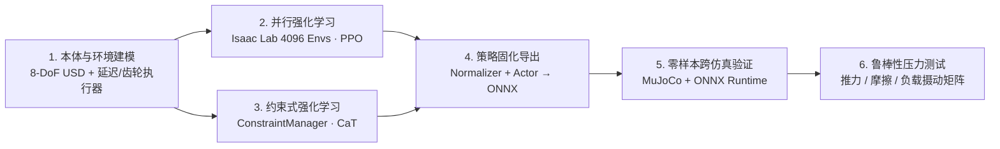

# 两轮足 Flamingo · Isaac Lab 强化学习实战


上面是多个 **Flamingo 两轮足机器人**在 Isaac Lab 中同时接受随机速度指令的大规模并行训练与回放画面：每台机器人独立采样前后线速度 $v_x$ 与航向角速度 $\omega_z$ 指令，仅靠底部两个主动轮与双腿关节协同完成动态站立、加减速与原地转向。

本课程围绕这台 **8 自由度双足轮腿机器人（Wheeled Biped）**，从零搭起一条完整的工业级具身强化学习链路：**本体与延迟执行器建模 → 奖励设计与 4096 环境并行 PPO → 约束式强化学习（CaT）对照 → ONNX 独立计算图导出 → MuJoCo 零样本跨仿真器迁移（Sim2Sim）与抗扰动压力测试**。

> [!NOTE] 开源致谢与课程定位
> 本课程基于开源研究仓库 [jaykorea/Isaac-RL-Two-wheel-Legged-Bot](https://github.com/jaykorea/Isaac-RL-Two-wheel-Legged-Bot)（作者 [@jaykorea](https://github.com/jaykorea)，MIT 协议）的 `main` 训练分支与 `sim2sim_onnx` 跨仿真验证分支整理重编。原仓库面向科研实验提供了丰富的任务代码；本课程将其提炼为一条**原理清晰、参数对齐、可逐步复现且面向工程交付**的 6 章完整实战教程。

---

## 全链路架构图 \{#architecture}



---

## 为什么在双足系列里学“两轮足”？ \{#why-wheeled-biped}

如果把纯双足点足/平足机器人（如 [MicroDuck RL](/docs/practices/humanoid/microduck-rl/)）和四足机器人（如 [CS123 Pupper](/docs/practices/quadruped/cs123/intro)）放在一起对比，**两轮足机器人（Wheeled Biped）**恰好处于一个极具工程价值的交叉点：

1. **天生的欠驱动非最小相位系统**：静态站立时底部只有两个轮地接触点（连成一条支撑线），俯仰方向（Pitch）与轮式倒立摆完全同构——想向前加速，轮子必须先瞬间后撤让质心前倾，再加速追赶质心；没有策略介入时 0.3 秒内就会拍地倒下。
2. **混合动作空间（位置 + 速度）**：髋、肩、膝 6 个腿部关节维持机身高度与横滚姿态，采用**目标角度 PD 控制**；左右 2 个驱动轮需要连续无限旋转，采用**目标角速度阻尼控制**。这是具身控制中处理异构执行器的绝佳范本。
3. **兼具轮式高能效与腿式主动悬挂**：平地巡航时无需高频抬腿迈步，能耗远低于纯双足/四足；遇到路面起伏、加减速俯仰冲击或横向落差时，双腿又能像主动悬挂一样实时调节质心高度与水平姿态。
4. **物理约束边界极其敏感**：轮电机极易在急停或抗推时打满力矩上限，左右腿若失去对称约束则会劈成“前后弓步”卡死。因此它非常适合用来对比**传统软惩罚调参（PPO）**与**约束式强化学习（CaT, Constraints as Terminations）**。

### 与站内相关课程的技术栈对照 \{#course-comparison}

| 维度 | [四足系列 · CS123 Pupper](/docs/practices/quadruped/cs123/intro) | [双足系列 · MicroDuck RL](/docs/practices/humanoid/microduck-rl/) | **双足系列 · 两轮足 Flamingo（本课程）** |
| :--- | :--- | :--- | :--- |
| **机器人构型** | 12 自由度四足点足 | 10–14 自由度微型双足 | **8 自由度双足轮腿（含闭链膝关节减速比 `-1.5`）** |
| **核心平衡难点** | 对角步态（Trot）周期相位协调 | 双足交替迈步与跑跳滚翻长链课程 | **轮式倒立摆欠驱动动态平衡 + 腿轮异构解耦** |
| **训练仿真栈** | MuJoCo CPU + Stable-Baselines3 | `mjlab` + MuJoCo Warp GPU | **NVIDIA Isaac Sim 4.5 + Isaac Lab 2.1（4096 并行）** |
| **算法看点** | 标准 PPO + 步态相位奖励 | 并行 PPO + 12 步正反向课程学习 | **非对称 Actor-Critic PPO vs 约束式 RL（CaT）** |
| **部署与验证** | 同引擎回放与 VLA 接入 | 固定条件离屏 GIF 验收 + ROCm 适配 | **ONNX 归一化融合导出 + MuJoCo 零样本 Sim2Sim 压测** |

---

## 你将亲手做出来的成果 \{#deliverables}

学完并跑通全部 6 章后，你将沉淀出一套完整的工程闭环产物：

1. **一套清晰的 8-DoF 两轮足环境配置说明**：理清 `DelayedPDActuatorCfg`（`0~20 ms` 通信延迟）、`GearDelayedPDActuatorCfg`（闭链皮带传动比 `-1.5`）与 28 维多帧堆叠观测空间。
2. **两条同条件对比训练的策略模型**：一条标准软惩罚 **PPO** 策略，一条引入虚拟终止概率折现的 **CaT** 策略，并掌握 TensorBoard 曲线诊断与病态步态排障方法。
3. **一个零依赖的独立推理计算图 `policy.onnx`**：把在线运行均值方差归一化器（`EmpiricalNormalization`）与 Actor 网络融合成单输入单输出 ONNX 文件。
4. **一套跨物理引擎的 MuJoCo Sim2Sim 验证台**：亲手对齐 Isaac Lab（广度优先关节序、`[w,x,y,z]`/`[x,y,z,w]` 四元数）与 MuJoCo（单腿深度优先关节序）的索引映射，支持键盘实时遥控。
5. **一份量化鲁棒性压测报告**：涵盖横向速度脉冲推力、低摩擦冰面滑移、机身负载偏置与传感器噪声下的存活率及跟踪 RMSE 对比表。

---

## 章节地图与学习节奏 \{#chapter-map}

| 章节 | 主题 | 核心问题与产出 | 建议耗时 |
| :--- | :--- | :--- | :--- |
| [第 1 章](./robot-and-env) | **本体建模与环境注册** | 拆解 Flamingo 8 自由度拓扑、延迟/齿轮执行器、混合动作空间与非对称堆叠观测，跑通环境烟雾测试 | 2–3 小时 |
| [第 2 章](./reward-and-ppo) | **奖励设计与 PPO 训练** | 理解轮式倒立摆非最小相位特性，拆解 16 项奖励与域随机化，启动 4096 环境并行 PPO 并排查 4 类病态步态 | 3–4 小时 |
| [第 3 章](./cat-constrained-rl) | **约束式强化学习（CaT）** | 推导 CaT 随机虚拟终止与 GAE 折现率重标定公式，对照 `ConstraintManager` 源码完成 PPO vs CaT 实验 | 3 小时 |
| [第 4 章](./onnx-and-sim2sim) | **策略导出与 MuJoCo Sim2Sim** | 剖析 `_OnnxPolicyExporter` 融合导出机制，解决跨引擎关节序/四元数/PD 增益五大错位陷阱，实现零样本迁移 | 3–4 小时 |
| [第 5 章](./robustness-eval) | **鲁棒性与抗扰动评测** | 利用 `PushManager` / `InertiaManager` / `NoiseManager` 构建四维压力测试，输出量化鲁棒性评测矩阵 | 2–3 小时 |
| [第 6 章](./delivery-and-interview) | **项目复盘与工程交付** | 整理标准化项目归档清单，复盘四大架构权衡，梳理足式/轮足运动控制岗位面试高频深挖问题 | 1.5 小时 |

---

## 硬件与软件环境准备 \{#setup}

### 硬件建议 \{#hardware}

- **训练端（第 1–3 章，Isaac Lab）**：建议使用配备 **NVIDIA RTX GPU（显存 ≥ 8 GB，推荐 12 GB+，如 RTX 3060 / 4070 / 4090 或云端 L4 / A10）**、内存 ≥ 32 GB 的 Linux 主机（推荐 Ubuntu 22.04 LTS）。4096 环境无头（`--headless`）训练 5000 轮通常只需 **25–45 分钟**。
- **验证端（第 4–5 章，MuJoCo Sim2Sim）**：导出 `policy.onnx` 后，MuJoCo + ONNX Runtime 推理仅需普通 CPU 笔记本（Linux / macOS / Windows 均可流畅运行 200 Hz 实时仿真）。

### 软件环境安装（双环境隔离） \{#software}

为了避免 Omniverse / Isaac Sim 庞大的依赖与轻量级部署验证环境冲突，强烈建议将**训练环境**与 **Sim2Sim 验证环境**分成两个独立的 Conda 虚拟环境：

#### 1. 训练环境（`flamingo_train`：Isaac Sim 4.5 + Isaac Lab 2.1）

先按照 [Isaac Lab 官方安装指南](https://isaac-sim.github.io/IsaacLab/main/source/setup/installation/pip_installation.html) 安装好 Isaac Sim `4.5.0` 与 Isaac Lab `v2.1.0`，然后克隆并安装上游训练仓库（`main` 分支）：

```bash
# 1. 激活已安装好 Isaac Sim 4.5 与 Isaac Lab 2.1 的虚拟环境
conda activate flamingo_train

# 2. 克隆上游仓库（main 分支为 Isaac Lab 训练与导出工程）
git clone -b main https://github.com/jaykorea/Isaac-RL-Two-wheel-Legged-Bot.git flamingo_isaaclab
cd flamingo_isaaclab

# 3. 以可编辑模式安装 lab.flamingo 扩展包及其依赖（含 co_rl、prettytable、reportlab 等）
pip install -e source/extensions/omni.isaac.lab_flamingo || pip install -e .
```

> [!TIP] 目录结构速览
> 上游仓库核心代码位于两个目录：
> - `lab/flamingo/`：机器人资产配置（`assets/flamingo/`）、基于管理器的强化学习任务（`tasks/manager_based/`）以及约束式强化学习扩展（`tasks/constraint_based/` 与 `isaaclab/isaaclab/managers/constraint_manager.py`）；
> - `scripts/co_rl/`：内置的强化学习训练框架（支持 PPO、SRMPPO、SAC、TQC 及 CaT 连续终止概率折现），包含 `train.py`、`play.py` 与 `core/wrapper/exporter.py`。

#### 2. 跨仿真验证环境（`flamingo_sim2sim`：MuJoCo + ONNX Runtime）

在另一套干净的 Python 3.10 环境中克隆 `sim2sim_onnx` 分支，用于第 4–5 章的零样本迁移与鲁棒性压测：

```bash
conda create -n flamingo_sim2sim python=3.10 -y
conda activate flamingo_sim2sim

git clone -b sim2sim_onnx https://github.com/jaykorea/Isaac-RL-Two-wheel-Legged-Bot.git flamingo_sim2sim
cd flamingo_sim2sim

pip install "gymnasium[mujoco]>=0.29.1" mujoco onnxruntime numpy scipy pygame matplotlib pandas prettytable tqdm torch
```

准备好环境后，进入 [第 1 章：本体建模与环境注册](./robot-and-env)，从 Flamingo 的 8 自由度机械耦合与传感器/执行器接口开始拆解。
