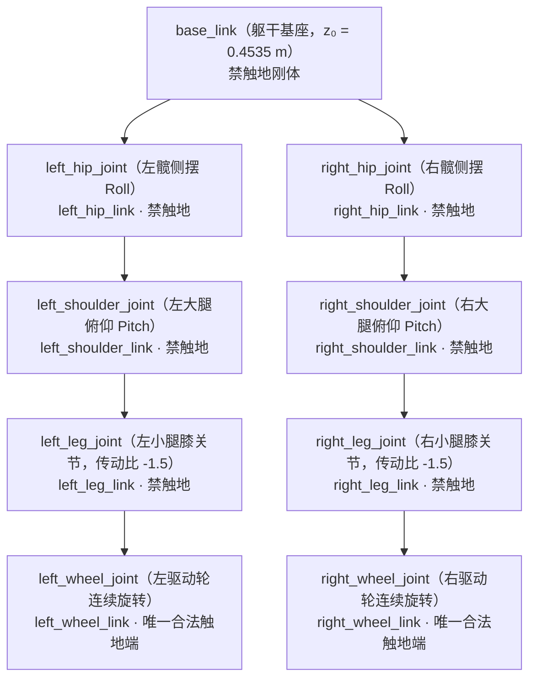

# 1. 本体建模与环境注册

在写下任何一行强化学习奖励函数之前，运动控制工程师必须先摸透机器人的**物理边界与机电接口**：这台机器人有几个自由度？哪些关节存在机械传动耦合？电机力矩和转速上限是多少？控制器发出的指令经历多少毫秒延迟才变成关节力矩？

本章我们将深入 `lab/flamingo/assets/flamingo/flamingo_rev01_5_2.py` 与 `lab/flamingo/tasks/manager_based/locomotion/velocity/flamingo_env/velocity_env_cfg.py`，把 Flamingo 两轮足机器人在 Isaac Lab 中的资产配置与 MDP（马尔可夫决策过程）接口彻底拆解清楚。

## 本章目标 \{#goals}

- 掌握 Flamingo **8 自由度对称轮腿构型**及膝关节闭链皮带耦合（`gear_ratio = -1.5`）的物理含义
- 读懂三类异构执行器配置：通信延迟位置 PD、齿轮耦合延迟 PD 与纯速度阻尼轮驱动
- 理解为什么两轮足必须采用**“6 维关节位置 + 2 维轮角速度”混合动作空间**
- 算清 **28 维单帧观测 × 历史帧堆叠 + 速度指令** 的策略输入维度，以及非对称 Actor-Critic 的特权观测设计
- 完成 Gymnasium 任务注册检查与零动作烟雾测试（Smoke Test）

## 前置阅读 \{#prerequisites}

- [机器人学基础 · URDF 机器人建模与 robot_state_publisher](/docs/foundations/robotics-and-ros2/urdf_and_rsp)
- [仿真工具 · Gymnasium 入门](/docs/foundations/simulation/gymnasium)
- [四足系列 · 1. 执行器与 PD 控制](/docs/practices/quadruped/cs123/pid-control)

---

## 1.1 Flamingo 8 自由度拓扑与闭链齿轮耦合 \{#morphology}

Flamingo 是一台左右对称的双足轮腿机器人。根节点为躯干 `base_link`，默认初始高度 $z_0 = 0.4535\text{ m}$，标准站立巡航目标高度为 $z_{\text{target}} = 0.48\text{ m}$。每条腿串联 4 个旋转自由度，整机共 **8 个主动自由度（8-DoF）**：



### 关节职能与接触规则

| 关节名称（左右对称） | 运动轴向与物理职能 | 初始关节角 | 刚体接触属性 |
| :--- | :--- | :--- | :--- |
| `left_hip_joint` / `right_hip_joint` | **髋部侧摆（Roll）**：调节轮距与机身横滚角（Roll）平衡 | `0.0 rad` | 非法触地（触发惩罚/终止） |
| `left_shoulder_joint` / `right_shoulder_joint` | **肩/大腿俯仰（Pitch）**：与膝关节协同控制机身高度与前后质心偏置 | `0.0 rad` | 非法触地（触发惩罚/终止） |
| `left_leg_joint` / `right_leg_joint` | **小腿/膝俯仰（Pitch）**：经同步带远端驱动，等效传动比 $\gamma = -1.5$ | `0.0 rad` | 非法触地（触发惩罚/终止） |
| `left_wheel_joint` / `right_wheel_joint` | **轮毂连续驱动（Continuous Pitch）**：维持倒立摆动态平衡与差速转向 | `0.0 rad` | **唯一合法触地刚体** |

> [!IMPORTANT] 工程细节：为什么小腿关节带有 `gear_ratio = -1.5`？
> 为了减轻腿部末端转动惯量（把重电机尽量往上挪近躯干），真实 Flamingo 真机把膝关节电机安装在靠近大腿根部的位置，通过同步带/连杆远端驱动小腿连杆，机械减速比与正方向约定为 **`-1.5`**。
> 在 `flamingo_rev01_5_2.py` 中，该特性通过自定义执行器 `GearDelayedPDActuatorCfg(gear_ratio=-1.5)` 与自定义观测函数 `mdp.joint_pos_leg_gear` 建模——电机端编码器读数、输出轴角度与关节驱动力矩之间严格遵循传动比换算。这是第 4 章跨仿真器迁移时必须对齐的关键物理参数之一。

---

## 1.2 异构执行器建模：延迟 PD、齿轮耦合与纯阻尼轮驱动 \{#actuators}

理想仿真器里策略算出的力矩会在 $0\text{ ms}$ 内无损施加在刚体上；但真实硬件存在 CAN 总线收发延时、电机转子转动惯量（Armature）以及电流环饱和限幅。如果直接在零延迟理想模型上训练，策略极易学出 `25 Hz` 极限正负跳变的“高频抖振（Bang-Bang Control）”，一上真机或换到 MuJoCo 就会剧烈共振。

上游资产文件 `lab/flamingo/assets/flamingo/flamingo_rev01_5_2.py` 对三组关节分别配置了精细的物理执行器：

| 执行器组 | 正则匹配关节 | 执行器类型 | 刚度 $K_p$ | 阻尼 $K_d$ | 力矩上限 $\tau_{\max}$ | 转速上限 $\omega_{\max}$ | 通信延迟（物理步） |
| :--- | :--- | :--- | :---: | :---: | :---: | :---: | :---: |
| **`hips`** | `.*_hip_joint` | `DelayedPDActuatorCfg` | `100.0` | `1.5` | `60.0 N·m` | `20.0 rad/s` | `0 ~ 4` 步（`0~20 ms`） |
| **`shoulders`** | `.*_shoulder_joint` | `DelayedPDActuatorCfg` | `100.0` | `1.5` | `60.0 N·m` | `20.0 rad/s` | `0 ~ 4` 步（`0~20 ms`） |
| **`legs`** | `.*_leg_joint` | `GearDelayedPDActuatorCfg` (`gear_ratio=-1.5`) | `120.0` | `1.5` | `90.0 N·m` | `13.0 rad/s` | `0 ~ 4` 步（`0~20 ms`） |
| **`wheels`** | `.*_wheel_joint` | `DelayedPDActuatorCfg` | **`0.0`** | **`0.7`** | `36.0 N·m` | `50.0 rad/s` | `0 ~ 4` 步（`0~20 ms`） |

对应核心配置代码如下（节选自 `flamingo_rev01_5_2.py`）：

```python
FLAMINGO_CFG = ArticulationCfg(
    spawn=sim_utils.UsdFileCfg(
        usd_path=f"{FLAMINGO_ASSETS_DATA_DIR}/Robots/Flamingo/flamingo_rev01_5_2/flamingo_rev01_5_2_merge_joints.usd",
        activate_contact_sensors=True,
        rigid_props=sim_utils.RigidBodyPropertiesCfg(
            disable_gravity=False,
            retain_accelerations=False,
            linear_damping=0.0,
            angular_damping=0.0,
            max_linear_velocity=1000.0,
            max_angular_velocity=1000.0,
            max_depenetration_velocity=1.0,
        ),
    ),
    init_state=ArticulationCfg.InitialStateCfg(
        pos=(0.0, 0.0, 0.4535),  # 初始生成高度 0.4535 m
        joint_pos={".*_joint": 0.0},
        joint_vel={".*": 0.0},
    ),
    actuators={
        "hips": DelayedPDActuatorCfg(
            joint_names_expr=[".*_hip_joint"],
            effort_limit=60.0, velocity_limit=20.0,
            min_delay=0, max_delay=4,  # 物理步 dt=0.005s，4 步对应最大 20 ms 随机延迟
            stiffness=100.0, damping=1.5, friction=0.0, armature=0.01,
        ),
        "shoulders": DelayedPDActuatorCfg(
            joint_names_expr=[".*_shoulder_joint"],
            effort_limit=60.0, velocity_limit=20.0,
            min_delay=0, max_delay=4,
            stiffness=100.0, damping=1.5, friction=0.0, armature=0.01,
        ),
        "legs": GearDelayedPDActuatorCfg(
            joint_names_expr=[".*_leg_joint"],
            gear_ratio=-1.5, gamma=1.0,
            effort_limit=90.0, velocity_limit=13.0,
            min_delay=0, max_delay=4,
            stiffness=120.0, damping=1.5, friction=0.0, armature=0.01,
        ),
        "wheels": DelayedPDActuatorCfg(
            joint_names_expr=[".*_wheel_joint"],
            effort_limit=36.0, velocity_limit=50.0,
            min_delay=0, max_delay=4,
            stiffness=0.0, damping=0.7, friction=0.0, armature=0.01,
        ),
    },
)
```

请注意这里两个非常精妙的机电设计：

1. **为什么 `wheels` 的刚度 `stiffness = 0.0`？**
   驱动轮在机器人匀速前进一分钟后，累计转角 $q_{\text{wheel}}$ 可能高达数百弧度！如果对轮子使用位置误差项 $K_p (q_{\text{des}} - q)$，不仅目标位置无法有界表示，角度累计还会直接打爆力矩上限。将 $K_p$ 设为 `0.0`、仅保留速度阻尼增益 $K_d = 0.7$ 后，PD 控制律自然退化为**纯速度闭环比例控制器**：
   $$
   \tau_{\text{wheel}} = \operatorname{clip}\!\Big(K_d \big(\omega_{\text{cmd}} - \dot{q}_{\text{wheel}}\big),\; -\tau_{\max},\; \tau_{\max}\Big)
   $$
2. **转子等效惯量 `armature = 0.01`**
   在关节对角质量矩阵上附加 $0.01\text{ kg}\cdot\text{m}^2$ 的等效转子反射惯量，既模拟了减速电机转子的动力学惯性，又显著提升了 `dt = 0.005 s` 显式/半隐式积分下的数值稳定性。

> [!TIP] 进阶扩展：KAN 符号执行器网络
> 在 `flamingo_rev01_5_2.py` 注释块中还预留了 `ActuatorNetKANCfg`（基于 Kolmogorov-Arnold Network 拟合真实电机台架采集的力矩非线性响应表达式 `symbolic_formula.txt`）。首轮训练直接使用默认的 `DelayedPDActuatorCfg` 即可稳定收敛并迁移至 MuJoCo。

---

## 1.3 控制时序与混合动作空间（8 维） \{#action-space}

### 控制频率与物理步长抽取（Decimation）

在 `LocomotionVelocityRoughEnvCfg.__post_init__`（`velocity_env_cfg.py`）中，仿真与控制节拍定义如下：

- **物理引擎步长 `sim.dt = 0.005 s`**（即 **200 Hz** 刚体动力学与接触求解，每执行动作周期更新一次内环 PD 力矩）；
- **控制抽取倍率 `decimation = 4`**：每执行 4 个物理步调用一次神经网络推理，因此**策略输出频率为 $200 / 4 = 50\text{ Hz}$（周期 $\Delta t_{\text{policy}} = 0.02\text{ s}$）**；
- **单回合时长 `episode_length_s = 20.0 s`**：对应每个 Episode 最多 $20.0 / 0.02 = 1000$ 个策略步。

### 8 维混合动作映射

策略网络最后一层的线性输出 $a_t \in \mathbb{R}^8$ 按顺序切分为 3 个动作组（见 `flat_env_stand_drive_cfg.py` 中的 `FlamingoActionsCfg`）：

| 动作切片 | 动作项名称 | 控制模式 | 绑定关节顺序（`preserve_order=True`） | 缩放系数 `scale` | 物理含义 |
| :---: | :--- | :--- | :--- | :---: | :--- |
| `a[0:2]` | `hip_joint_pos` | `JointPositionActionCfg` | `left_hip_joint`, `right_hip_joint` | `1.0 rad` | 目标髋关节侧摆角 $q_{\text{des}} = 1.0 \cdot a_i$ |
| `a[2:6]` | `shoulder_leg_joint_pos` | `JointPositionActionCfg` | `left_shoulder_joint`, `right_shoulder_joint`, `left_leg_joint`, `right_leg_joint` | `1.0 rad` | 目标大腿与小腿俯仰角 $q_{\text{des}} = 1.0 \cdot a_i$ |
| `a[6:8]` | `wheel_vel` | `JointVelocityActionCfg` | `left_wheel_joint`, `right_wheel_joint` | **`40.0 rad/s`** | 目标左右轮角速度 $\omega_{\text{cmd}} = 40.0 \cdot a_i$ |

注意 `use_default_offset=False`（因为初始站姿所有关节默认角均为 `0.0 rad`），且全部开启了 **`preserve_order=True`**——这保证了动作向量严格按照列表书写的关节顺序排列，而不会随 USD 文件内部图节点加载顺序变化。

---

## 1.4 非对称 Actor-Critic 与多帧堆叠观测空间 \{#observation-space}

真实两轮足机器人通常**没有昂贵且易漂移的激光雷达/双目里程计线速度计**，机载本体传感器只有：
1. **电机编码器**：6 个腿部关节角度 $q$（不含轮子累计转角！）与 8 个关节角速度 $\dot{q}$；
2. **机载六轴 IMU**：机身三轴角速度 $\boldsymbol{\omega}_b$ 与重力在机身坐标系下的投影向量 $\mathbf{g}_b = R_w^T [0, 0, -1]^T$。

只看单帧本体传感器，策略无法直接得知机身当前线速度 $v_x$、地面摩擦系数、质心偏移以及电机延迟状态。为此，Flamingo 环境在 `ObservationsCfg` 中同时使用了两项现代足式 RL 核心技术：

1. **时序观测堆叠（Observation Stacking）**：将策略观测拆分为 `stack_policy`（需要拼入历史滑动窗口的高频本体状态，单帧 **28 维**）与 `none_stack_policy`（无需重复堆叠的当前目标速度指令，**3 维**）。当 `--num_policy_stacks 2`（或 `3`）时，`CoRlVecEnvWrapper` 自动维护滑动队列，让 MLP 隐式辨识出线速度、轮地滑移率与外部推力！
2. **非对称 Actor-Critic（Asymmetric Actor-Critic）**：部署上真机的 **Actor（策略网络）** 只能看到带均匀噪声的本体传感器；而仅在训练阶段计算价值基线的 **Critic（价值网络）** 可以额外读取无噪声的真值机身线速度 $\mathbf{v}_b$、真实高度与双轮触地布尔标志等“上帝视角特权信息（Privileged Information）”，大幅降低优势函数估计方差。

### Actor 单帧堆叠观测明细（`StackPolicyCfg`，共 28 维）

| 维度区间 | 观测项名称 | 物理量与关节顺序 | 缩放系数 `scale` | 训练均匀噪声 `Unoise` | 为什么这样设计？ |
| :---: | :--- | :--- | :---: | :---: | :--- |
| `[0:4]` | `joint_pos_hip_shoulder` | `[L_hip, R_hip, L_sh, R_sh]` 位置 | `1.0` | `[-0.05, +0.05] rad` | 直接反映腿部伸展与侧倾构型 |
| `[4:6]` | `joint_pos_leg` | `[L_leg, R_leg]` 位置（含 `gear_ratio=-1.5`） | `1.0` | `[-0.05, +0.05] rad` | 经齿轮比换算的小腿编码器位置；**剔除了无界旋转的轮子位置！** |
| `[6:10]` | `joint_vel_hip_shoulder` | `[L_hip, R_hip, L_sh, R_sh]` 角速度 | `0.15` | `[-1.5, +1.5] rad/s` | 将 `±20 rad/s` 压缩至 `±3` 量级，利于神经网络归一化 |
| `[10:12]` | `joint_vel_leg` | `[L_leg, R_leg]` 角速度（含 `gear_ratio=-1.5`） | `0.15` | `[-1.5, +1.5] rad/s` | 匹配闭链膝关节电机端测速 |
| `[12:14]` | `joint_vel_wheel` | `[L_wheel, R_wheel]` 轮角速度 | `0.15` | `[-1.5, +1.5] rad/s` | 轮速可达 `±50 rad/s`，乘 `0.15` 避免数值一枝独秀 |
| `[14:17]` | `base_ang_vel` | 机身坐标系三轴角速度 $\boldsymbol{\omega}_b$ | `0.25` | `[-0.15, +0.15] rad/s` | 陀螺仪读数，反映俯仰倾倒速率与转向角速度 |
| `[17:20]` | `base_projected_gravity` | 机身系投影重力向量 $\mathbf{g}_b$ | `1.0` | `[-0.05, +0.05]` | 无欧拉角万向节死锁，平直站立时为 `[0, 0, -1]` |
| `[20:28]` | `actions` | 上一时刻策略输出的 8 维动作 $a_{t-1}$ | `1.0` | 无噪声 | 帮助网络感知动作变化率与 `0~20 ms` 执行器延迟队列 |

### Actor 非堆叠指令观测（`NoneStackPolicyCfg`）

在平地巡航任务 `FlamingoFlatEnvCfg` 中，非堆叠分支将高度扫描、线速度真值等全部置为 `None`，仅保留速度指令项 `velocity_commands`（3 维）：
- $v_{x,\text{cmd}} \in [-1.5, 1.5]\text{ m/s}$（前后目标线速度，缩放 `1.0`）
- $v_{y,\text{cmd}} = 0.0\text{ m/s}$（两轮差速非完整约束无法直接横移，缩放 `0.0`）
- $\omega_{z,\text{cmd}} \in [-2.5, 2.5]\text{ rad/s}$（航向转向目标角速度，缩放 `0.25`）

因此，当堆叠帧数设为 $K$（例如 $K=2$ 或 $K=3$）时，输入 Actor 网络的总观测维度严格满足：

$$
D_{\text{actor}} = 28 \times K + 3 \quad \text{（例如 } K=2 \Rightarrow 59\text{ 维；} K=3 \Rightarrow 87\text{ 维）}
$$

而 Critic 网络除了无噪声的 28 维本体观测外，`StackCriticCfg` 还额外包含机身三轴真值线速度 `base_lin_vel_x/y/z`（3 维，缩放 `2.0`），`NoneStackCriticCfg` 还包含左右轮触地力掩码与真实高度等特权信号，且全程 `enable_corruption = False`。

---

## 1.5 任务注册与环境烟雾测试 \{#smoke-test}

打开 `lab/flamingo/tasks/manager_based/locomotion/velocity/flamingo_env/__init__.py`，可以看到环境如何注册到标准 `gymnasium` 注册表中：

```python
gym.register(
    id="Isaac-Velocity-Flat-Flamingo-v1-ppo",
    entry_point="isaaclab.envs:ManagerBasedRLEnv",
    disable_env_checker=True,
    kwargs={
        "env_cfg_entry_point": flat_env.flat_env_stand_drive_cfg.FlamingoFlatEnvCfg,
        "co_rl_cfg_entry_point": agents.co_rl_cfg.FlamingoFlatPPORunnerCfg_Stand_Drive,
    },
)
```

同时，仓库总会成对注册一个带 `-Play-` 后缀的评测环境 `Isaac-Velocity-Flat-Flamingo-Play-v1-ppo`：它继承训练配置，但**关闭了观测传感器噪声（`enable_corruption = False`）**、打开了速度箭头可视化（`debug_vis = True`），并将随机推力间隔缩短到 `5.5~6.5 s` 以便直观检验抗扰动能力。

### 动手验证：启动 16 环境零动作烟雾测试

在正式投入 GPU 算力训练前，先在 `flamingo_train` 环境中用少量并行实例跑一次烟雾测试，确认 USD 资产加载、接触传感器与动作维度完全正常：

```bash
conda activate flamingo_train
cd flamingo_isaaclab

# 启动 16 个并行 Flamingo 实例，发送全零动作观察自由倒地与自动重置
python scripts/zero_agent.py --task Isaac-Velocity-Flat-Flamingo-v1-ppo --num_envs 16
```

**预期现象（验收标准）**：
1. 终端打印出 `Observation Manager`（包含 `stack_policy: (16, 28)` 与 `none_stack_policy: (16, 3)`）与 `Action Manager`（总维度 `8`）的结构表格，无任何 USD 路径缺失报错；
2. 视窗中 16 台 Flamingo 在初始高度 `0.4535 m` 处生成，由于轮子输入速度为 `0` 且无闭环平衡控制，机器人在重力微扰下于 `0.3~0.6 s` 内前倾或后仰；
3. 一旦躯干、髋、大腿或小腿触地（接触力超过 `1.0 N`），非法接触终止条件 `base_contact` 立即触发，该环境瞬间重置回随机初始位姿继续循环。

亲眼看到两轮足在零控制下“站不住半秒钟”，你就能直观体会欠驱动系统的控制难度。下一章，我们将剖析如何设计 16 项软硬兼施的奖励函数，用 4096 环境并行 PPO 教会它稳稳站住并丝滑跟踪任意速度与转向指令。
