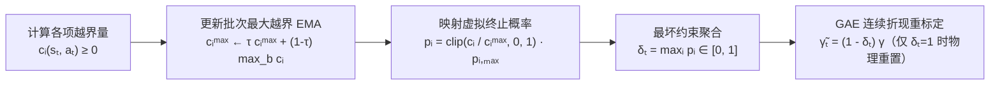

# 3. 约束式强化学习（CaT）

在第 2 章中，我们用 16 项加权求和的标量奖励把 Flamingo 训得能站能跑。但在真实机器人工程里，**“跟踪速度”（优化目标）**和**“电机不过流、关节不超速、双腿不劈叉”（安全与形态约束）**本质上是两类完全不同的数学对象：

- **优化目标（Objective）**：多多益善（速度跟得越准越好）；
- **安全约束（Constraint）**：只要保持在安全阈值以内（$c_i(s_t, a_t) \le 0$）就足够好，一旦越界则必须严厉禁止！

本章我们深入拆解 ICRA 2024 提出的经典足式约束强化学习算法 **CaT（Constraints as Terminations，把约束转化为虚拟终止概率）**，并对照上游仓库中的 `ConstraintManager` 与 `RolloutStorage` 源码，手把手完成 **Baseline PPO vs CaT** 的受控对比实验。

## 本章目标 \{#goals}

- 透彻理解为什么在多约束机器人上“靠手搓负奖励权重”会陷入帕累托死胡同
- 掌握 **CaT 算法的核心数学推导**：批最大违规量指数滑动平均（EMA）、违规终止概率映射 $p_i(s,a)$ 以及 **不中断物理轨迹的 GAE 折现因子重标定**
- 读懂上游 `constraint_manager.py` 与 `rollout_storage.py` 中仅用十几行代码把离散 `dones` 升级为连续 `float32` 折现掩码的工程实现
- 学会配置 `ConstraintsCfg` 中的 `"truncate"` / `"terminate"` / `"constraint"` 三类终止项，完成同随机种子 PPO 与 CaT 对比验证

## 前置阅读 \{#prerequisites}

- [第 2 章：奖励设计与 PPO 训练](./reward-and-ppo)
- 论文参考：Elliot Chane-Sane et al., *"CaT: Constraints as Terminations for Legged Locomotion Reinforcement Learning"*, ICRA 2024 ([arXiv:2403.18765](https://arxiv.org/abs/2403.18765))

---

## 3.1 为什么软惩罚调参（Soft Penalty）总让人左右为难？ \{#penalty-dilemma}

传统无约束 RL 把带约束问题强行拉格朗日松弛成固定权重和：

$$
\tilde{r}(s_t, a_t) = r_{\text{task}}(s_t, a_t) - \sum_{i=1}^{M} \lambda_i \, c_i(s_t, a_t)
$$

在 Flamingo 上调节惩罚系数 $\lambda_i$ 时，工程师常常撞上两堵墙：

1. **惩罚系数 $\lambda_i$ 偏小 → 约束形同虚设**：当机器人在高速急停或转向时，只要牺牲一点点力矩越限罚分就能换取高额的 `track_lin_vel` 奖励，策略就会心安理得地让轮电机长期顶在 `36 N·m` 饱和线上运行；
2. **惩罚系数 $\lambda_i$ 偏大 → 探索坍缩与“自杀套利”**：在训练初期策略还不会平衡，关节速度、姿态角处处超标，巨额负惩罚使单步总奖励 $\tilde{r}_t \ll 0$。此时活得越久扣分越多，机器人要么学会原地僵死不动，要么直接一头栽倒提前终止回合；
3. **跨量纲不可通约**：力矩单位是 $\text{N}\cdot\text{m}$、角加速度是 $\text{rad/s}^2$、对称误差是 $\text{rad}$——只要主任务奖励改了一点点（例如加入高度跟踪），所有 $\lambda_i$ 又得推倒重调。

那如果反过来采用**硬终止（Hard Termination）**——只要任一关节力矩或姿态一越界就立刻 `env.reset()` 重开一局呢？
在训练前几百轮，4096 个环境几乎每走 2 步就会踩中某条约束被强行掐断，根本收集不到完整的长时程轨迹，训练效率直接归零！

---

## 3.2 CaT 核心原理：不掐断轨迹的“随机虚拟终止” \{#cat-math}

CaT 的破局思路极其优雅：**既然“摔倒终止”之所以威慑力极强，是因为它会砍掉未来所有正回报 $V(s_{t+1})$，那我们为什么不把软约束越界转化为一个介于 $[0, p_{\max}]$ 之间的“虚拟终止概率” $\delta_t$，只按比例打折未来价值，而不真正重置物理仿真器呢？**



让我们严格对应上游 `lab/flamingo/isaaclab/isaaclab/managers/constraint_manager.py` 的代码走完这四步公式：

### 第一步：自适应归一化（Batch Max EMA）

不同约束 $c_i(s_t, a_t) \ge 0$（$=0$ 表示完全合规，$>0$ 表示违规程度）的物理量纲天差地别。为了免去手动标定分母，`ConstraintManager` 在每个训练步跨 4096 个并行环境取当前批次最大违规量，并用平滑系数 $\tau = 0.95$ 维护指数滑动平均上限 $c_i^{\max}$：

$$
c_{i,\text{batch}}^{\max} = \max_{b \in \{1,\dots,N_{\text{env}}\}} \big(c_i(s_{t,b}, a_{t,b}),\; 10^{-6}\big), \qquad
c_i^{\max} \leftarrow \tau \, c_i^{\max} + (1 - \tau)\, c_{i,\text{batch}}^{\max}
$$

### 第二步：映射单约束虚拟终止概率 $p_i$（含可选课程升温）

对于每个越界环境（$c_i > 0$），将其违规比例线性映射到 $[p_{\min}, p_{i,\max}]$（默认 $p_{\min} = 0$）：

$$
p_i(s_t, a_t) = \operatorname{clip}\!\left(\frac{c_i(s_t, a_t)}{c_i^{\max}},\; 0,\; 1\right) \cdot p_{i,\max}
$$

这里超参数 **$p_{i,\max} \in (0, 1]$** 具有极其直观的物理含义：**哪怕这项约束在全批次里违背得最严重，单步最多以 $p_{i,\max}$ 的概率“没收未来期望收益”**（等价于期望存活视野被压缩到 $1 / p_{i,\max}$ 步）！
- 若某约束开启了课程调度 `use_curriculum=True`，在前 `static_curriculum_steps = 30000` 步内令 $p_{i,\max} = 0$（先专心学站立求生），随后按期望视野从 $T_{\text{start}} = 20$ 平滑过渡到目标 $T_{\text{end}} = 1 / p_{i,\max}$。

### 第三步：多约束最大值聚合（Worst-Case Aggregation）

不用把十几项惩罚相加（相加会导致多项轻微越界叠成巨额惩罚），而是直接取所有约束终止概率的**逐元素最大值**：

$$
\delta_t = \max_{i} \, p_i(s_t, a_t) \in [0, 1]
$$

- 对于硬约束（如躯干触地 `illegal_contact_hard`），设定 `time_out="terminate"` 且 $p_{\max} = 1.0$，触发时 $\delta_t = 1.0$，物理环境真正执行重置（`reset_buf == 1.0`）；
- 对于软约束（`time_out="constraint"`，如 $p_{\max} = 0.1$ 或 $0.25$），$\delta_t < 1.0$，**机器人在仿真器中继续正常往下走，不断流、不重开！**

### 第四步：GAE 优势估计中的连续折现率重标定（点睛之笔！）

打开 `scripts/co_rl/core/storage/rollout_storage.py` 第 47–52 行与第 118–121 行，你会惊叹于它的实现有多简洁：

```python
# rollout_storage.py: 当开启 use_constraint_rl 时，dones 从离散 byte 升级为连续 float32！
if self.cfg.get("use_constraint_rl", False):
    self.dones = torch.zeros(num_transitions_per_env, num_envs, 1, dtype=torch.float32, device=self.device)

# compute_returns(): 一行公式无需改动，自然实现有效折现率 (1 - delta_t) * gamma！
for step in reversed(range(self.num_transitions_per_env)):
    next_values = last_values if step == self.num_transitions_per_env - 1 else self.values[step + 1]
    next_is_not_terminal = 1.0 - self.dones[step].float()  # 即 (1 - δ_t) ∈ [0, 1]
    delta = self.rewards[step] + next_is_not_terminal * gamma * next_values - self.values[step]
    advantage = delta + next_is_not_terminal * gamma * lam * advantage
    self.returns[step] = advantage + self.values[step]
```

写成数学公式，TD 残差与广义优势估计（GAE）变为：

$$
\delta_t^{\text{TD}} = r_t + (1 - \delta_t)\gamma V(s_{t+1}) - V(s_t), \qquad
\hat{A}_t = \delta_t^{\text{TD}} + (1 - \delta_t)\gamma\lambda \hat{A}_{t+1}
$$

**一句话读懂它的威力**：
- 因为主任务奖励 $r_t > 0$，未来价值 $V(s_{t+1}) > 0$；一旦动作触犯了某项软约束导致 $\delta_t = 0.25$，未来价值的权重瞬间从 $0.99$ 暴跌至 $(1 - 0.25) \times 0.99 = 0.7425$！
- **无论主任务奖励放大 10 倍还是缩小 10 倍，$(1 - \delta_t)$ 都是按相对比例砍掉未来回报，彻底免疫奖励尺度变化，且永远不会把总回报变成诱导自杀的巨额负数！**

---

## 3.3 代码实战：配置 Flamingo 的软硬约束项 \{#code-walkthrough}

在 `lab/flamingo/tasks/constraint_based/locomotion/velocity/flamingo_env/flat_env/stand_drive/flat_env_stand_drive_cfg.py` 中，`ConstraintsCfg` 将所有边界条件统一纳入 `ConstraintTermCfg`（别名 `DoneTerm`），通过 `time_out` 字段区分三种行为：

| `time_out` 模式 | 返回值范围 | 物理重置环境？ | 对 GAE 价值回传的影响 | 典型代表项 |
| :--- | :---: | :---: | :--- | :--- |
| **`"truncate"`** | `{0, 1}` | **是** | 属于时间截断，通过 `time_outs` 做价值自举（Bootstrap），不扣未来收益 | `time_out_cons`（满 20s）、`terrain_out_of_bounds_cons` |
| **`"terminate"`** | `{0, 1}` | **是** | 硬约束死亡：$\delta_t = 1.0$，未来价值清零并触发终止惩罚 | `base_contact`（躯干/髋/腿非法触地） |
| **`"constraint"`** | $[0, +\infty)$ | **否** | 软约束折现：映射为 $\delta_t \in [0, p_{\max}]$，按 $(1-\delta_t)\gamma$ 压缩未来回报 | 力矩超限、关节超速、双腿对齐、静止零力矩等 |

在 `flat_env_stand_drive_cfg.py` 中，作者已经为你写好了整套可直接启用的软约束函数库（位于 `constraint_based/locomotion/velocity/mdp/constraints.py`）。在做 **PPO vs CaT 对照实验**时，只需取消 `ConstraintsCfg` 中目标软约束的注释（并将 `FlamingoRewardsCfg` 中对应的重复软惩罚项权重置零或调轻）：

```python
@configclass
class ConstraintsCfg:
    """CaT 软硬约束与截断配置示例"""
    # 1. 回合超时截断（不惩罚）
    time_out = DoneTerm(func=mdp.time_out_cons, time_out="truncate")

    # 2. 硬约束：躯干与腿部连杆严禁触地（p_max = 1.0，触发即物理重置）
    base_contact = DoneTerm(
        func=mdp.illegal_contact_hard,
        params={
            "sensor_cfg": SceneEntityCfg(
                "contact_forces",
                body_names=["base_link", ".*_hip_link", ".*_shoulder_link", ".*_leg_link"],
            ),
            "threshold": 1.0,
        },
        p_max=1.0,
        time_out="terminate",
    )

    # 3. 软约束：电机计算力矩超出饱和限幅（平滑抑制过流）
    joint_effort = DoneTerm(
        func=mdp.joint_effort_out_of_limit_soft,
        params={"asset_cfg": SceneEntityCfg("robot", joint_names=[".*_joint"])},
        p_max=0.05,
        use_curriculum=True,
        time_out="constraint",
    )

    # 4. 软约束：关节角速度越界与左右双腿镜像对齐
    vel_limits = DoneTerm(
        func=mdp.joint_vel_out_of_limit_soft,
        params={"asset_cfg": SceneEntityCfg("robot", joint_names=[".*_joint"])},
        p_max=0.10,
        time_out="constraint",
    )
    joint_align_shoulder = DoneTerm(
        func=mdp.joint_align_soft,
        params={"asset_cfg": SceneEntityCfg("robot", joint_names=[".*_shoulder_joint"])},
        p_max=0.25,
        time_out="constraint",
    )
    joint_align_leg = DoneTerm(
        func=mdp.joint_align_soft,
        params={"asset_cfg": SceneEntityCfg("robot", joint_names=[".*_leg_joint"])},
        p_max=0.25,
        time_out="constraint",
    )

    # 5. 软约束：零速指令时抑制轮子原地搓动发热
    stand_still = DoneTerm(
        func=mdp.stand_still_soft,
        params={"asset_cfg": SceneEntityCfg("robot", joint_names=[".*_wheel_joint"])},
        p_max=0.25,
        use_curriculum=True,
        time_out="constraint",
    )
```

> [!NOTE] 版本对齐小贴士
> 注意上游 `constraint_based/.../flat_env_stand_drive_cfg.py` 第 18 行默认导入的是早期 `flamingo_rev01_5_1`（目标高度 `0.36288 m`）。若要与第 2 章的 `v1-ppo` 做严格公平的同构对比，建议将其统一改为与 `manager_based` 一致的 `flamingo_rev01_5_2`（目标高度 `0.48 m`、相同 `StackPolicyCfg` 维度），只保持“软奖励惩罚 vs CaT 软约束折现”这唯一自变量！

---

## 3.4 启动 CaT 训练与受控对照实验 \{#experiment}

### 运行命令

`constraint_based` 分支的任务入口注册为 `ManagerBasedConstraintRLEnv`（`train.py` 检测到该环境类型时会自动打开 `agent_cfg.use_constraint_rl = True`）：

```bash
conda activate flamingo_train
cd flamingo_isaaclab

# 使用与第 2 章完全相同的 seed=42、环境数与迭代轮数启动 CaT 训练
python scripts/co_rl/train.py \
  --task Isaac-Velocity-Flat-Flamingo-v1-ppo-constraint \
  --algo ppo \
  --seed 42 \
  --num_envs 4096 \
  --num_policy_stacks 2 \
  --num_critic_stacks 2 \
  --max_iterations 5000 \
  --headless
```

在 TensorBoard 中，除了常规奖励曲线外，`ConstraintManager` 还会额外打出一组专属监控面板 **`Episode_Constraint/<term_name>`**，直接展示每一项软约束在单回合内的平均违规幅值！

### PPO vs CaT 典型实验表现对照

在 5000 轮同条件训练后，对比两条策略在随机加减速与突加推力下的典型行为特征：

| 评估维度 | 标准软惩罚 PPO（`v1-ppo`） | 约束式强化学习 CaT（`v1-ppo-constraint`） | 原因解析 |
| :--- | :--- | :--- | :--- |
| **前期站立收敛速度（Iter `0~400`）** | 较快 | **更快且更稳**（尤其开启 `use_curriculum=True` 时） | 前 `30,000` 步软约束豁免，奖励纯正无负分干扰，策略先全速攻克倒立摆平衡 |
| **急停/抗推时的峰值力矩削顶率** | 偶发打满力矩上限（靠静态 `-0.1` 权重难以兼顾极端冲击） | **显著下降**（电机力矩主动留出安全裕度） | 一旦接近饱和线，$\delta_t$ 陡增直接压低后续价值预期，策略学会提前利用俯仰缓冲泄力 |
| **左右腿对称度（$\lvert q_L - q_R \rvert$）** | 高速转向时偶有轻微高低腿不对称 | **双腿高度同步**（对称误差收敛至 `< 0.03 rad`） | Batch Max EMA 随违规均值缩小而自动放大灵敏度，持续精细打磨小残差！ |
| **零速驻留表现（`cmd = 0`）** | 可能残留微幅前后晃动 | **安静稳立**（`stand_still_soft` 精准压制零指令轮动） | 条件约束只在 `||cmd|| < 0.01` 时激活虚拟终止，完全不影响正常高速行驶 |

> [!IMPORTANT] 记住 CaT 最核心的自适应特性
> 仔细回看公式 $p_i = (c_i / c_i^{\max}) p_{i,\max}$：随着训练推进，全体机器人的双腿不对称误差从 `0.5 rad` 降到了 `0.05 rad`，此时分母 $c_i^{\max}$ 也会跟着降到 `0.05 rad`！也就是说，CaT 就像一把**自动变倍的显微镜**——粗调期容忍大误差，精调期自动放大残余违规信号，这是固定权重的线性/平方惩罚永远做不到的。

现在我们手里已经有了训练成熟的 PPO 与 CaT 两条策略权重（`.pt`）。但它们目前还被锁在庞大的 Isaac Sim / PyTorch 环境里。下一章，我们将把它们蒸馏成纯洁的 `.onnx` 计算图，并跨越物理引擎鸿沟，零样本迁移到轻快严谨的 **MuJoCo** 中运行！
