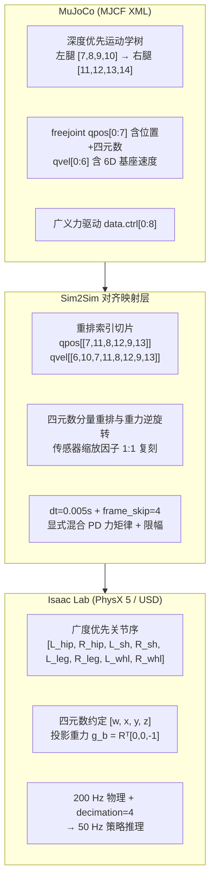

# 4. 策略导出与 MuJoCo Sim2Sim

很多强化学习初学者的项目止步于“在训练它的同一个仿真器里录一段漂亮视频”。但在真实的机器人团队里，**在把策略刷进价值数万元的真机电机驱动板之前，必须先过一道强制安检门——跨物理引擎零样本验证（Sim2Sim Verification）**。

为什么 Sim2Sim 如此重要？
1. **求解器完全独立**：Isaac Lab 底层采用 NVIDIA PhysX 5 的 GPU 时间高斯-赛德尔（TGS）刚体与接触求解器；而 **MuJoCo** 采用广义坐标凸优化软接触求解器。如果策略依赖了 PhysX 特有的接触穿透伪影，一进 MuJoCo 就会立刻摔倒；
2. **提前暴露所有工程接线 Bug**：真机部署最常见的事故根本不是 RL 算法不行，而是**关节编码器顺序接反、IMU 四元数实部虚部颠倒、观测归一化漏乘、控制周期差了 2 倍**！在 MuJoCo 的纯 Python + `onnxruntime` 裸机循环里把这些坑全部踩平，真机上电成功率能提升一个数量级。

本章我们将先在 Isaac Lab 中用 `play.py` 回放并导出融合归一化的 `policy.onnx`，再切换到 `sim2sim_onnx` 分支，逐行打通 MuJoCo 零样本闭环控制。

## 本章目标 \{#goals}

- 使用 `scripts/co_rl/play.py` 完成策略可视化回放、视频录制，并理解 `_OnnxPolicyExporter` 如何将在线归一化统计量与 Actor 网络固化进同一张 `.onnx` 图
- 彻底搞懂并修复 **Isaac Lab → MuJoCo 跨引擎迁移的五大经典错位陷阱**（尤其是广度优先 vs 深度优先关节序！）
- 跑通 `flamingo_sim2sim` 下的 ONNX Runtime 50 Hz 闭环控制与 Pygame 键盘实时遥控

## 前置阅读 \{#prerequisites}

- [第 1 章：本体建模与环境注册](./robot-and-env)
- [第 2 章：奖励设计与 PPO 训练](./reward-and-ppo)
- [仿真工具 · MuJoCo 基础](/docs/foundations/simulation/mujoco)

---

## 4.1 在 Isaac Lab 中回放策略并融合导出 ONNX \{#export-onnx}

### 1. 运行 `play.py` 验收并自动生成导出文件

当第 2 章（或第 3 章 CaT）训练完成后，使用对应的 `-Play-` 环境启动回放与自动导出：

```bash
conda activate flamingo_train
cd flamingo_isaaclab

# 加载最新一次训练的最后 checkpoint，录制回放视频并自动导出 JIT (.pt) 与 ONNX (.onnx)
python scripts/co_rl/play.py \
  --task Isaac-Velocity-Flat-Flamingo-Play-v1-ppo \
  --algo ppo \
  --num_envs 32 \
  --num_policy_stacks 2 \
  --num_critic_stacks 2 \
  --video \
  --video_length 400
```

运行成功后，检查实验目录下的 `exported/` 子文件夹：

```text
logs/co_rl/Flamingo_Flat_Stand_Drive/ppo/<run_timestamp>/
├── model_4999.pt                 # 包含 Actor, Critic, Normalizer 与优化器状态的训练权重
├── videos/play/                  # 自动录制的 MP4 多视角速度跟踪演示
└── exported/
    ├── policy.pt                 # TorchScript JIT 独立推理模型
    └── policy.onnx               # 融合了 Normalizer + Actor MLP 的标准 ONNX 模型！
```

### 2. 源码级剖析：为什么绝不能直接 `torch.onnx.export(actor)`？

打开 `scripts/co_rl/core/wrapper/exporter.py` 第 404–466 行的 `_OnnxPolicyExporter` 类：

```python
class _OnnxPolicyExporter(torch.nn.Module):
    """将 EmpiricalNormalization 与 Actor 网络封装为单张 ONNX 推理图"""

    def __init__(self, actor_critic, normalizer=None, verbose=False):
        super().__init__()
        self.actor = copy.deepcopy(actor_critic.actor)
        # 关键！深拷贝训练期积累了数亿步 running_mean 和 running_var 的归一化层
        self.normalizer = copy.deepcopy(normalizer) if normalizer else torch.nn.Identity()

    def forward(self, x):
        # 部署端只需喂入原始缩放后的物理观测 x，图内自动完成 (x - μ) / √(σ² + ε)！
        return self.actor(self.normalizer(x))
```

> [!WARNING] 部署头号血泪教训：遗漏 `EmpiricalNormalization`
> 在 `co_rl_cfg.py` 中我们开启了 `empirical_normalization = True`。这意味着 Actor 第一层全连接权重期望看到的是均值为 `0`、标准差为 `1` 的标准化特征。如果你在部署时只导出了 `actor_critic.actor` 的权重而忘了把 `normalizer` 串在前面，输入稍大一点就会让 `ELU` 层彻底失真，机器人上电瞬间就会疯狂抽搐翻车！
> `_OnnxPolicyExporter` 把 `normalizer` 的固定均值/方差 Buffer 与 `actor` 三层 MLP（`[512, 256, 128]`）合并导出为静态输入 `obs: float32[1, D_actor]`、输出 `actions: float32[1, 8]` 的单算子图（`opset_version=11`），部署端无需任何 PyTorch 依赖。

### 3. 导出后必做的 10 行数值等价性自检

把 `exported/policy.onnx` 拷入 `flamingo_sim2sim` 目录前，建议养成用随机张量核对输入输出形状与精度的好习惯：

```python
import numpy as np
import onnxruntime as ort
import torch

jit_model = torch.jit.load("exported/policy.pt").eval()
ort_sess = ort.InferenceSession("exported/policy.onnx", providers=["CPUExecutionProvider"])

input_name = ort_sess.get_inputs()[0].name
obs_dim = ort_sess.get_inputs()[0].shape[1]
print(f"ONNX 输入名: {input_name}, 维度: [1, {obs_dim}], 输出形状: {ort_sess.get_outputs()[0].shape}")

dummy_obs = np.random.randn(1, obs_dim).astype(np.float32)
with torch.no_grad():
    pt_out = jit_model(torch.from_numpy(dummy_obs)).numpy()
ort_out = ort_sess.run(None, {input_name: dummy_obs})[0]

max_diff = np.max(np.abs(pt_out - ort_out))
assert max_diff < 1e-5, f"导出精度异常: {max_diff}"
print(f"数值对齐通过！最大绝对误差: {max_diff:.2e}")
```

---

## 4.2 跨仿真器迁移（Sim2Sim）的五大“隐形错位陷阱” \{#five-pitfalls}

现在我们来到最硬核的部分：为什么把同一个 URDF 转成的 USD（Isaac Lab）和 MJCF XML（MuJoCo）放在一起，直接读取 `data.qpos` 喂给 `policy.onnx` 会 100% 瞬间原地爆炸？

对照上游 `sim2sim_onnx` 分支的 `assets/flamingo_torque.xml` 与 `flamingo_stand_main.py`，我们把这 **五大跨引擎差异** 逐一拆开：



### 陷阱一：关节遍历顺序彻底不同（头号杀手！）

在 MuJoCo 的 MJCF 文件中，刚体树按 `<body name="left_hip_link"> ... </body>` 写完一整条左腿后，再写 `<body name="right_hip_link"> ... </body>` 右腿（**深度优先遍历 DFS**）；且根节点 `<freejoint/>` 占据了 `qpos[0:7]`（3 维位置 + 4 维四元数，共 7 个数）与 `qvel[0:6]`（3 维线速度 + 3 维角速度，共 6 个数）！

而在第 1 章的 Isaac Lab 配置中，所有观测和动作都是**左右交替（广度优先 BFS）**排列的！请看精确索引对照表：

| 策略期望的关节顺序 | MuJoCo `data.qpos` 索引 | MuJoCo `data.qvel` 索引 | 说明 |
| :--- | :---: | :---: | :--- |
| `0: left_hip_joint` | `qpos[7]` | `qvel[6]` | 左腿根部侧摆 |
| `1: right_hip_joint` | **`qpos[11]`** | **`qvel[10]`** | **跨过左腿后 3 个关节跳到右腿根部！** |
| `2: left_shoulder_joint` | `qpos[8]` | `qvel[7]` | 左大腿俯仰 |
| `3: right_shoulder_joint` | **`qpos[12]`** | **`qvel[11]`** | 右大腿俯仰 |
| `4: left_leg_joint` | `qpos[9]` | `qvel[8]` | 左小腿膝关节（注意核对 `gear_ratio`） |
| `5: right_leg_joint` | **`qpos[13]`** | **`qvel[12]`** | 右小腿膝关节 |
| `6: left_wheel_joint` | （不进观测）`qpos[10]` | `qvel[9]` | 左轮连续角速度 |
| `7: right_wheel_joint` | （不进观测）`qpos[14]` | **`qvel[13]`** | 右轮连续角速度 |

这就是为什么在 `flamingo_stand_main.py` 第 115–116 行必须写出看似神秘但一丝不苟的切片重排：

```python
# 从深度优先的 MuJoCo 状态向量重排为 Isaac Lab 的左右交替顺序！
q_joints = self.data.qpos[[7, 11, 8, 12, 9, 13]]          # 6 维腿部关节角（剔除 10, 14 左右轮角）
qd_all   = self.data.qvel[[6, 10, 7, 11, 8, 12, 9, 13]]   # 8 维全部关节角速度
```

同样地，当你在 MuJoCo 中把算好的 8 维力矩塞回 `self.data.ctrl[:]` 时，也必须确认 XML 中 `<actuator>` 标签的声明顺序是左右交替还是先左后右！在 `assets/flamingo_torque.xml` 中，`<actuator>` 已贴心地按 `[L_hip, R_hip, L_sh, R_sh, L_leg, R_leg, L_whl, R_whl]` 顺序声明；若你自己从 URDF 导出 XML，务必逐行核对 `<motor joint="..."/>` 顺序。

### 陷阱二：四元数实部顺序 `[w, x, y, z]` vs `[x, y, z, w]`

- **MuJoCo** 的 `qpos[3:7]` 与 `framequat`（`orientation` 传感器）统一采用 **`[w, x, y, z]`**（实部 `w` 在前）；
- **Isaac Lab (`isaaclab.utils.math`)** 内部四元数同样是 **`[w, x, y, z]`**；
- 但 Python 科学计算常用的 **`scipy.spatial.transform.Rotation.from_quat()`** 默认要求 **`[x, y, z, w]`**（实部 `w` 在最后）！

因此，计算第 1 章 `v1-ppo` 所需的机身系投影重力向量 $\mathbf{g}_b = R_w^T [0, 0, -1]^T$ 时，最稳妥、零外部库歧义的写法是直接使用 `[w, x, y, z]` 逆旋转公式：

```python
def quat_rotate_inverse_wxyz(quat_wxyz: np.ndarray, vec: np.ndarray) -> np.ndarray:
    """将世界系向量 vec 逆旋转至机身坐标系，quat 格式严格为 [w, x, y, z]"""
    w = quat_wxyz[0]
    xyz = quat_wxyz[1:4]
    t = 2.0 * np.cross(-xyz, vec)
    return vec + w * t + np.cross(-xyz, t)

# MuJoCo orientation 传感器直接返回 [w, x, y, z]
quat_wxyz = data.sensor("orientation").data.astype(np.float64)
projected_gravity = quat_rotate_inverse_wxyz(quat_wxyz, np.array([0.0, 0.0, -1.0]))
```

> [!CAUTION] 版本匹配提醒：投影重力 vs 欧拉角
> 上游 `sim2sim_onnx` 早期脚本（`flamingo_stand_main.py`）适配的是旧版欧拉角观测模型（`euler` 3 维）；而我们在第 1–3 章基于最新 `main` 分支训练的 `v1-ppo` 使用的是**无奇异点的 `base_projected_gravity`（3 维）+ 显式观测缩放系数（关节角速度 `×0.15`、机身角速度 `×0.25`、航向角速度指令 `×0.25`）+ 膝关节传动比 `gear_ratio = -1.5`**。自己训练的模型迁移时，观测拼装每一项的物理含义与缩放乘数必须与 `StackPolicyCfg` **逐元素 100% 对齐**！

### 陷阱三：历史观测滑动窗口的方向（最新帧在前还是在后？）

当 `--num_policy_stacks 2` 时，59 维输入向量中 `[0:28]` 是当前帧 $o_t$ 还是上一帧 $o_{t-1}$？
在 `co_rl` 的状态处理器与 `sim2sim_onnx`（`previous_states.insert(0, current_state)`）中，**最新帧 $o_t$ 排在最前面 `[0:28]`，历史帧 $o_{t-1}, o_{t-2}$ 依次往后排，最后拼接 3 维非堆叠速度指令 `commands`**！回合刚 `reset()` 的第 0 步，尚未填满的历史槽位用零向量补齐。

### 陷阱四：控制步长与混合 PD 力矩律复刻

- MuJoCo XML 中 `<option timestep="0.005"/>`，配合 `frame_skip = 4`，保证每次 `do_simulation(ctrl, frame_skip=4)` 推进 $4 \times 0.005 = 0.02\text{ s}$（严格对齐 Isaac Lab 的 **50 Hz** 策略频率）；
- 在这 4 个子物理步中，采用力矩电机（`<motor>`）配合 Python 端显式混合 PD 控制器输出力矩：
  - 6 个腿部关节：$\tau_{\text{leg}} = \operatorname{clip}\!\big(K_p (a_{\text{pos}} \cdot s_{\text{pos}} - q) + K_d (0 - \dot{q}),\; -\tau_{\max},\; \tau_{\max}\big)$；
  - 2 个驱动轮：$\tau_{\text{wheel}} = \operatorname{clip}\!\big(K_{d,w} (a_{\text{whl}} \cdot s_{\text{whl}} - \dot{q}_{\text{whl}}),\; -\tau_{w,\max},\; \tau_{w,\max}\big)$。

### 陷阱五：接触求解器阻尼微调

由于 MuJoCo 软接触与关节阻尼的耗散特性同 PhysX 略有差异，在 Sim2Sim 部署时，若发现腿部在硬地面出现轻微高频蜂鸣，可在保持策略网络完全不动的前提下，将 MuJoCo 端内环 PD 增益按比例微调（例如上游 `sim2sim_onnx` 采用 `kp_j = 75.0 ~ 100.0, kd_j = 0.5 ~ 1.5, kd_w = 0.3 ~ 0.7`）或开启一阶动作低通滤波 `alpha = 0.8 ~ 1.0`。

---

## 4.3 动手运行：MuJoCo + ONNX 零样本闭环与键盘遥控 \{#run-sim2sim}

切换到第 0 章准备好的轻量级 `flamingo_sim2sim` 环境，即可零 GPU 跑起跨仿真验证：

### 1. 先用上游自带预训练策略跑通交互遥控

```bash
conda activate flamingo_sim2sim
cd flamingo_sim2sim

# 若想直接体验上游自带的 ONNX 策略，指定对应模型路径即可启动 MuJoCo 视窗 + Pygame 遥控台
python flamingo_stand_main.py --load_model assets/policy.onnx
```

> [!TIP] macOS 用户线程提示
> 在 macOS 上，OpenGL/Cocoa GUI 要求主线程驱动渲染窗口（或使用 `mjpython` 启动）。如果在 macOS 直接运行多线程 `pygame + MujocoRenderer` 遇到窗口卡死，可将渲染模式设为离屏录制或将 `run_mujoco` 移入主循环，使用 `mjpython` 运行。Linux（Ubuntu X11/Wayland）与 Windows 下可直接双窗口实时交互。

### 2. 对接你自己第 2/3 章导出的 `v1-ppo` ONNX 最小纯净闭环模板

为了让你一目了然地把第 2/3 章亲手训出的 `exported/policy.onnx`（`num_policy_stacks=2`，59 维输入）接入 MuJoCo，下面给出剥离了所有冗余日志的**核心 60 行对齐推理骨架**：

```python
import mujoco
import mujoco.viewer
import numpy as np
import onnxruntime as ort

# 1. 加载 MuJoCo 模型与第 2/3 章导出的 ONNX 策略
model = mujoco.MjModel.from_xml_path("assets/flamingo_torque.xml")
model.opt.timestep = 0.005  # 200 Hz 物理步长
data = mujoco.MjData(model)

sess = ort.InferenceSession("exported/policy.onnx", providers=["CPUExecutionProvider"])
in_name = sess.get_inputs()[0].name

DECIMATION = 4              # 4 物理步 = 50 Hz 策略控制
NUM_STACKS = 2              # 与训练参数 --num_policy_stacks 2 严格一致
GEAR_RATIO = -1.5           # 膝关节同步带传动比

# 关节重排索引：MuJoCo DFS -> Isaac Lab BFS [L_hip, R_hip, L_sh, R_sh, L_leg, R_leg, L_whl, R_whl]
QPOS_IDX = [7, 11, 8, 12, 9, 13]
QVEL_IDX = [6, 10, 7, 11, 8, 12, 9, 13]

def quat_rot_inv(q_wxyz: np.ndarray, v: np.ndarray) -> np.ndarray:
    w, xyz = q_wxyz[0], q_wxyz[1:4]
    t = 2.0 * np.cross(-xyz, v)
    return v + w * t + np.cross(-xyz, t)

def build_single_frame_obs(data: mujoco.MjData, last_action: np.ndarray) -> np.ndarray:
    q = data.qpos[QPOS_IDX].copy()
    q[4:6] *= GEAR_RATIO                      # 对齐 mdp.joint_pos_leg_gear
    qd = data.qvel[QVEL_IDX].copy()
    qd[4:6] *= GEAR_RATIO                     # 对齐 mdp.joint_vel_leg_gear
    qd *= 0.15                                # 对齐 StackPolicyCfg 速度缩放 0.15

    omega = data.sensor("angular-velocity").data * 0.25
    quat = data.sensor("orientation").data    # [w, x, y, z]
    proj_grav = quat_rot_inv(quat, np.array([0.0, 0.0, -1.0]))

    return np.concatenate([q, qd, omega, proj_grav, last_action]).astype(np.float32)  # 28 维

# 2. 初始化站立位姿与历史帧队列
data.qpos[2] = 0.4535
data.qpos[3:7] = [1.0, 0.0, 0.0, 0.0]
mujoco.mj_forward(model, data)

last_action = np.zeros(8, dtype=np.float32)
history = [np.zeros(28, dtype=np.float32) for _ in range(NUM_STACKS)]
cmd_scaled = np.array([0.6, 0.0, 0.0 * 0.25], dtype=np.float32)  # 目标前进 0.6 m/s

# 3. 启动 50 Hz 策略 + 200 Hz 内环 PD 零样本闭环
with mujoco.viewer.launch_passive(model, data) as viewer:
    while viewer.is_running():
        frame_obs = build_single_frame_obs(data, last_action)
        history.pop(-1)
        history.insert(0, frame_obs)
        obs = np.concatenate([*history, cmd_scaled])[np.newaxis, :]  # [1, 59]

        raw_action = sess.run(None, {in_name: obs})[0][0]
        last_action = np.clip(raw_action, -1.0, 1.0)

        # 动作解码：前 6 维目标角度 (scale=1.0)，后 2 维目标轮速 (scale=40.0)
        q_des = last_action[0:6] * 1.0
        w_des = last_action[6:8] * 40.0

        for _ in range(DECIMATION):
            q_cur = data.qpos[QPOS_IDX]
            qd_cur = data.qvel[QVEL_IDX]
            tau_hip_sh = np.clip(100.0 * (q_des[0:4] - q_cur[0:4]) - 1.5 * qd_cur[0:4], -60.0, 60.0)
            tau_leg    = np.clip(120.0 * (q_des[4:6] - q_cur[4:6] * GEAR_RATIO) - 1.5 * (qd_cur[4:6] * GEAR_RATIO), -90.0, 90.0)
            tau_wheel  = np.clip(0.7 * (w_des - qd_cur[6:8]), -36.0, 36.0)

            data.ctrl[:] = np.concatenate([tau_hip_sh, tau_leg, tau_wheel])
            mujoco.mj_step(model, data)
        viewer.sync()
```

当你看到在 Isaac Lab 里训练出的策略**未经任何 MuJoCo 数据微调**，第一次加载进 MuJoCo 就能先轻退半步前倾质心、随后稳稳加速至 `0.6 m/s` 巡航时，你就真正打通了具身强化学习的 **Sim2Sim 跨引擎闭环**！

但“平地无风走得稳”只是及格线。如果有人从侧面猛踹它一脚、地面洒了水变滑、或者背上多绑了一块 2 公斤的电池，PPO 和 CaT 谁能扛得住？下一章，我们在 MuJoCo 中搭建结构化的**四维鲁棒性压力测试台**。
