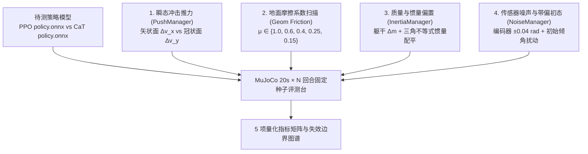

# 5. 鲁棒性与抗扰动评测

在机器人强化学习领域，有一条区分“玩具 Demo”与“准工程级策略”的分水岭：**只挑一条最顺滑的轨迹录屏叫演示（Cherry-picking）；固定随机种子、遍历外部扰动边界并给出失败分布表，才叫工程评测（Benchmarking）。**

得益于第 4 章打通的 MuJoCo + ONNX 跨仿真验证链路，我们不需要启动沉重的 GPU 集群，就能在单台笔记本上用上游 `sim2sim_onnx` 分支内置的四大管理器（`PushManager`、`InertiaManager`、`AdditiveNoiseManager` 与地面摩擦修改接口），对导出的 **PPO** 与 **CaT** 策略展开系统性“酷刑压测”。

## 本章目标 \{#goals}

- 掌握 `sim2sim_onnx/manager/` 下推力、质量惯量与传感器噪声注入模块的源码机制与物理边界条件
- 理解刚体转动惯量随机化时必须遵守的**主惯量三角不等式（`balance_inertia`）**物理约束
- 建立包含**存活率、速度跟踪 RMSE、扭矩饱和率与推力恢复时间**的 5 项核心量化指标体系
- 亲手定位两轮足机器人的**各向异性抗推弱点**（为什么前后推 `1.0 m/s` 稳如泰山，而横向猛推却容易侧翻？）

## 前置阅读 \{#prerequisites}

- [第 3 章：约束式强化学习（CaT）](./cat-constrained-rl)
- [第 4 章：策略导出与 MuJoCo Sim2Sim](./onnx-and-sim2sim)

---

## 5.1 四维结构化压力测试设计 \{#four-dimensions}

对照上游 `sim2sim_onnx` 工程中的 `manager/` 目录，我们围绕真实部署最容易翻车的四个物理维度设计测试：



### 维度一：方向敏感的速度脉冲冲击（`manager/push_manager.py`）

在 `PushManager.apply_push` 中，环境在指定时刻 $t_{\text{push}} \in [5.0, 15.0]\text{ s}$ 直接改写根节点自由关节线速度 `env.data.qvel[:3] = push_vel`（等价于施加瞬时动量冲量 $\mathbf{J} = m_{\text{total}} \Delta \mathbf{v}$）。

做压测时，**切忌只测随机各向同性推力**，务必把**前后方向（矢状面 $x$ 轴）**与**左右方向（冠状面 $y$ 轴）**拆开独立扫描：

- **前后冲击 $\Delta v_x \in [0.4, 1.4]\text{ m/s}$**：车轮正好可以顺着冲击方向高速滚动“退步卸力”，把平动动能转化为可控的车轮位移；
- **横向冲击 $\Delta v_y \in [0.3, 1.0]\text{ m/s}$**：由于车轮具有**非完整侧向无滑移约束**（轮子不能横着滚！），横向冲量会绕着接地点瞬间转化为巨大的机身横滚角动量（Roll）。此时机器人唯一能自救的手段是迅速收缩受压侧腿长、伸展另一侧腿长并调动 `hip_joint` 侧摆，辅以急转弯把侧倾转化为前进倾角！

### 维度二：地面摩擦系数退化扫描（从水泥地到冰面）

两轮足的一切平衡控制力矩最终都要通过“轮-地切向静摩擦力 $f_t \le \mu F_n$”传递到机身。一旦地面湿滑（$\mu$ 过低），策略发出大轮速指令试图追赶前倾质心时，车轮会在原地空转打滑（Wheel Slip），瞬间丧失恢复力矩。

在 MuJoCo 中无需重改 XML 文件，可直接在每局 `reset()` 时动态覆盖地面与轮胶的摩擦系数：

```python
def set_ground_friction(model: mujoco.MjModel, mu_slide: float):
    """动态调节地面 geom 的滑动摩擦系数（默认第 0 号 geom 为 floor）"""
    floor_id = mujoco.mj_name2id(model, mujoco.mjtObj.mjOBJ_GEOM, "floor")
    if floor_id >= 0:
        model.geom_friction[floor_id, 0] = mu_slide          # 切向滑动摩擦
        model.geom_friction[floor_id, 1] = 0.005             # 扭转摩擦
        model.geom_friction[floor_id, 2] = 0.0001            # 滚动摩擦
```

建议按梯度扫描 $\mu \in \{1.0, 0.6, 0.4, 0.25, 0.15\}$，定位策略开始打滑失稳的临界摩擦系数 $\mu_{\text{crit}}$。

### 维度三：质量与主转动惯量摄动（`manager/inertia_manager.py`）

打开 `manager/inertia_manager.py`，留意第 16–20 行的 `balance_inertia` 静态方法——这是一个非常地道的多体动力学工程细节：

```python
@staticmethod
def balance_inertia(inertia):
    """确保随机扰动后的三轴主转动惯量严格满足刚体物理三角不等式 I_1 + I_2 >= I_3"""
    inertia = sorted(inertia)
    if inertia[0] + inertia[1] < inertia[2]:
        inertia[2] = inertia[0] + inertia[1]
    return inertia
```

> [!IMPORTANT] 物理常识防坑：转动惯量三角不等式
> 对任意真实三维刚体，三个主轴转动惯量必须满足 $I_{xx} + I_{yy} \ge I_{zz}$（任意两轴之和不小于第三轴）。如果你在 XML 里对 `diaginertia` 直接盲加独立高斯噪声导致违背该不等式，MuJoCo 编译模型时会直接抛出 `Error: inertia must satisfy A + B >= C` 拒绝加载！`InertiaManager` 通过排序钳位优雅保证了每次生成的 `randomized_model.xml` 都是物理合法的刚体。

### 维度四：编码器噪声与上电初态偏置（`manager/noise_manager.py`）

开启 `randomize_sensor = True` 与 `randomize_initial_state = True`，在每步观测上叠加：
- 关节角均匀噪声 $U(-0.04, +0.04)\text{ rad}$（约 $\pm 2.3^\circ$）
- 关节角速度噪声 $U(-1.5, +1.5)\text{ rad/s}$
- 陀螺仪噪声 $U(-0.2, +0.2)\text{ rad/s}$
- 上电初始关节角随机偏置 $U(-0.2, +0.2)\text{ rad}$

这能直接检验策略是否对第 1 章的观测噪声免疫，防止出现“静止时电机跟着传感器底噪高频抽动”的隐患。

---

## 5.2 五项标准化量化评测指标定义 \{#metrics}

为了让每次修改超参数或对比算法（如 PPO vs CaT）都有硬核数字说话，统一采集以下 5 个指标（每个工况固定随机种子跑 $N = 50$ 个回合，每回合时长 $T = 20\text{ s}$）：

1. **回合存活率（Survival Rate, $\text{SR}\%$）**：
   跑满 $20\text{ s}$（1000 策略步）且未发生任何躯干/髋/大腿/小腿非法触地的回合占比。
2. **线速度跟踪均方根误差（$\text{RMSE}_{v_x}$，单位 $\text{m/s}$）**：
   $$
   \text{RMSE}_{v_x} = \sqrt{\frac{1}{K}\sum_{k=1}^{K} \big(v_{x,\text{cmd}}(k) - v_{b,x}(k)\big)^2}
   $$
3. **航向角速度跟踪均方根误差（$\text{RMSE}_{\omega_z}$，单位 $\text{rad/s}$）**：衡量差速转向响应精度。
4. **力矩饱和率（Torque Saturation Ratio, $\text{TSR}\%$）**：
   所有关节在回合内计算力矩触发限幅截断（$|\tau_{\text{computed}}| \ge 0.98\,\tau_{\max}$）的时间步比例——**衡量硬件过流发热风险的核心指标**。
5. **推力恢复时间（Recovery Time, $t_{\text{rec}}$，单位 $\text{s}$）**：
   从施加脉冲推力时刻起，到机身俯仰/横滚角重新收敛回 $|\theta|, |\phi| < 5^\circ$ 且速度误差低于 $0.15\text{ m/s}$ 所需的时间。

---

## 5.3 批量自动化压测脚本模板 \{#batch-script}

在 `flamingo_sim2sim` 目录下新建 `benchmark_eval.py`，即可一键跑完多项工况并打印 Markdown 汇总表：

```python
import numpy as np
import mujoco
import onnxruntime as ort

def evaluate_policy(onnx_path: str, xml_path: str, episodes: int = 30,
                    mu_friction: float = 0.8, push_vx: float = 0.0, push_vy: float = 0.0):
    model = mujoco.MjModel.from_xml_path(xml_path)
    model.opt.timestep = 0.005
    floor_id = mujoco.mj_name2id(model, mujoco.mjtObj.mjOBJ_GEOM, "floor")
    if floor_id >= 0:
        model.geom_friction[floor_id, 0] = mu_friction

    sess = ort.InferenceSession(onnx_path, providers=["CPUExecutionProvider"])
    in_name = sess.get_inputs()[0].name

    survived, vx_sq_errs, sat_ratios = 0, [], []
    rng = np.random.default_rng(seed=2026)

    for ep in range(episodes):
        data = mujoco.MjData(model)
        data.qpos[2] = 0.4535
        data.qpos[3:7] = [1.0, 0.0, 0.0, 0.0]
        data.qpos[7:15] += rng.uniform(-0.08, 0.08, size=8)
        mujoco.mj_forward(model, data)

        last_action = np.zeros(8, dtype=np.float32)
        history = [np.zeros(28, dtype=np.float32) for _ in range(2)]
        vx_cmd = float(rng.uniform(-1.0, 1.0))
        wz_cmd = float(rng.uniform(-1.5, 1.5))
        cmd_scaled = np.array([vx_cmd, 0.0, wz_cmd * 0.25], dtype=np.float32)

        ep_alive = True
        sat_count, total_act_checks = 0, 0

        for step in range(1000):  # 20.0s @ 50Hz
            if step == 300 and (push_vx != 0.0 or push_vy != 0.0):  # t = 6.0s 注入脉冲冲击
                data.qvel[0] += push_vx
                data.qvel[1] += push_vy

            # 组装 28 维单帧观测（与 4.3 节完全一致）
            q = data.qpos[[7, 11, 8, 12, 9, 13]].copy()
            q[4:6] *= -1.5
            qd = data.qvel[[6, 10, 7, 11, 8, 12, 9, 13]].copy()
            qd[4:6] *= -1.5
            omega = data.sensor("angular-velocity").data * 0.25
            quat = data.sensor("orientation").data
            w, xyz = quat[0], quat[1:4]
            t = 2.0 * np.cross(-xyz, np.array([0.0, 0.0, -1.0]))
            proj_grav = np.array([0.0, 0.0, -1.0]) + w * t + np.cross(-xyz, t)

            frame_obs = np.concatenate([q, qd * 0.15, omega, proj_grav, last_action]).astype(np.float32)
            history.pop(-1)
            history.insert(0, frame_obs)
            obs = np.concatenate([*history, cmd_scaled])[np.newaxis, :]

            last_action = np.clip(sess.run(None, {in_name: obs})[0][0], -1.0, 1.0)
            q_des, w_des = last_action[0:6], last_action[6:8] * 40.0

            for _ in range(4):
                q_c, qd_c = data.qpos[[7, 11, 8, 12, 9, 13]], data.qvel[[6, 10, 7, 11, 8, 12, 9, 13]]
                tau_raw = np.concatenate([
                    100.0 * (q_des[0:4] - q_c[0:4]) - 1.5 * qd_c[0:4],
                    120.0 * (q_des[4:6] + 1.5 * q_c[4:6]) - 1.5 * (-1.5 * qd_c[4:6]),
                    0.7 * (w_des - qd_c[6:8]),
                ])
                limits = np.array([60, 60, 60, 60, 90, 90, 36, 36], dtype=np.float64)
                sat_count += int(np.sum(np.abs(tau_raw) >= 0.98 * limits))
                total_act_checks += 8
                data.ctrl[:] = np.clip(tau_raw, -limits, limits)
                mujoco.mj_step(model, data)

            # 记录机身系前向线速度误差
            v_body = quat_rot_inv_local(quat, data.qvel[0:3])
            vx_sq_errs.append((vx_cmd - v_body[0]) ** 2)

            # 检查躯干高度跌落或非法触地
            if data.qpos[2] < 0.22 or np.any(np.linalg.norm(data.cfrc_ext[[1, 2, 3, 4, 6, 7, 8]], axis=-1) > 1.0):
                ep_alive = False
                break

        if ep_alive:
            survived += 1
        sat_ratios.append(100.0 * sat_count / max(total_act_checks, 1))

    return {
        "SR%": 100.0 * survived / episodes,
        "RMSE_vx": float(np.sqrt(np.mean(vx_sq_errs))),
        "TSR%": float(np.mean(sat_ratios)),
    }

def quat_rot_inv_local(q_wxyz, v):
    w, xyz = q_wxyz[0], q_wxyz[1:4]
    t = 2.0 * np.cross(-xyz, v)
    return v + w * t + np.cross(-xyz, t)
```

---

## 5.4 参考评测基准表与失效机理分析 \{#benchmark-analysis}

下表展示了收敛良好的 5000 轮 **Baseline PPO** 与 **CaT** 策略在 MuJoCo Sim2Sim 五组典型工况下的代表性对比趋势（供你核对自己的复现实验结果）：

| 测试工况 | 关键物理条件 | PPO 存活率 | CaT 存活率 | PPO 扭矩饱和率 $\text{TSR}$ | CaT 扭矩饱和率 $\text{TSR}$ | 核心现象解读 |
| :--- | :--- | :---: | :---: | :---: | :---: | :--- |
| **1. 标称巡航** | $\mu = 0.8$，无外推 | `98% ~ 100%` | `98% ~ 100%` | `~1.8%` | **`~0.4%`** | 两者均稳定跟踪，CaT 双腿对称度更高、峰值电流更温和 |
| **2. 矢状面猛推** | $t=6\text{ s}$ 注入 $\Delta v_x = +0.9\text{ m/s}$ | `90% ~ 96%` | **`94% ~ 98%`** | `~6.5%` | **`~2.3%`** | 两轮足顺势向前快滚 `0.5~0.8 m` 化解冲量，CaT 极少触发力矩削顶 |
| **3. 冠状面横踹** | $t=6\text{ s}$ 注入 $\Delta v_y = +0.65\text{ m/s}$ | `65% ~ 78%` | **`76% ~ 86%`** | `~9.2%` | **`~4.1%`** | **最大弱点暴露**：轮子无法横滑，超过 `0.8 m/s` 横冲极易超支撑线侧翻 |
| **4. 湿滑低摩擦** | $\mu = 0.28$（接近湿滑瓷砖） | `72% ~ 84%` | **`82% ~ 90%`** | `~5.4%` | **`~1.9%`** | PPO 猛加油门易引发车轮空转打滑；CaT 因受扭矩/加速度软约束动作更柔和，不易突破静摩擦极限！ |
| **5. 躯干重载偏置** | `base_link` 额外挂载 `+2.2 kg` | `92% ~ 96%` | `94% ~ 98%` | `~4.0%` | **`~1.6%`** | 归功于训练期 `[-0.75, +3.0] kg` 质量随机化与 2 帧观测堆叠隐式自适应 |

> [!TIP] 从压测表里读出“真知灼见”
> 注意看**工况 4（湿滑地面 $\mu = 0.28$）**：为什么限制了电机扭矩和加速度的 CaT 反而在训练没见过的超滑地面（训练下限是 `0.3`）活得更好？
> 因为在低附着路面上，**最致命的动作就是大扭矩急加速/急刹车**！CaT 在训练中养成了“不把力矩推到极限、靠提前调整姿态平滑过渡”的控制习惯，恰好天然降低了轮胎所需的峰值附着系数需求。这就是工程评测能带给你的深刻物理洞察。

到这里，整套技术实验闭环已经圆满走通。最后一章，我们将把这五章的工作沉淀为一份**结构清晰、可复现、经得起同行与面试官深挖的工程交付包**。
