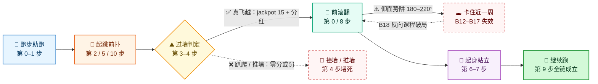
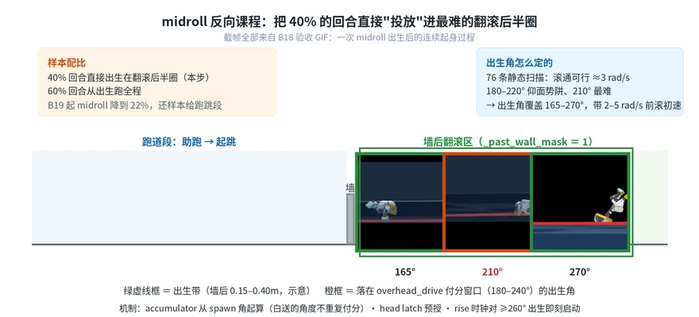
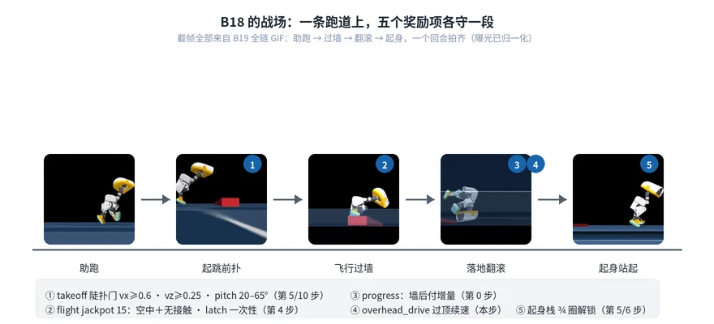
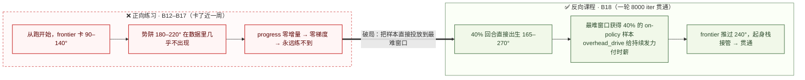
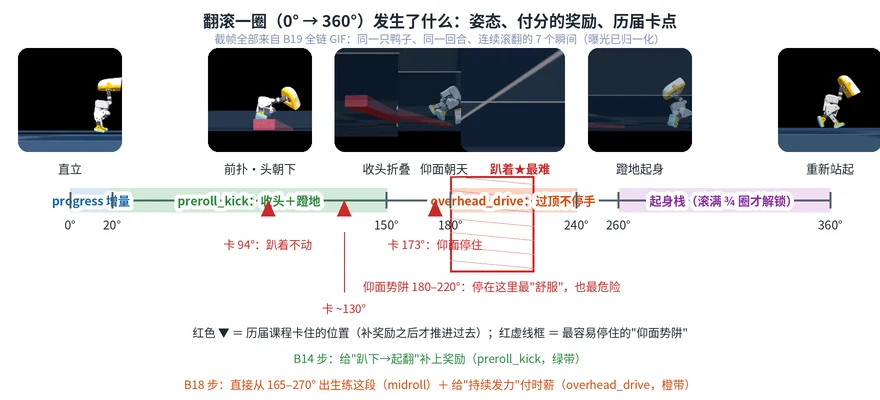
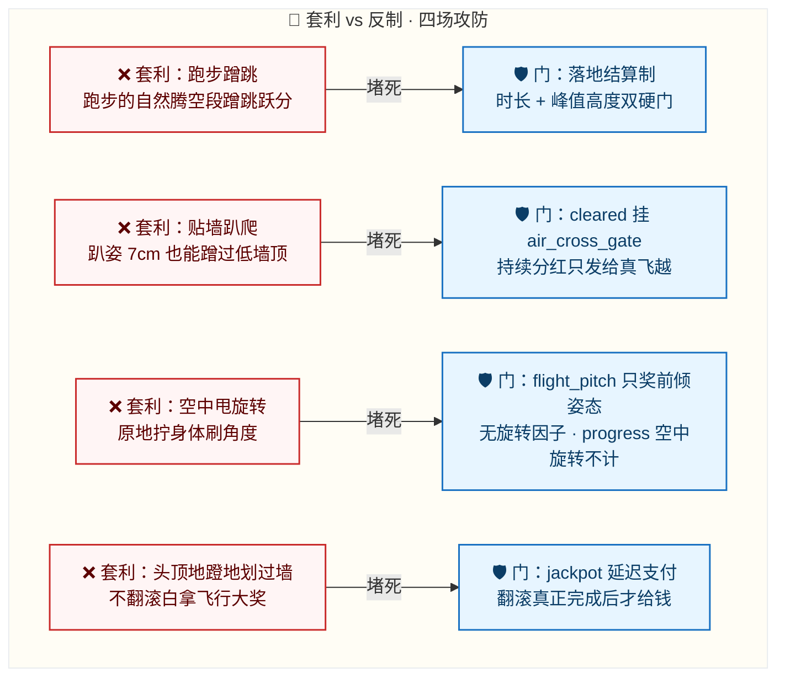

import Figure from '@site/src/components/Figure';

# MicroDuck 跳墙课程：12 步复现跑跳滚翻全链

[基础教程](./index.md)介绍了怎样训练单个动作。这一课继续把动作接起来：平地跑步 → 跳跃前扑 → 越过矮墙 → 前滚翻 → 起身继续跑。最终策略可以稳定完成 5cm 墙全链，reward 为 79.4。

<Figure caption="12 步课程全览：每格同步播放该步的验收 GIF（实时速度循环；前传·平地翻滚见下文第 0 步）" width={880}>


</Figure>

开始本课前，建议先完成[基础教程](./index.md)，了解 PPO 训练流程和奖励设计。本课代码位于 `codes/practices/humanoid/microduck-wall-curriculum/`，与基础教程使用独立的代码目录。

| 你的路线 | 需要什么 | 完成后你能做到 |
| --- | --- | --- |
| 阅读课程 | 浏览器即可 | 看懂课程表的设计逻辑与每步验收标准 |
| 动手复现 | Linux、NVIDIA GPU、约 40 GPU 小时 | 从平地翻滚跑到 5cm 墙全链，每步出自己的验收 GIF |

## 一、课程全景

**路线**：平地翻滚（前传）→ 无墙跳学校 → 1cm 真实墙 → 2cm → 起身链 → midroll 反向课程 → 全链 → 3.5cm → 5cm。

把整条动作链画成关卡图，可以看到每一步主要解决什么问题。红色虚线标出两类失败：过墙时套利，以及翻滚时卡住。



<div style={{display:'flex', gap:'8px', alignItems:'center', flexWrap:'wrap', margin:'0.75rem 0 0.25rem'}}>
  <strong>墙高课程（第 11–12 步，仅调整 SINK，reward 不变）：</strong>
  <span style={{background:'#f1f8e9', border:'1.5px solid #588157', color:'#2b4a2b', borderRadius:'12px', padding:'2px 12px', fontSize:'0.85rem'}}>0.5cm</span><span>→</span>
  <span style={{background:'#f1f8e9', border:'1.5px solid #588157', color:'#2b4a2b', borderRadius:'12px', padding:'2px 12px', fontSize:'0.85rem'}}>1cm</span><span>→</span>
  <span style={{background:'#f1f8e9', border:'1.5px solid #588157', color:'#2b4a2b', borderRadius:'12px', padding:'2px 12px', fontSize:'0.85rem'}}>2cm</span><span>→</span>
  <span style={{background:'#f1f8e9', border:'1.5px solid #588157', color:'#2b4a2b', borderRadius:'12px', padding:'2px 12px', fontSize:'0.85rem'}}>3.5cm</span><span>→</span>
  <span style={{background:'#fff9db', border:'1.5px solid #f08c00', color:'#664d03', borderRadius:'12px', padding:'2px 12px', fontSize:'0.85rem', fontWeight:'700'}}>5cm 🏆 reward 79.4</span>
  <em style={{fontSize:'0.85rem', color:'#68707d'}}>先降低墙高确认成功率，再逐步升墙；每档均通过 GIF 验收后继续</em>
</div>

**以下训练配置全程不变**：

- PPO（rsl_rl，PPOWithSymmetry），actor / critic (512,256,128) ELU，obs 归一化。
- lr 1e-3 自适应（desired_kl 0.01）、clip 0.2、entropy 0.01、γ 0.99、λ 0.95、24 steps/env。

<details>
<summary>PPO / rsl_rl / PPOWithSymmetry 分别是什么？</summary>

- **PPO**（Proximal Policy Optimization，近端策略优化）：本课使用的强化学习算法。更新时限制单次更新中策略的变化幅度（clip 0.2），避免一次更新破坏已经学会的行为。
- **rsl_rl**：PyPI 包 `rsl-rl-lib`，ETH 苏黎世机器人系统实验室（RSL）开源的强化学习库，Isaac Lab / mjlab 生态的标准训练库；`uv run train` 的训练循环就来自它（课程锁定 5.0.1）。
- **PPOWithSymmetry**：rsl_rl 的 PPO 变体，额外加入**镜像对称损失**。MicroDuck 机身左右对称：把每帧观测按左右镜像规则变换（左右腿关节互换、yaw / roll 分量取反），策略对镜像观测必须输出镜像动作，否则计入损失（权重 0.5）。其作用类似数据增广：同一份经验可同时用于学习“左腿在前”和“右腿在前”，并让步态保持左右对称。本文实验中的样本效率接近翻倍。61 维观测的完整镜像规则写在 `src/mjlab_microduck/tasks/symmetry.py`。

</details>
- Teacher-student obs：墙信息只提供给 critic；actor 不接收墙的信息，因此起跳时机依靠步数节奏，而非视觉感知。
- 每轮 6000–8000 iter（2048 envs ≈ 3h；4096 envs ≈ 2–2.5h）。

**总耗时**：按最小成功路线计算，12 轮约需 36–40 GPU 小时；把返工计算在内约 45–50h，连续训练约 2 天。加上人工查看 GIF 和验收，实际通常需要安排 4–6 天。

## 二、动手前准备

```bash
cd codes/practices/humanoid/microduck-wall-curriculum
UV_HTTP_TIMEOUT=600 uv sync --locked

# smoke test：64 envs × 5 iter，验证任务注册与墙场景加载
WANDB_MODE=offline uv run train Mjlab-RouladeDiveWall-Flat-MicroDuck \
  --env.scene.num-envs 64 \
  --agent.max-iterations 5
```

**成功信号**：终端出现训练迭代信息并正常结束。`Mjlab-RouladeDiveWall-Flat-MicroDuck` 就是课程主任务，`DIVEWALL_*` 环境变量控制课程各阶段的开关与参数，全部定义在 `src/mjlab_microduck/tasks/microduck_roulade_env_cfg.py`。

课程每步对应一个 `scripts/train_phase*.sh`：脚本 `cd` 到代码目录、设置全套 `DIVEWALL_*` 变量、从上一阶段 checkpoint 续训，结束后自动渲染回放并转出 GIF。换 warm 起点或迭代数：

```bash
LOAD_RUN=<run_dir> LOAD_CKPT=<model_XXXX.pt> MAX_ITER=8000 ./scripts/train_phaseB24_wall_school.sh
```

:::info[GIF 验收口径]

渲染验收 GIF 时，必须带上训练使用的全套 `DIVEWALL_*` 环境变量。否则墙高、出生距离或 spawn 混合比例可能不一致，回放结果不能作为该阶段的验收依据。

:::

## 三、12 步课程表（复现主表）

下面每一步都列出复现配置、warm-start 起点、迭代数和验收结果，并说明当时为什么这样调整奖励。复现结果有偏差时，可以据此判断应先检查哪一项。

### 第 0 步 · 前传：平地翻滚

**配置**：翻滚主链 progress w12 + head_pivot w4。**验收**：GIF 原地前滚翻。

**设计意图**：先把动作链后半段的翻滚单独练稳。progress 不直接按累计翻滚角度给分，而只奖励**前沿增量**；原地蹭动、来回晃动，或滚过 2π 后重复刷角度，都拿不到这部分奖励。head_pivot 用来鼓励以头部为支点的翻滚姿态。单独练稳这项技能后，后续课程重点解决过墙和起身衔接。

<Figure caption="第 0 步 · 平地前滚翻（单点技能）" width={640}>


</Figure>

### 第 1 步 · A3 跳学校

**配置**：hop_forward 权重 6→15（躯干 z>0.13 高度门）；track 2→1；vx 0.25–0.6。warm：前传 ckpt · 6000 iter。**验收**：朝墙跑 + 真跳。

**设计意图**：A 阶段曾出现“跑步比跳划算”的情况——实测跑步得分 1.16，跳跃得分 0.30，策略因而更倾向于跑步。这一步将跳跃权重提高到跑步的 3 倍，收窄速度命令范围，避免通过跑快获得更高奖励；同时增加**躯干高度门**，贴地扑腾不再被计为跳跃。heading_hold 用来约束航向，减少转头绕墙。

<Figure caption="第 1 步 · A3 跳学校：朝墙跑 + 起跳" width={640}>


</Figure>

### 第 2 步 · A4 真跳毕业

**配置**：air_time_height_credit w6 **落地结算制**（时长 + 峰值 z 双门）；overspeed −1.5；heading 6。warm：A3 · 6000 iter。**验收**：抽帧确认腾空 z≥0.14 的真跳。

**设计意图**：跑步步态也会自然腾空，如果只按是否腾空给分，跑得越快反而越容易拿到跳跃奖励。因此改为落地时统一结算，并要求腾空时长和峰值高度同时达标。overspeed 进一步限制借高速跑动获得跳跃分。这里的重点不是单纯加大跳跃奖励，而是先把“什么才算跳”定义清楚。

<Figure caption="第 2 步 · A4 真跳毕业：腾空 z≥0.14" width={640}>


</Figure>

### 第 3 步 · B5 1cm 临界墙

**配置**：出生拉近 0.40–0.65m；takeoff 60° 门；墙侧奖罚组上线。warm：A4 · 6000 iter。**验收**：cleared / flight 指标首次非零。

**设计意图**：无墙环境连续调整了 6 个版本，仍没有稳定学到真正的跳跃，因此引入 1cm 矮墙。现有的小跳已经足以越过这个高度，但要干净过墙，策略需要前倾扑出；过墙奖励由此开始与跳跃质量挂钩。出生距离缩短是为了避免助跑过长时转头绕墙。takeoff 的 60° 前倾门来自一个物理限制：**墙顶只比站立重心低约 2cm，直立起跳无法越过**，所以要求起跳时躯干已经前倾。

<Figure caption="第 3 步 · B5 1cm 临界墙：近墙扑跳" width={640}>


</Figure>

### 第 4 步 · B7 2cm 真降墙

**配置**：flight_clear_bonus 15 **一次性 latch**；cleared drip 接 air_cross_gate；墙接触 −2 / 推墙 −3。warm：B5 · 6000 iter。**验收**：8/8 干净过墙。

**设计意图**：B6 探针中，8 只里有 6 只以趴姿爬过墙。趴姿躯干约有 7cm 高，低墙无法阻止这种通过方式，起身后仍可获得过墙分红。为区分爬越和飞越，将持续分红接到 flight 的门闩 air_cross_gate 上：只有当前回合真正腾空越墙，才继续获得这部分奖励。15 分一次性大奖用于突出飞越事件，墙接触和推墙惩罚则排除扒墙翻越。

<Figure caption="第 4 步 · B7 2cm 真降墙：干净过墙" width={640}>


</Figure>

### 第 5 步 · B11 起跳质量

**配置**：takeoff vx≥0.6 + vz≥0.25 双硬门；起身四层栈铺设。warm：B7 · 6000 iter。**验收**：干净过墙——但落地躺平，暴露起身问题。

**设计意图**：此前出现过贴地平扑过墙：身体几乎没有垂直速度，也能蹭过墙顶。vz≥0.25 硬门要求先获得向上速度再前扑，否则起跳项不得分。同时打开落地姿态、直立、高度和利落度四层起身奖励。这一阶段的过墙已经稳定，但 GIF 显示落地后仍会躺平，下一步因此转向起身问题。

<Figure caption="第 5 步 · B11 起跳质量：双硬门扑跳（落地躺平暴露起身问题）" width={640}>


</Figure>

### 第 6 步 · B12 起身链激活

**配置**：rise gate 180→150°、w→3；airborne 260→180°、w→3；gate_hi 360°。warm：B11 · 6000 iter。**验收**：首次过墙后站起来。

**设计意图**：诊断探针显示，策略滚到“仰面朝天”（约 173°）就停了。从该姿态到起身，原有奖励门均尚未触发，策略在这一段收不到有效梯度。于是将 rise / airborne 的门降到仰面姿态刚出现时就能生效、权重加到 3，并把各项上界放宽到 360°，滚过头后仍能获得起身奖励。经过这些调整，策略首次在过墙后站了起来。

<Figure caption="第 6 步 · B12 起身链激活：首次过墙后站起来" width={640}>


</Figure>

### 第 7 步 · B14 填奖励真空

**配置**：preroll_kick w2（fold 0.6 + 前倾角速度 0.4，窗口 20°–150°）；stand_tax 8→3。warm：B12b · 6000 iter。**验收**：frontier 冲过约 130°。

**设计意图**：上一步主要用 stand_tax 8 惩罚躺地，B12b 刚出现的起身行为反而退化。检查动作过程后发现，“趴下→收头→蹬地起翻”之间缺少正向引导。preroll_kick 在 20°–150° 窗口内奖励两个动作：收头贴地（前滚翻过头顶的几何前提，占 0.6）和支撑面前倾角速度（从趴姿发起旋转，占 0.4）。同时将 stand_tax 降回 3，给探索留出空间。

<Figure caption="第 7 步 · B14 填真空：frontier 冲过 130°" width={640}>


</Figure>

### 第 8 步 · B18 midroll 反向课程 ★

**配置**：midroll spawn 40%（墙后 0.15–0.40m、165°–270°、2–5 rad/s 前滚初速）；overhead_drive 1.5（180–240°、接地、clip(ω/3, 0, 1)）。warm：B14 · 8000 iter。**验收**：起身链贯通。

**设计意图**：B12–B17 的调整集中在奖励侧，包括降门、加权、罚躺和放宽肩滚，但 frontier 始终卡在 90–140°。问题有两个来源：

- **梯度层**：progress 只奖励前沿增量。身体停进仰面势阱后，frontier 不再推进，每步得分恒为零，策略收不到继续发力的信号。
- **数据层**：on-policy 样本要覆盖 165° 以后的状态，策略得先自己滚到那里；它恰恰无法滚到。没有这些样本，后续训练也很难改善这一段动作。

为确认翻滚在物理上是否可行，先运行 `scripts/probe_static_roll_physics.py`，做了 76 条开环实验：从不同初始角度静止释放，逐角度记录能否滚通。实验给出三个结论：

1. 滚通在物理上可行，临界角速度约为 3 rad/s；
2. 180–220° 仰躺是稳定势阱，210°（脸朝下）是全圈最难的窗口；
3. 过了头顶之后必须持续发力，不能中途停下。

基于这些结果，B18 同时调整出生状态和奖励。**midroll spawn** 不再等策略自己滚到最难的窗口，而是把 40% 的回合直接初始化到这一段：

<Figure caption="midroll 出生采样示意：40% 的回合直接出生在翻滚后半圈" width={800}>



</Figure>

midroll spawn 不会重复发放已有进度的奖励：accumulator 从 spawn 角起算，head latch 预授，rise 时钟对 ≥260° 出生即刻启动。这样，出生状态就是“正在翻滚”的合法状态，策略可以先学最难的后半圈，再接回完整动作链。

midroll spawn 解决了样本覆盖问题，**overhead_drive** 则补上停滞时的奖励信号：在 180–240° 窗口内且身体接地时，按 clip(ω/3, 0, 1) 给分。分母中的 3 rad/s 来自上述物理扫描；停止发力就没有奖励，持续转动才能持续得分。放回整条动作链中，各奖励项负责不同的阶段：

<Figure caption="B18 奖励分工：五个奖励项覆盖不同动作阶段" width={800}>



</Figure>

正向练习和反向课程的样本来源差异如下：



经过这一轮 8000 iter，frontier 推过原先的卡点，起身链贯通。验收 GIF 中首次出现小黄鸭过墙后滚完整圈、再自己站起来的完整过程。

<Figure caption="第 8 步 · B18 midroll 反向课程：起身链贯通" width={640}>


</Figure>

### 第 9 步 · B19 全链成立

**配置**：midroll 0.4→0.22；flight_pitch 1.5（15°→60° ramp，vx≥0.5 门，**无旋转因子**）。warm：B18 · 8000 iter。**验收**：GIF 呈现跑→跳扑→滚→跑。

**设计意图**：B18 将 40% 的回合设为中间出生，前扑段的练习样本相应减少。翻滚已经学会后，这一步把比例降到 0.22，让更多回合从完整起跑开始。flight_pitch 用来提供空中保持前扑姿态的梯度，只奖励前倾角，不计旋转；B15 已经表明，空中旋转一旦计分，策略可能通过原地甩身体刷角度。至此，全链各环节都有对应的奖励支撑。

<Figure caption="第 9 步 · B19 全链成立：跑→跳扑→滚→跑" width={640}>


</Figure>

### 第 10 步 · B20 把跳做足

**配置**：takeoff 陡扑门 20/65° + w 6→12。warm：B19 · 8000 iter。**验收**：大前倾角扑出。

**设计意图**：全链已经跑通，但验收 GIF 仍显示跳得不足、跳扑衔接生硬。B16 时没有采用陡扑门，因为策略还不具备翻滚能力；到 B20，可以进一步要求前倾不到 20° 时起跳零分、65° 才拿满。这样落地时身体已翻过半，可以顺势滚过，而不是扑倒、停顿，再重新蹬腿发力。权重从 6 提到 12，则是因为探针显示该项得分趋近 0，对总奖励的贡献很小。

<Figure caption="第 10 步 · B20 陡扑：大前倾角扑出" width={640}>


</Figure>

### 第 11 步 · B21 3.5cm 墙

**配置**：reward 零改动，只升墙 `WALL_SINK=0.085`；升墙前先 probe（apex 余量 +8.4cm）。warm：B20 · 8000 iter。**验收**：3.5cm 全链稳定。

**设计意图**：这里继续遵循单变量原则。升墙前先用跳高探针测得腾空顶点余量为 +8.4cm，确认 3.5cm 墙在能力范围内；随后不改奖励，只把墙抬高。如果训练失败，也更容易判断问题是否来自墙高，而不必先排查奖励改动。

<Figure caption="第 11 步 · B21 3.5cm 墙全链" width={640}>


</Figure>

### 第 12 步 · B24 5cm（终点）

**配置**：与 B21 全同配置，唯一变量 `WALL_SINK` 0.085→0.070。warm：B21 · 8000 iter。**验收**：reward 持平无回撤。

**设计意图**：继续只改墙高。策略已在 3.5cm 墙上通过验收，这一步保持 reward 配置不变，把有效墙高从 3.5cm 提到 5cm。最终 reward 持平、没有回撤，课程到此结束。

<Figure caption="第 12 步 · B24/B22v2 5cm 终点（reward 79.4）" width={640}>


</Figure>

以下方案已在课程中验证无效，复现时可以直接跳过：B13（stand_tax 8 只有惩罚，没有正向引导）、B15（空中旋转计分被套利）、B17（瓶颈不是形态问题，放宽肩滚门无效）、B22（助跑一次拉远 2 倍，actor 看不见墙，步数节奏跟不上）、B23 方向（0 墙对照无意义）。

## 四、关键 Reward 设计速查

下图把过墙落地后的翻滚按角度拆开，标出各奖励项的作用区间和此前训练中的卡点。这里的**翻滚角**指身体翻转的角度：0° 为直立，360° 为滚完一圈重新站起。

<Figure caption="翻滚一圈的奖励地图：姿态、窗口分工与历届卡点" width={800}>



</Figure>

图中的鸭子图标表示对应角度的姿态，彩色横带表示各奖励项的生效区间，红色三角标出此前训练实际卡住的位置。三个术语需要区分：

- **翻滚角（accum）**：从过墙落地那一刻起累计的身体翻转角度，只增不减，是整个起身链的进度条。
- **前沿（frontier）**：已经付过分的翻滚进度。progress 只奖励前沿向前推进的增量，原地不动或来回晃动都拿不到分。
- **奖励真空**：某个区间没有任何奖励项生效，动作改进也不会反映到得分上，策略因而得不到有效梯度。此前几个卡点都位于这类区间附近。

| 翻滚角 | 动作阶段 | 主要奖励 | 引入步骤 |
| --- | --- | --- | --- |
| 0–20° | 刚越过墙落地，身体直立 | progress：只有“比上一步滚得更多”才付增量 | 第 0 步 |
| 20–150° | 前扑、收头折叠、准备起翻 | preroll_kick：收头贴地（占 0.6）＋ 蹬地发力（占 0.4） | 第 7 步 |
| 150–260° | 翻过仰面、脸朝下趴着——全程最难的势阱 | rise / airborne 起身栈提前解锁 ＋ overhead_drive 给持续发力奖励 | 第 6、8 步 |
| 260–360° | 起身、站直、继续跑 | 起身四层栈（落地姿态 / 直立 / 高度 / 利落度） | 第 5、6 步 |

- **翻滚主链**：progress 按 Δfrontier 付增量、单步封顶 3 rad/s；全部翻滚奖励过 `_past_wall_mask` 门 + accumulator 门控（空中旋转不计分）。墙前翻滚不得分，翻滚必须发生在墙后才结算。
- **防套利设计**：四种常见捷径与对应限制如下（红色为套利路径，蓝色为反制门）。



- **一次性大奖**：wall_flight_clear_bonus 15，latch 只付一次。稀疏的大事件由它提供信用分配目标，日常 shaping 则由 takeoff / flight 等密集项承担。
- **B24 最终配置**：`B1=0, B3=1, B17=0, B18=1 (MIDROLL_FRAC=0.22), B21=1 + WALL_SINK=0.070, WALL_DIST=0.40,0.65, POSTDIVE_PROB=0`。

<details>
<summary>想看每一项的完整推导？</summary>

课程期间的 reward 调整记录（包括改动原因、失败归因和 W&B 曲线解读）保留在作者的训练日志中；本节只列出复现所需的主要内容。

</details>

## 五、课程设计与复现的 10 点经验

1. **一次只动一个变量**：B24 只改 SINK。同时修改多个奖励或环境参数，失败后很难定位原因。
2. **先验收，再升档**：每档训练 6000–8000 iter，确认 GIF 中的动作合格后再继续。warm-start 选择能力已经验证的 ckpt，不使用已经退化的 ckpt。
3. **先检查物理可行性**：翻滚卡住时，76 条开环静态物理扫描比继续盲目调奖励更快给出了方向。升墙前，也先用探针检查跳高临界和 apex 余量。
4. **确认奖励能够触发**：flight 高度门 0.14 与站立 COM 0.146 的对比说明，门限设置不当会让目标行为长期拿不到奖励。
5. **先检查奖励是否容易被套利**：课程中就出现过把跑步的自然腾空计成跳跃的情况。
6. **惩罚要配合正向引导**：只提高 stand_tax 会压制刚出现的起身行为；加入 preroll_kick 后，才有了“趴下→收头→蹬地起翻”的正向信号。
7. **从关键中间状态练起**：midroll spawn 先覆盖最难的后半圈，再逐步降低比例、接回完整动作。
8. **课程跨度要小**：环境变化如果打乱策略原有的步数计时节奏，整条动作链可能失效。
9. **不要只看训练曲线**：最终动作要用 GIF 回放验收。reward 高，不代表步态自然或动作衔接正确。
10. **注意配置块的覆盖顺序**：env_cfg 后写入的块会覆盖前面的配置。修改环境参数后，先用探针验证，再开始长训。

## 六、素材、来源与边界

本页 GIF 均为课程收官时的验收素材，来自作者 run15 系列的训练与回放；集成进教程时未重新逐帧复核。复现时，请以你自己训练出的、带全套 `DIVEWALL_*` 配置渲染的 GIF 为验收依据。

- 代码：`codes/practices/humanoid/microduck-wall-curriculum/`。
- 兼容组合与回归测试见代码目录的 `README.md`；性能配置（4096 envs、njmax 128）的由来见 `docs/perf/`。
- 许可证：代码 Apache-2.0；3D 模型文件按上游说明使用 CC BY-SA-NC。
- 相关背景：[基础教程](./index.md)与[实验记录](./experiment-notes.md)。
