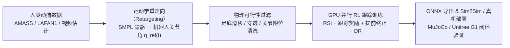

# 人形全身运动跟踪（Motion Tracking）

只靠手工设计奖励函数（如速度跟踪 + 抬脚高度），很难让 20–30+ 自由度的人形机器人自然地完成挥手、下蹲、转身、舞蹈或跑酷等复杂动作。**全身运动跟踪（Whole-Body Motion Tracking / DeepMimic 范式）** 通过将人类动作捕捉（MoCap）轨迹重定向到机器人本体，让强化学习策略在物理约束下追踪参考运动，是当前通用人形运动控制的主流基座。

## 1. 完整技术链路总览 \{#pipeline}

## 2. 第一步：动捕数据与运动学重定向 \{#retargeting}

常用公开动捕来源包括 **AMASS**（覆盖海量日常行走、跑跳、抓取与体操动作）与 **LAFAN1**（高质量长序列运动与转身）。由于人体与机器人（如 Unitree G1 / H1）在身高、腿长比例和自由度分布上存在差异，直接拷贝关节角会导致严重的足底悬空或穿透，通常采用**优化式重定向**：

1. **尺度对齐**：按骨盆高度与腿长比例缩放人类根部平移轨迹 $\mathbf{p}_{\text{root}}^{\text{human}}(t)$。
2. **关键点逆运动学优化**：在每一帧求解机器人广义坐标 $\mathbf{q}_{\text{ref}}(t)$，最小化关键链接（骨盆、双脚、双手、头部）的三维位置与朝向误差，同时施加关节限位与时间平滑正则项：

$$\min_{\mathbf{q}_t} \sum_{k \in \mathcal{K}} w_k \|\mathbf{p}_k^{\text{robot}}(\mathbf{q}_t) - \mathbf{p}_k^{\text{target}}(t)\|^2 + \lambda_{\text{smooth}} \|\mathbf{q}_t - \mathbf{q}_{t-1}\|^2$$

3. **轨迹清洗**：剔除重力物理明显不可行（如长时间单脚悬空静止）或频繁自碰撞的片段，并统一插值到策略控制频率（如 50 Hz）。

## 3. 第二步：RL 跟踪训练的四个关键机制 \{#rl-tracking}

运动跟踪能否收敛出自然流畅且鲁棒的动作，取决于四个核心设计：

### ① 参考状态初始化（RSI, Reference State Initialization）
- 如果每次 episode 都从第 0 帧静止站姿起步，策略往往卡在前半段、根本探索不到后半段高难动作。
- **RSI 做法**：每次 reset 随机从参考轨迹中均匀（或按失败率加权）采样时刻 $t_0$，直接把机器人的 `qpos / qvel` 初始化到参考帧 $\mathbf{q}_{\text{ref}}(t_0), \dot{\mathbf{q}}_{\text{ref}}(t_0)$，大幅提升长序列学习效率。

### ② 提前终止（Early Termination）
- 当机身关键部位非预期触地，或根部/关键点相对参考轨迹的误差超过安全阈值（如位置误差 `> 0.25–0.5 m`）时立即终止本轮。这能避免策略把大量样本浪费在“摔倒后胡乱挣扎”的垃圾状态上。

### ③ 分层高斯跟踪奖励
将关节、关键点、根部位姿与速度误差统一映射为有界指数奖励，并叠加正则项防止高频抖动：

$$r_{\text{track}} = w_q \exp(-\alpha_q \|\mathbf{q} - \mathbf{q}_{\text{ref}}\|^2) + w_{\dot{q}} \exp(-\alpha_{\dot{q}} \|\dot{\mathbf{q}} - \dot{\mathbf{q}}_{\text{ref}}\|^2) + w_{\text{ee}} \exp(-\alpha_{\text{ee}} \|\mathbf{p}_{\text{ee}} - \mathbf{p}_{\text{ee,ref}}\|^2) + w_{\text{root}} r_{\text{root}}$$

- **相干动作观测**：Actor 观测除当前本体状态（角速度、重力投影、关节位置/速度、上一步动作）外，还需输入**未来若干帧参考目标**（如未来 $0.02\text{ s}, 0.1\text{ s}, 0.2\text{ s}$ 的相对位姿/关节角）或相位编码 $(\sin \phi, \cos \phi)$，使策略能够提前预判发力。

### ④ 面向部署的域随机化与 Teacher-Student 蒸馏
- 单纯跟踪干净参考轨迹的策略极易过拟合仿真物理；必须结合质量/惯量、地面摩擦、执行器延迟和随机推撞做域随机化。
- 若使用特权信息（如世界系根速度、全局位置）训练 Teacher，部署前需通过 DAgger / 行为克隆蒸馏为仅依赖机载本体感知与目标指令的 Student 策略。

## 4. 工程落地与本仓库延伸实践 \{#practice}

- **从步态跟踪起步（Unitree G1 12-DoF 周期相位策略）**：周期步态本质上是“简化版相位跟踪”——通过输入 $(\sin(2\pi t / T), \cos(2\pi t / T))$ 驱动左右腿交替摆动与支撑，仅需 47 维本体观测 + 轻量 LSTM 即可在 MuJoCo 中实现前后、横移、转向与原地站立的稳健行走。
- **进阶长链技能课程**：如果你希望不依赖动捕数据、通过课程学习自发涌现复杂动作（如跑跳越墙、前滚翻与自主起身），强烈建议对照精读 [MicroDuck 12 步跳墙课程](/docs/practices/humanoid/microduck-rl/wall-curriculum) 中的奖励防套利与反向课程设计。
- **跨仿真验证**：导出 ONNX 并在 MuJoCo 中逐帧核对跟踪误差，方法详见 [Sim2Sim 验证实战指南](/docs/practices/quadruped/sim2sim/placeholder) 与 [Flamingo ONNX 导出与 MuJoCo Sim2Sim](/docs/practices/humanoid/flamingo-isaaclab/onnx-and-sim2sim)。
