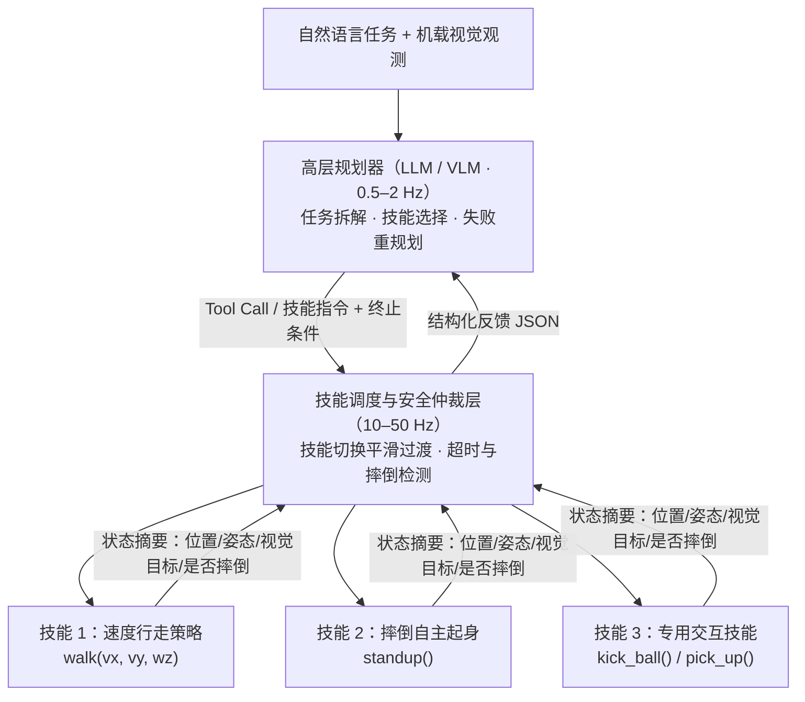

# 双足高层任务规划与技能编排

强化学习运控能让双足机器人走得稳、跳得过墙、摔倒后自己爬起来，但它本身并不理解“把地上的球踢到红框里”这类多步语义任务。要让机器人完成长时程复杂任务，主流工程方案是**“快慢系统分层架构”**：高层多模态大模型负责语义理解与步骤编排（1–5 Hz），底层 RL / 控制技能库负责实时全身平衡与动作执行（50–1000 Hz）。

## 1. 分层任务规划架构 \{#hierarchical-architecture}

## 2. 技能原语（Skill Primitives）设计原则 \{#skill-primitives}

直接让大模型输出 12–29 维关节目标既慢又不安全；正确做法是将底层策略封装成**语义清晰、自带安全边界和返回状态的工具函数**：

| 技能原语 | 典型输入参数 | 内部实现 | 必须返回的结构化反馈 |
| :--- | :--- | :--- | :--- |
| `walk_to(dx, dy, dyaw)` | 相对目标位姿与超时时间 | 底层 RL 速度跟踪策略 + 比例航向伺服 | `status`（到达/超时/摔倒）、实际位移、当前机身直立度 |
| `look_at(pitch, yaw)` | 头部目标角度 | 颈部/头部位置跟踪接口（如 MicroDuck 4D head_pose） | 目标视野图像、是否检测到目标物体 |
| `stand_up()` | 无 | 专用起身 RL 策略（切换回行走前需稳定站姿） | 是否恢复直立（`upright > 0.85`）、机身高度 |
| `execute_skill(name)` | 技能名（如 `kick`、`pick`） | 加载对应 ONNX 权重并执行动作序列 | 成功标志、视觉验证结果 |

### 技能切换的工程关键点：无缝衔接（Skill Transition）
- **切入前置条件（Precondition）**：任意技能启动前校验状态（例如未处于直立状态时，调度层必须强制拦截 `walk_to` 并优先触发 `stand_up()`）。
- **动作过渡平滑**：在不同 ONNX 策略之间切换的 0.2–0.5 s 内，对目标关节角做线性或指数插值（EMA），同时重置新策略的历史动作缓存与步态相位，避免电机瞬时阶跃冲击。

## 3. ReAct 闭环与异常重规划 \{#replanning}

真实环境必然出现意外（推撞摔倒、目标被踢偏、视野遮挡）。高层规划不能做成一次性开环脚本，而应采用 **Observe → Think → Act → Verify** 循环：

1. **视觉与本体状态摘要**：每次技能执行完毕或触发中断（如 `upright < 0.5` 判定摔倒）时，向规划器回传精简的结构化 JSON + 关键帧图像。
2. **保护性自动恢复**：低层安全中断（摔倒、关节过温）由调度层直接触发确定性恢复技能（`stand_up()`），恢复后再把控制权交还高层规划器决定是否继续原目标。
3. **步数与超时护栏**：为单个子技能与整条任务链设置最大重试次数与步数预算，防止大模型陷入死循环。

## 4. 仓库内可直接动手复现的关联项目 \{#hands-on}

本仓库已提供三条从易到难的“高层智能 + 底层运控”实战链路，覆盖不同技术范式：

- **LLM Tool Calling + 视觉闭环**：[CS123 第 7 章：语言控制](/docs/practices/quadruped/cs123/llm-control) 与 [第 8 章：视觉感知追球](/docs/practices/quadruped/cs123/perception) —— 完整展示如何将底层步态封装为 Tool API，用 Function Calling / ReAct 循环拆解多步动作。
- **多技能底层库构建**：[MicroDuck RL（18 个动作模式）](/docs/practices/humanoid/microduck-rl/) —— 训练行走、起身、拾取、踢球与翻滚等独立技能权重，为高层调度提供真实技能池。
- **端到端轻量 VLA 分层**：[Petoi Quaddle VLA 导航训练](/docs/practices/vla/quaddle/) —— 用 SmolVLA（高层视觉-语言策略）+ 查表 CPG（底层运控）在 10 GB 显存下打通“导航 → 避障 → 组合任务”闭环。
