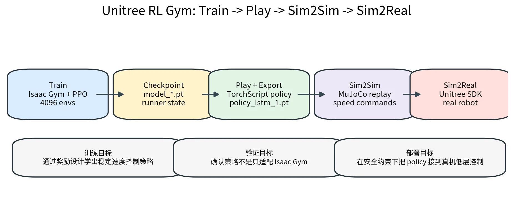
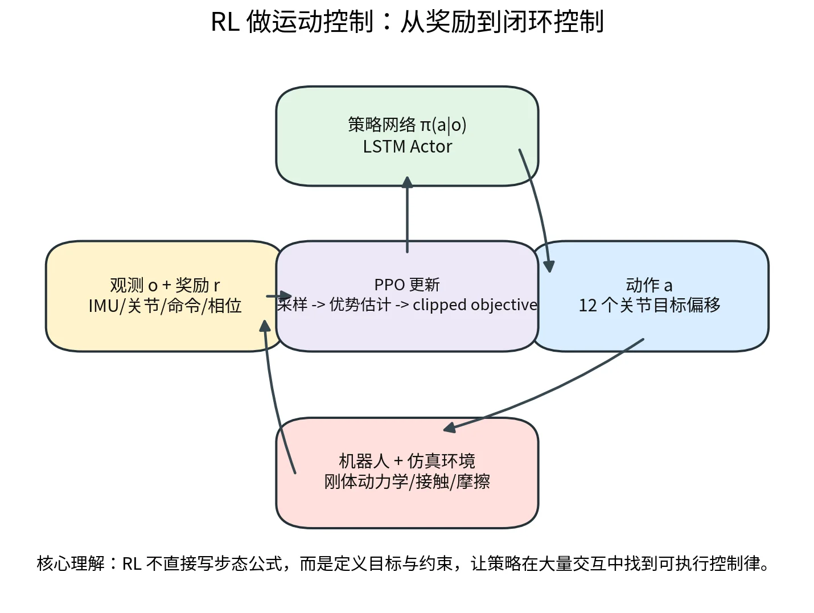
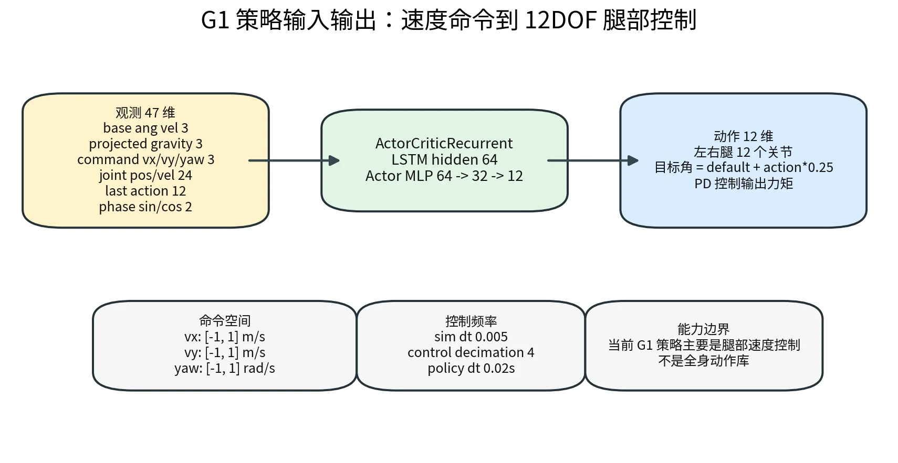

# Unitree G1 人形运控实战

相比四足机器人天然具备宽大的多点支撑多边形，**全尺寸双足人形机器人**每迈出一步都在主动打破并重建动态平衡。本专题以 **Unitree G1（12 自由度下肢锁定上身构型为主线，并延伸至 29-DoF 全身控制）** 为载体，完整打通从**大规模 GPU 并行强化学习训练、16 项奖励动力学拆解、两级 MuJoCo Sim2Sim 与浏览器实时 LSTM 推理，到 AMP 动作模仿、趴地起身（Get-Up）与 NVIDIA GR00T Whole-Body Control（SONIC）** 的工程全链路。

:::tip[零配置立刻试玩 Unitree G1！]
无需安装任何环境：直接打开 [在线仿真实验室](/simulation)，在左侧选择 **Unitree G1**，即可在浏览器里以 50 Hz 实时运行本专题导出的无状态 LSTM 行走策略，体验前后左右行走、原地转向以及 **外力推撞（快捷键 `P`）** 后的实时跨步恢复！
:::

## 1. 全链路工程闭环与硬件/模型规格 \{#overview}

G1 运控从仿真训练走向实机部署，通常经过五个严格衔接的阶段：

| 维度 | 本专题 12-DoF 走路基线（`unitree_rl_gym`） | 29-DoF 全身扩展（`unitree_rl_mjlab` / `GR00T-WBC`） |
| :--- | :--- | :--- |
| **活动自由度** | 12 自由度（每条腿 `hip_pitch / roll / yaw`、`knee`、`ankle_pitch / roll`） | 29 自由度（下肢 12 + 腰部 3 + 双臂 14） |
| **策略网络** | 循环神经网络 **LSTM**（隐状态 64 维，47 维观测 → 12 维动作） | MLP / 历史堆叠 / Latent Token 解码（SONIC） |
| **物理 / 控制频率** | 仿真 `500 Hz`（`2 ms`），策略 `50 Hz`（`decimation = 10`） | 仿真 `200–500 Hz`，策略 `50 Hz`，电机内环 `10–20 kHz` |
| **底层执行方式** | 关节 PD 转力矩（髋 `100/2`、膝 `150/4`、踝 `40/2`） | 同型 PD + DDS `LowState / LowCmd` 通信 |
| **足底接触建模** | 每只脚 4 个原始球形接触点（`r = 5 mm`） | 完整足底碰撞几何 + 域随机化摩擦 |

### 10,000 轮训练核心基线实测（单卡 GPU）

| 核心指标 | 实测数值 | 工程含义 |
| :--- | :---: | :--- |
| **总训练迭代数** | `10,000` | 覆盖初期站稳、中期提速与后期正则再平衡 |
| **后期吞吐（最后 500 轮均值）** | `122,644 FPS` | 大规模并行仿真使万轮训练可在单晚完成 |
| **Episode Length 首次满长（1000 步 / 20 s）** | 第 `1,135` 轮 | 先学会“不摔倒”（`423` 轮破 200 步，`664` 轮破 900 步） |
| **Mean Reward 首次破 `20`** | 第 `1,762` 轮 | 明显晚于满长存活——**先活着，再走得好** |
| **峰值 / 最终 Mean Reward** | `23.110`（第 5,285 轮）/ `20.358` | 后期出现正则项与探索的再平衡波动，属正常现象 |
| **浏览器无状态 ONNX 体积与精度** | `127 KB`，`max_err = 1.19e-6` | 27 个 STL 网格由 `24.0 MB` 轻量化至 `1.49 MB` |

## 2. 控制闭环与策略输入输出契约 \{#io-contract}

理解人形策略部署，最核心的是把**观测向量、历史隐状态、动作缩放和 PD 力矩**四件事逐维对齐：

- **47 维观测向量顺序**：`omega(3) × 0.25` → `projected_gravity(3)` → `cmd(3) × [2.0, 2.0, 0.25]` → `(q - q_default)(12) × 1.0` → `dq(12) × 0.05` → `last_action(12)` → `[sin(2πφ), cos(2πφ)](2)`（步态相位周期 `T = 0.8 s`）。
- **动作映射**：$q_{\text{target}} = q_{\text{default}} + 0.25 \cdot a_t$，再由各关节 PD 刚度/阻尼算出力矩送入 MuJoCo `<motor>` 执行器。

## 3. 章节导航 \{#chapters}

| 章节 | 核心内容 | 重点产出 |
| :--- | :--- | :--- |
| **[1. 奖励函数深度拆解与 10,000 轮训练动力学](./reward-and-training.md)** | 16 项奖励按 6 大功能分组、公式与权重符号对照、阶段热力图与 8,000 轮后回落归因 | 掌握人形双足奖励防崩与曲线诊断方法 |
| **[2. MuJoCo Sim2Sim 多速度验证与浏览器 LSTM 部署](./sim2sim-and-web.md)** | `0.2 / 0.5 / 0.8 m/s` 步态对比、两级 Sim2Sim（单进程 vs DDS）、无状态 LSTM ONNX 导出与网格轻量化 | 跑通从 `.pt` 到浏览器 WASM 与 DDS 的跨引擎闭环 |
| **[3. 进阶拓展：AMP 动作模仿、起身（Get-Up）与 GR00T WBC](./whole-body-extensions.md)** | 忠实复现 AMP 的真实踩坑（含 RSI 瞬移假象避坑铁律）、HoST/HumanUP 防空翻起身设计、SONIC Latent Action 架构 | 理解双足行走之后的全身控制前沿路线与算力边界 |

---

下一步：[1. 奖励函数深度拆解与 10,000 轮训练动力学 →](./reward-and-training.md)
