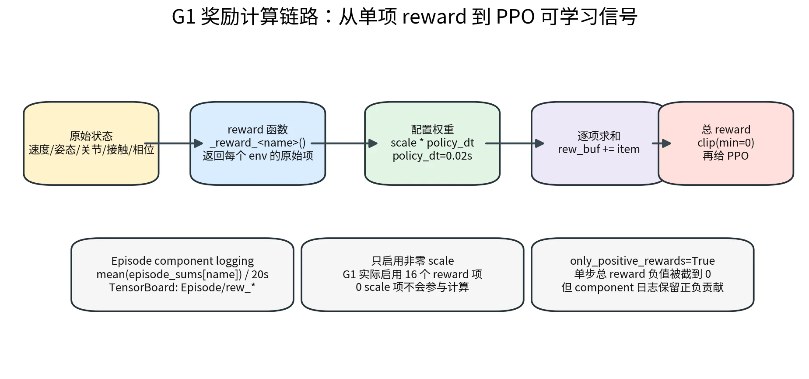
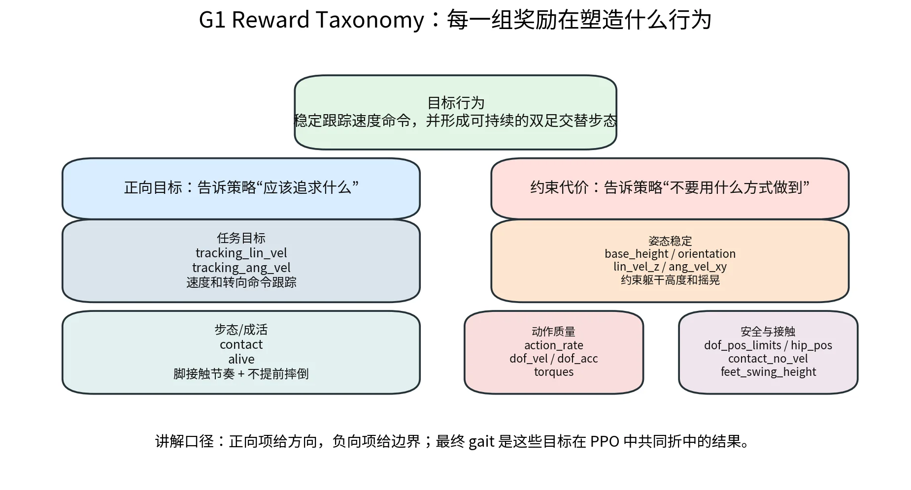
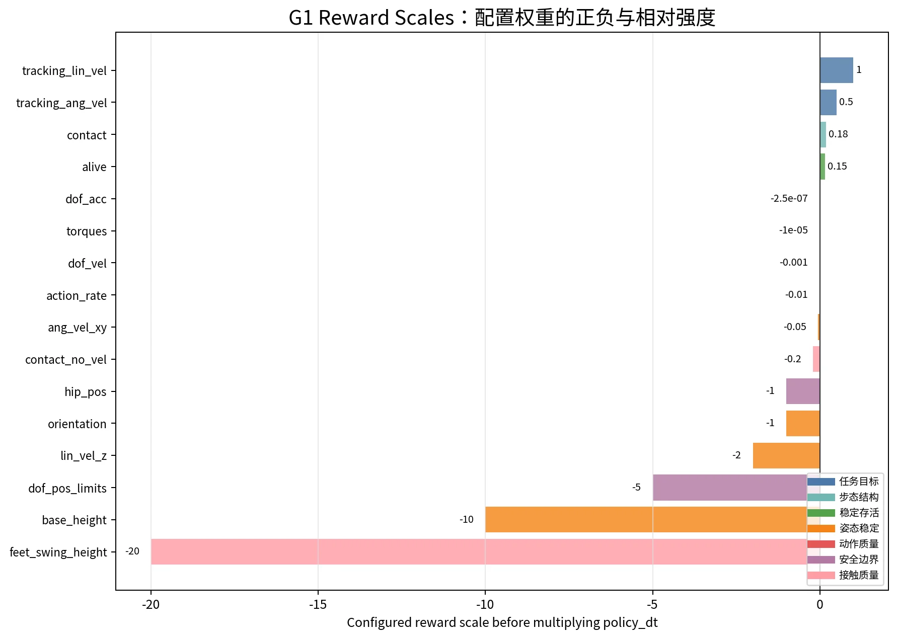
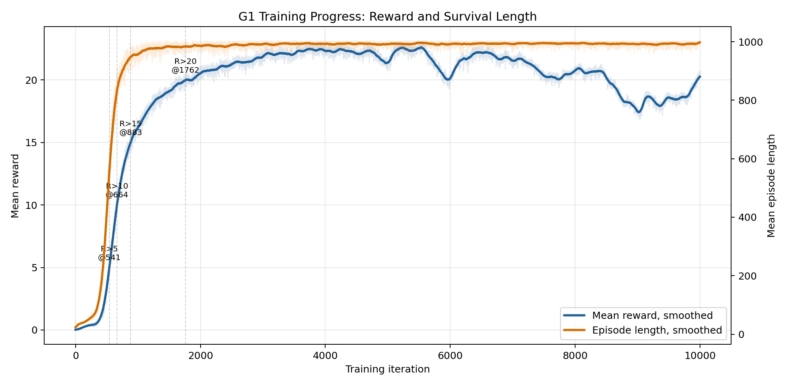
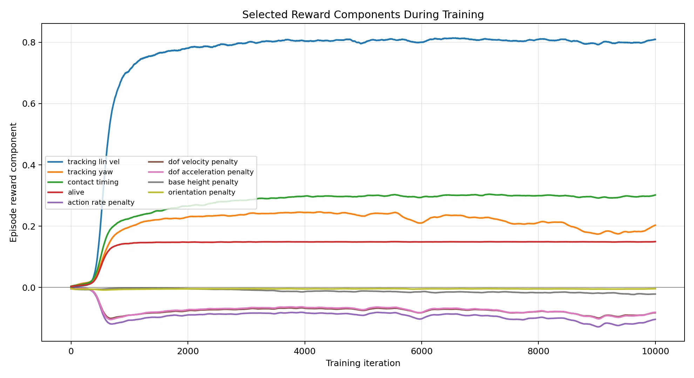
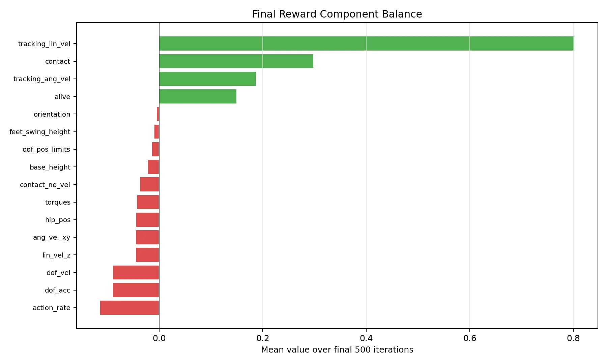
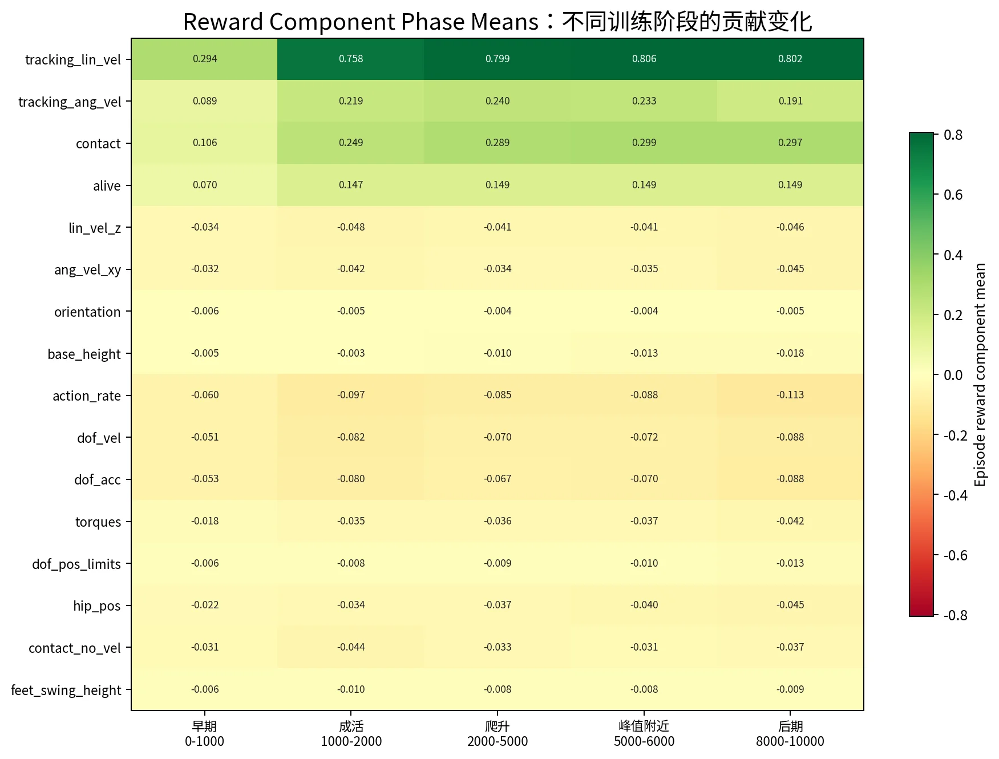
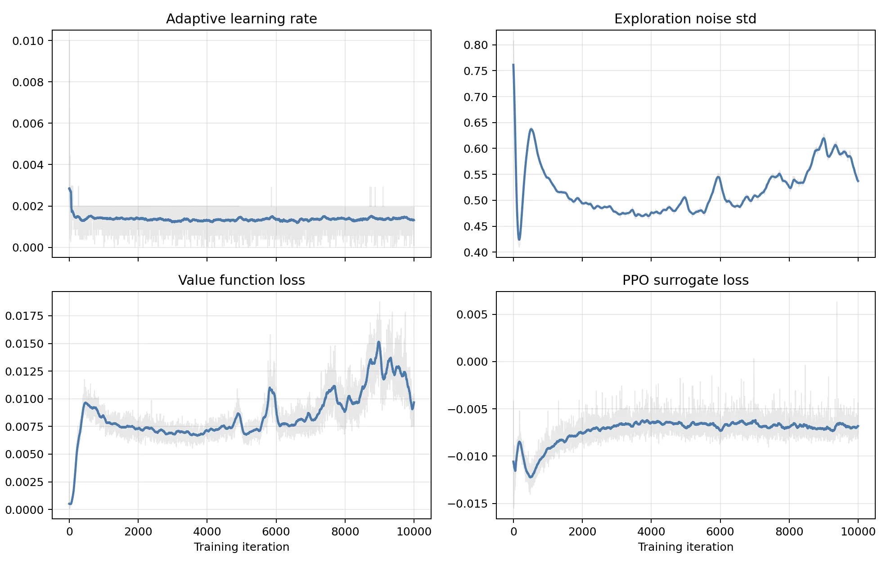
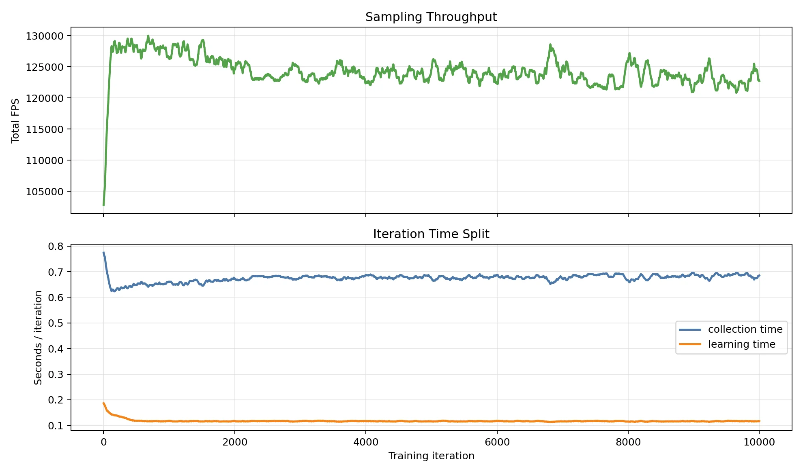

# 1. 奖励函数深度拆解与 10,000 轮训练动力学

很多人调人形双足强化学习，最容易陷入“盲改权重”的死循环：把速度跟踪调大，机器人就劈叉猛冲；把姿态惩罚调大，机器人就站在原地一动不动。本章基于 Unitree G1 一套完整的 **10,000 轮并行 PPO 训练日志**，逐项拆解 16 个奖励函数如何共同塑造出稳定的双足步态。

## 1. 奖励计算管线与 6 大功能分组 \{#reward-taxonomy}

在 `unitree_rl_gym` 中，每个控制步（`dt = 0.02 s`）都会计算 16 个子奖励项，分别乘以 `scale * dt` 后求和；若配置了 `only_positive_rewards = True`，还会对负总和截断以防策略“主动早死自杀”：

这 16 项并非随意堆砌，而是清晰地分为 **6 个功能模块**（4 个正激励项 + 12 个负正则/约束项）：

| 奖励项 | 功能分组 | 权重 `scale` | 数学形式 | 工程意图 |
| :--- | :--- | :---: | :--- | :--- |
| `tracking_lin_vel` | 任务目标 | `+1.0` | $\exp(-\|v_{xy}^* - v_{xy}\|^2 / \sigma)$ | 主驱动：奖励前进、后退与横移速度跟踪 |
| `tracking_ang_vel` | 任务目标 | `+0.5` | $\exp(-(\omega_z^* - \omega_z)^2 / \sigma)$ | 奖励偏航角速度跟踪（原地转与弯道行进） |
| `contact` | 步态结构 | `+0.18` | $\sum_i \mathbb{I}(\text{contact}_i = \text{stance}_i)$ | 将足底触地与时钟相位对齐，显式塑造左右交替步态 |
| `alive` | 稳定存活 | `+0.15` | $1.0$ | 未提前终止即给分，在训练早期强力拉升存活时长 |
| `lin_vel_z` | 姿态稳定 | `-2.0` | $v_z^2$ | 抑制躯干上下剧烈弹跳 |
| `ang_vel_xy` | 姿态稳定 | `-0.05` | $\omega_x^2 + \omega_y^2$ | 抑制机身 roll / pitch 晃动 |
| `orientation` | 姿态稳定 | `-1.0` | $g_x^2 + g_y^2$ | 通过投影重力惩罚机身前倾/侧倾 |
| `base_height` | 姿态稳定 | `-10.0` | $(z_{\text{base}} - 0.78)^2$ | 将骨盆高度锚定在 `0.78 m` 附近，防止深蹲或蹦跳 |
| `action_rate` | 动作质量 | `-0.01` | $\sum (a_{t-1} - a_t)^2$ | 惩罚连续控制步动作突变，抑制抖动 |
| `dof_vel` | 动作质量 | `-0.001` | $\sum \dot{q}^2$ | 惩罚过高关节转速，避免高频甩腿 |
| `dof_acc` | 动作质量 | `-2.5e-7` | $\sum ((\dot{q}_t - \dot{q}_{t-1})/\Delta t)^2$ | 抑制关节加速度冲击 |
| `torques` | 动作质量 | `-1e-5` | $\sum \tau^2$ | 降低峰值功耗与无效发力 |
| `dof_pos_limits` | 安全边界 | `-5.0` | $\sum d_{\text{soft\_limit}}$ | 惩罚逼近软关节限位，保护硬件安全 |
| `hip_pos` | 安全边界 | `-1.0` | $\sum q_{\text{hip\_roll/yaw}}^2$ | 限制髋部过度外八/内扣 |
| `contact_no_vel` | 接触质量 | `-0.2` | $\sum \mathbb{I}_{\text{contact}}\|v_{\text{foot}}\|^2$ | 支撑脚触地时惩罚滑移速度 |
| `feet_swing_height` | 接触质量 | `-20.0` | $\sum_{\text{swing}} (z_{\text{foot}} - 0.08)^2$ | 约束摆动脚抬脚高度至约 `8 cm`，既不拖脚也不猛踢 |

:::info[别只看 scale 数字：先看乘以量纲后的真实贡献]
看权重绝对值最容易踩的坑是**忽视量纲差异**：`dof_acc` 权重只有 `-2.5e-7`，但关节加速度平方量级可达 $10^5$；`feet_swing_height` 权重高达 `-20.0`，但 $(0.08\text{ m})^2 = 0.0064$。判断某一项是否过重，**必须看训练日志里乘以量纲后的实际贡献值，而不是只看配置里的 `scale` 数字**。
:::

## 2. 10,000 轮训练曲线：先学会“活着”，再学会“走得好” \{#training-dynamics}

观察整体回报与回合长度曲线，可以清晰看到双足 PPO 学习的三个典型阶段：

| 里程碑 | 首次达标轮次 | 行为特征 |
| :--- | :---: | :--- |
| `episode_length ≥ 200`（4 s） | 第 `423` 轮 | 摆脱随机乱踢，开始勉强维持直立 |
| `episode_length ≥ 500`（10 s） | 第 `517` 轮 | 能在低速下连续迈步不摔倒 |
| `reward ≥ 10` & `length ≥ 900` | 第 `664` 轮 | 步态节奏成形，偶发跌倒大幅下降 |
| `episode_length ≥ 1000`（满长 20 s） | 第 `1,135` 轮 | **存活基本通关**，几乎不再因摔倒提前终止 |
| `reward ≥ 20` | 第 `1,762` 轮 | 速度跟踪精度与步态平滑度同步提质 |
| 峰值 `reward = 23.110` | 第 `5,285` 轮 | 达到全程最高综合分（平滑峰值 `22.614` @ `5,539`） |

一个极具价值的工程现象出现在 **第 8,000 轮之后**：平滑总回报从 `22.6` 附近下探到最低 `17.42`（第 `9,021` 轮），随后回升到最终 `20.36`，但同期 **`episode_length` 始终稳稳贴在 `993–1002` 满长上限**。这说明后期回报波动**不是“重新开始摔倒”**，而是速度跟踪、动作平滑与探索噪声之间的动态再平衡。

## 3. 各奖励项的演进与最终贡献结构 \{#component-balance}

把核心子奖励项随训练轮次展开，再配合阶段热力图，就能直观看到“哪个阶段靠什么拿分”：

在最后 500 轮的稳态分布中：
- **四大正贡献**构成了清晰的“任务主驱动 + 节奏护航”结构：`tracking_lin_vel`（`+0.802`）> `contact`（`+0.298`）> `tracking_ang_vel`（`+0.187`）> `alive`（`+0.149`）。
- **主要正则代价**集中在控制平滑度：`action_rate`（`-0.114`）、`dof_acc`（`-0.089`）、`dof_vel`（`-0.088`）、`lin_vel_z`（`-0.045`）、`ang_vel_xy`（`-0.045`）、`hip_pos`（`-0.045`）和 `torques`（`-0.043`）；而 `orientation`（`-0.0045`）与 `feet_swing_height`（`-0.0094`）几乎压到零，说明机身直立度与抬脚高度已被策略牢牢收敛。

## 4. 学习动力学与并行吞吐诊断 \{#learning-and-fps}

除了看 reward，排查 PPO 训崩还必须盯住 **探索噪声 `noise_std`、KL 散度自适应学习率与仿真吞吐 FPS**：

- **自适应学习率（`schedule = adaptive`）**：按目标 KL 自动微调学习率，最终稳定在 `1.30e-3`；探索标准差从 `1.0` 收敛到 `0.41–0.53` 区间，既保持策略确定性又避免过早塌缩。
- **吞吐分布**：后期平均 `122,644 FPS`，绝大多数时间花在 GPU 物理前向与策略采样，单次 PPO 更新耗时占比极低——这也是做万轮迭代和消融实验的工程底气。

---

上一步：[← Unitree G1 总览](./index.md) · 下一步：[2. MuJoCo Sim2Sim 多速度验证与浏览器 LSTM 部署 →](./sim2sim-and-web.md)
