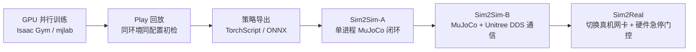

# 2. MuJoCo Sim2Sim 多速度验证与浏览器 LSTM 部署

训练日志里回报超过 `20` 绝不意味着策略可以直接上真机。不同物理引擎（Isaac Gym / MuJoCo Warp vs 标准 MuJoCo CPU）在接触求解、阻尼积分、传感器噪声与推理链路上的细微差别，足以让一条在训练器里走满 20 秒的策略在部署环境里 2 秒就翻车。本章走通 **两级 Sim2Sim 验收** 与 **浏览器端无状态 LSTM ONNX 部署**。

## 1. 两级 Sim2Sim 验证架构 \{#two-stage-sim2sim}

在 `humanoid-simulation` 与 `unitree_rl_gym` 工程实践中，推荐把 Sim2Sim 明确拆成两层，每层只验证一个问题：

| 阶段 | 核心验证目标 | 典型排错重点 |
| :--- | :--- | :--- |
| **Sim2Sim-A（单进程 MuJoCo）** | 策略本身、47 维观测拼装、关节顺序、PD 刚度/阻尼与 50 Hz 节拍是否跨引擎一致 | 关节序错位、投影重力符号、四元数 `wxyz/xyzw` 约定、未清零的 `last_action` |
| **Sim2Sim-B（DDS 通信双进程）** | 仿真进程与控制器进程通过 `Unitree SDK2 / DDS` 收发 `LowState` 与 `LowCmd`，模拟真实通信链路 | 进程调度抖动、消息丢包超时看门狗、零指令稳停与遥控器模式切换 |

## 2. 多速度档位 Sim2Sim 实测对照 \{#speed-comparison}

为了避免“只测一个速度看起来还行”，我们对同一份训练策略在 MuJoCo 中固定测试 **低速（`0.2 m/s`）、中速（`0.5 m/s`）、高速（`0.8 m/s`）** 三档前向指令：

| `vx = 0.2 m/s`（低速稳步） | `vx = 0.5 m/s`（常规巡航） | `vx = 0.8 m/s`（快速行进） |
| :---: | :---: | :---: |
|  |  |  |

实测中应重点观察三点：
1. **步幅与步频随速度单调变化**：`0.2 → 0.5 → 0.8 m/s` 步幅明显拉大，但躯干俯仰角波动仍保持极小（`min_up > 0.996`）。
2. **全向与静止能力齐备**：除前向加速外，后退（`-0.2 m/s`）、横移（`±0.2 m/s`）、原地转向（`±0.5 rad/s`）与零速指令均需连续 6 秒无跌倒、无明显原地打转漂移。
3. **外力推撞恢复**：行走中施加 `0.55 m/s` 瞬时侧向速度冲量后，策略能否通过主动跨步重新把骨盆拉回直立姿态。

## 3. 把循环策略（LSTM）导出到浏览器 ONNX Runtime Web \{#web-lstm-onnx}

`unitree_rl_gym` 默认导出的 `policy_lstm_1.pt` 是**有状态 TorchScript 模型**（把 LSTM 隐状态 `hidden_state / cell_state` 存在模块内部缓冲区），无法直接被浏览器里的 `onnxruntime-web` 跨步加载或干净重置。

我们在本仓库 [codes/practices/humanoid/unitree-g1-web/](https://github.com/datawhalechina/dive-into-embodied-ai/tree/main/codes/practices/humanoid/unitree-g1-web) 中采用**无状态显式隐状态 ONNX 接口**彻底解决这一问题：

1. **展开无状态图接口**：将输入显式拆为 `obs (1, 47)`、`h_in (1, 1, 64)`、`c_in (1, 1, 64)`，输出显式返回 `action (1, 12)`、`h_out (1, 1, 64)`、`c_out (1, 1, 64)`。
   - **好处 1**：与原 TorchScript 模型在 9 组 MuJoCo 轨迹快照上逐维比对，最大绝对误差仅 **`1.19e-6`**，单文件 ONNX 体积仅 **`127 KB`**。
   - **好处 2**：浏览器里点击“重置”时，[simulation/runtime/g1.mjs](https://github.com/datawhalechina/dive-into-embodied-ai/blob/main/simulation/runtime/g1.mjs) 只需把 `h / c / action` 数组清零，即可保证确定性冷启动，不留任何历史污染。
2. **视觉网格 16× 轻量化，物理 100% 零改动**：
   - `g1_12dof.xml` 原始 27 个 STL 网格总计 **`24.0 MB`**，网页首屏加载过慢；而模型足底碰撞实际依赖的是每只脚底的 **4 个原始球形接触点（`size="0.005"`）**，各连杆惯性也由显式 `<inertial>` 定义。
   - 对 27 个 STL 做轻量化网格简化后总大小降至 **`1.49 MB`**，再将重复碰撞层标记为 `group="3"`（渲染时隐藏、物理完全保留），在 WASM MuJoCo 中跑完全部五指令与推撞恢复测试，轨迹与 Python 原生 MuJoCo 小数点后三位完全一致：

| 浏览器 WASM 验收命令（6 秒） | 终点位置 `[x, y, z]`（m） | 最低骨盆高度 `minZ` | 最低直立度 `minUp` |
| :--- | :--- | :---: | :---: |
| 前进 `[0.5, 0, 0]` | `[+2.767, -0.298, 0.739]` | `0.734 m` | `0.996` |
| 后退 `[-0.2, 0, 0]` | `[-0.892, -0.153, 0.744]` | `0.741 m` | `0.998` |
| 横移 `[0, 0.2, 0]` | `[+0.080, +0.774, 0.741]` | `0.738 m` | `0.998` |
| 转向 `[0, 0, 0.5]` | `[+0.123, +0.041, 0.746]`（`qz=0.747`） | `0.744 m` | `0.998` |
| 静止 `[0, 0, 0]` | `[+0.114, -0.047, 0.743]` | `0.741 m` | `0.998` |
| 行走中 `0.55 m/s` 侧推 | 持续直立恢复前进 | `> 0.65 m` | `> 0.90` |

现在就可以打开 [在线仿真实验室](/simulation) 选择 **Unitree G1**、**Unitree H1（10-DoF）** 或 **Unitree H1-2（12-DoF）**，亲自用 `WASD / QE` 操控并按 `P` 推撞测试！三款宇树人形共享同一套无状态 LSTM 浏览器适配器（`simulation/runtime/g1.mjs`），在 MuJoCo 中施加 `0.55 m/s` 侧向推撞后的闭环恢复实测如下：

| Unitree G1（12-DoF） | Unitree H1（10-DoF，1.8 m） | Unitree H1-2（12-DoF，双轴踝） |
| :---: | :---: | :---: |
|  |  |  |

---

上一步：[← 1. 奖励函数与训练动力学](./reward-and-training.md) · 下一步：[3. 进阶拓展：AMP 动作模仿、起身与 GR00T WBC →](./whole-body-extensions.md)
