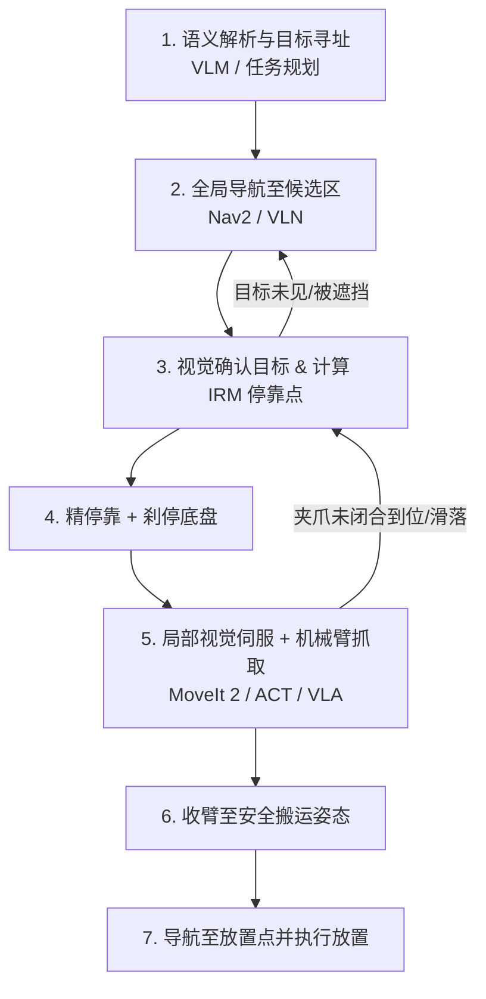

# 移动底盘 + 机械臂协同操作实战

把机械臂装到移动底盘（或四足/人形躯干）上，远不止是“把导航代码和抓取代码拼在一起”。底盘定位误差、停靠姿态可达性、基座-机械臂动力学耦合以及跨模块异常恢复，共同决定了整个移动操作系统的真实成功率。

## 1. 两种主流控制范式对比 \{#control-paradigms}

| 范式 | 工作方式 | 优势 | 局限与适用场景 |
| :--- | :--- | :--- | :--- |
| **解耦分层（Navigate → Dock → Manipulate）** | 先导航至目标附近停稳并刹停底盘，再用机载/腕部视觉精定位并调用机械臂策略或 MoveIt 2 抓取 | 工程稳健、模块可独立调试、可直接复用现成 Nav2 + ACT / VLA 抓取策略 | 动作不连贯，碰到开门、推车、长桌面拖拉等需要边走边抓的任务会卡壳 |
| **全身协同（Whole-Body Control / RL / VLA）** | 将底盘 `(vx, vy, wz)` 与机械臂关节统一纳入同一优化（Whole-Body IK / MPC）或同一端到端策略输出 | 可动态借助底盘扩展手臂工作空间、流畅完成开门/搬运/边走边抓 | 状态与动作维数高、训练与标定复杂、对全身碰撞安全约束要求严格 |

**工程落地建议**：从零搭建首个移动操作闭环时，优先跑通**解耦分层 + 腕部视觉闭环精调**（把端到端成功率稳定到 80%+），再在开门或大范围操作子任务中引入全身 IK 或联合策略。

## 2. 停靠位姿规划与逆可达性图（IRM） \{#base-placement}

“导航到了物体附近，但机械臂怎么也够不到或撞到桌子”是移动操作最常见的工程坑。核心解法是建立**逆可达性图（Inverse Reachability Map, IRM）**：

1. **离线计算工作空间**：在仿真中以机械臂基座为原点采样海量末端位姿，求逆运动学（IK）统计每个体素的可操作度（Manipulability，避免接近奇异点）与无碰撞通过率；
2. **反演最优停靠区**：给定待抓物体的三维位姿 $\mathbf{T}_{\text{obj}}$，将可达性分布反向投影到地面平面，再与障碍代价地图求交集，直接筛选出**既不撞桌脚、又让目标恰好落在机械臂高可操作区中心**的停靠点 $(x_{\text{dock}}, y_{\text{dock}}, \theta_{\text{dock}})$；
3. **容忍定位误差的二次视觉伺服**：由于 SLAM / AMCL 存在 `3–8 cm` 定位偏差，底盘停稳后切忌直接按全局地图坐标盲抓，必须切换至**机载腕部/头部相机的局部坐标系**重新估计目标相对机械臂基座的位姿。

## 3. 端到端系统状态机与异常恢复 \{#state-machine}

一个可长期稳定运行的移动操作 Demo，核心在于把每个环节的失败分支显式写进状态机（Behavior Tree / FSM）：

三个容易被忽略但至关重要的工程细节：
- **行进前必做“收臂（Tuck Arm）”**：带着伸出的手臂移动不仅极易撞墙，还会把整机质心前移导致加减速倾翻；
- **全链路统一外参标定**：串联 `base_link → camera → arm_base → end_effector` 坐标树，任何一环的外参偏差都会直接叠加到抓取误差上（标定方法见 [相机、LiDAR 与 IMU 外参与投影](/docs/foundations/perception/sensor-projection)）；
- **抓握成功自检**：用夹爪开合宽度、电机电流或腕部相机画面确认物体确实被稳稳夹起，再触发下一阶段的运输导航。

## 4. 组合站内实战快速起步 \{#hands-on}

你可以直接组合本仓库已上线的成熟模块，搭建自己的移动操作闭环：
- **导航与语义探索**：[建图与自主导航实战](../navigation-basics/placeholder) · [视觉语言导航实战](../vision-language-nav/placeholder) · [Quaddle VLA 导航](/docs/practices/vla/quaddle/)
- **抓取与长时程操作**：[MoveIt 2 规划项目](/docs/foundations/robotics-and-ros2/moveit2_project) · [ACT 双臂操作](/docs/practices/vla/act) · [π₀.₅ + RECAP（LIBERO 复现）](/docs/practices/vla/recap) · [SO-101 真机实战](/docs/practices/robot-arm/data-collection/so101-lerobot-real)
- **返回总览**：[← 移动操作总览](../placeholder)
