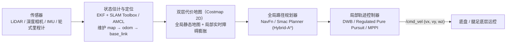

# 建图与自主导航实战（SLAM + Nav2）

让移动机器人安全可靠地从 A 点走到 B 点，是所有高级视觉语言导航与移动操作的前提。本专题以工业界和学术界最通用的 **ROS 2 + SLAM Toolbox + Nav2** 栈为主线，拆解自主导航的核心模块与调参排错要点。

## 1. 自主导航标准数据流 \{#nav2-pipeline}

核心坐标系约定（REP-105，详见 [tf2 坐标变换](/docs/foundations/robotics-and-ros2/tf2)）：
- **`odom → base_link`**：由轮式/足端里程计 + IMU 融合给出，**局部连续平滑但长期会累积漂移**；
- **`map → odom`**：由 SLAM 回环或 AMCL 定位周期校正，**消除全局漂移但允许小幅跳变**；
- 规划器在 `map` 系下生成全局路径，局部控制器在 `odom` 系下平滑跟踪速度指令，兼顾全局准确与局部平稳。

## 2. 建图与定位关键步骤 \{#slam-localization}

### ① 在线建图（SLAM Toolbox）
- **核心原理**：结合前端激光帧间扫描匹配（Scan Matching）与后端位姿图优化（Pose Graph Optimization），在机器人绕行回到已探索区域时触发回环检测（Loop Closure），一次性修正累计角度与位移漂移。
- **建图实操要点**：建图阶段放慢转速（尤其是纯 2D 激光遇到长走廊等退化环境时），确保扫描覆盖重叠充足；保存为 `.pgm + .yaml` 静态栅格地图及 `.posegraph` 序列化图。

### ② 已知地图定位（AMCL）
- **自适应蒙特卡洛定位（AMCL）**：用粒子群表示机器人位姿后验分布，结合运动模型预测与激光观测似然重采样；当定位不确定度高时自动增加粒子数，收敛后减少粒子节省算力。

## 3. 代价地图与控制器选型 \{#costmap-controllers}

- **代价地图（Costmap）三层插件**：
  1. `StaticLayer`：加载已知地图中的墙壁与固定家具；
  2. `ObstacleLayer` / `VoxelLayer`：实时接入 2D 激光或 3D 深度点云标注动态行人、椅子与低矮障碍；
  3. `InflationLayer`：按机器人外接半径（`robot_radius` 或足迹 `footprint`）向外膨胀安全代价梯度，使规划路径天然远离墙角。

- **主流局部控制器对比**：

| 控制器 | 适用底盘 | 特点与调参建议 |
| :--- | :--- | :--- |
| **Regulated Pure Pursuit (RPP)** | 差速 / 阿克曼 | 计算轻量、路径跟踪极其平滑；通过曲率降速与障碍前瞻减速保证安全 |
| **DWB（动态窗口法）** | 差速 / 全向 / 四足 | 在速度空间采样前向模拟轨迹并按多 Critics（贴合路径、远离障碍、朝向目标）打分 |
| **MPPI（模型预测路径积分）** | 差速 / 全向 / 阿克曼 | GPU/SIMD 并行采样式 MPC，窄通道绕障与动态避障表现显著优于传统 DWB |

## 4. 高频 Nav2 调试与排错清单 \{#troubleshooting}

| 现象 | 排查命令 | 高频根因与解法 |
| :--- | :--- | :--- |
| 机器人一启动就原地转圈不前进 | `ros2 topic echo /cmd_vel` + 查看 RViz 局部 Costmap | `inflation_radius` 过大导致机器人自身陷入致命代价区，或机器人 `footprint` 与实际尺寸不符 |
| 激光扫描墙体出现重影/歪斜 | `ros2 run tf2_tools view_frames` | `odom` 尺度标定误差、IMU 偏航方向取反、或 LiDAR 外参旋转角标错 |
| 走过门框/窄通道时反复急停重试 | 检查全局/局部 Costmap 分辨率与 `cost_scaling_factor` | 提高 `cost_scaling_factor` 使膨胀梯度衰减更陡，并适当缩小 `footprint_padding` |
| 腿足接入 `/cmd_vel` 时转向过度或打滑 | 对比底层策略实际跟踪误差 | 按底层 RL 策略真实可达速度包络收紧 Nav2 的 `max_vel_x / max_vel_theta / acc_lim` |

## 关联基础与下一步 \{#next-steps}

- **理论底座**：[ROS 2 工程基础与 tf2](/docs/foundations/robotics-and-ros2/intro) · [ODO、时间戳与状态估计](/docs/foundations/perception/odo-timestamps-state-estimation) · [MPC 控制器原理](/docs/foundations/controllers/mpc)
- **进阶专题**：[视觉语言导航（VLN）实战 →](../vision-language-nav/placeholder) · [移动底盘 + 机械臂协同操作 →](../mobile-manip-demo/placeholder)
