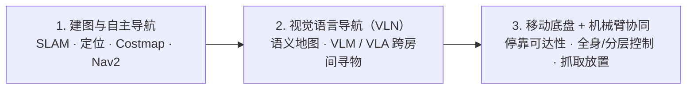

# 移动操作

固定底座机械臂的工作空间被局限在一张桌面以内，而纯移动底盘/腿足机器人无法改造物理世界。**移动操作（Mobile Manipulation）** 将“去到目标位置”与“和环境交互”合二为一，是家庭服务、仓储物流与通用人形机器人的核心落地形态。

## 技术全景：三层渐进能力 \{#architecture}

## 专题导航 \{#topics}

| 阶段 | 专题 | 核心内容 | 配套关联实战 |
| :--- | :--- | :--- | :--- |
| 1 | [建图与自主导航实战](./navigation-basics/placeholder) | 2D/3D SLAM 建图、AMCL 定位、全局/局部代价地图、Nav2 控制器（DWB / MPPI）与常见调参排错 | [ROS 2 教程](/docs/foundations/robotics-and-ros2/intro) · [ODO 与状态估计](/docs/foundations/perception/odo-timestamps-state-estimation) |
| 2 | [视觉语言导航（VLN）实战](./vision-language-nav/placeholder) | 语义指令理解、SR / SPL 评测指标、分层 VLM + 导航 vs 端到端 VLA 路线与室内多房间部署要点 | [Petoi Quaddle VLA 导航](/docs/practices/vla/quaddle/)（10 GB 显存端到端复现） |
| 3 | [移动底盘 + 机械臂协同操作](./mobile-manip-demo/placeholder) | 停靠位姿与逆可达性图（IRM）、解耦控制 vs 全身协同（Whole-Body IK / RL）、任务状态机与异常恢复 | [MoveIt 2 规划](/docs/foundations/robotics-and-ros2/moveit2_basics) · [ACT 双臂](/docs/practices/vla/act) · [π₀.₅ + RECAP](/docs/practices/vla/recap) |

## 推荐学习路线 \{#learning-path}

1. **先补工程与感知底座**：确保熟悉 [ROS 2 与 tf2 坐标树](/docs/foundations/robotics-and-ros2/tf2) 和 [传感器标定与投影](/docs/foundations/perception/sensor-projection)——移动操作极度依赖“底盘—相机—机械臂”三者统一的外参链。
2. **先打通单环节闭环**：分别通过 [Quaddle VLA 导航](/docs/practices/vla/quaddle/) 体验视觉语言导航闭环，通过 [ACT](/docs/practices/vla/act) 或 [SO-101 真机教程](/docs/practices/robot-arm/data-collection/so101-lerobot-real) 跑通机械臂操作。
3. **再按顺序阅读下方三篇专题**，把建图导航、语义理解与移动抓取组装成完整系统。
