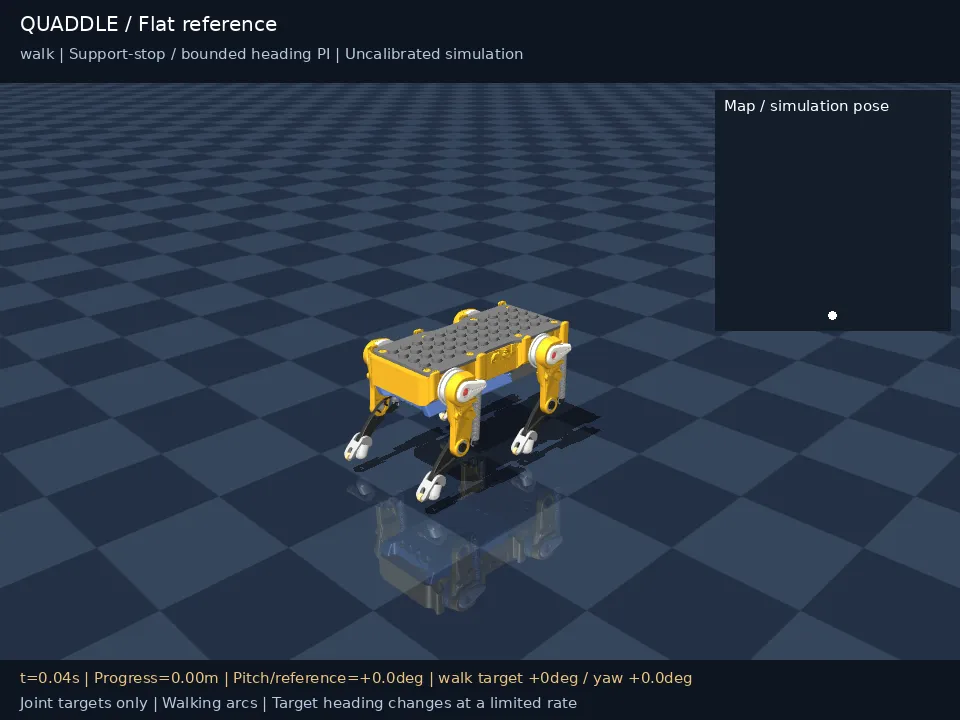

# 四足系列

围绕四足机器人的建模、控制、强化学习与多模态决策，提供从**单关节 PD 控制**到**整机步态、PPO 策略训练、网页实时仿真与语言视觉闭环**的完整实战项目。

## 🗂️ 项目总览 \{#projects}

| 分类 | 项目 | 简介 |
| :--- | :--- | :--- |
| 分章主线 | [从零到一搭建四足机器人](./cs123/intro) | 沿着 8 章主线，从 MuJoCo 执行器、正逆运动学、Pupper 建模走到开环步态、PPO 训练、LLM 控制与视觉追球 |
| 跨平台运控与 Sim2Sim | [Unitree Go2 运控｜MJX（ROCm / CUDA）](/docs/practices/amd/unitree-rl-mjx) | 基于 MuJoCo MJX / JAX 在 AMD 与 NVIDIA 单卡（8 GB 显存）上训练 Go2 速度策略，导出 ONNX 直通官方 C++ 仿真部署栈（也可在 [在线仿真](/simulation) 零配置试玩） |
| 网页与多场景仿真 | [Petoi Quaddle 四足步行仿真](./quaddle-mujoco/) | 在浏览器里直接控制四舵机机器人行走与停止，学习闭环连杆适配、残差 PPO 训练与多地形实验分析 |
| 语言视觉闭环 | [Petoi Quaddle VLA 导航训练](../vla/quaddle/) | 只凭语言指令与相机画面的自主导航：SmolVLA 高层决策 + 查表 CPG 低层运控，10GB 显存复现（L2 导航 90% / L3 避障 80% / L4 组合 85%） |
| 跨仿真验证 | [Sim2Sim 验证指南](./sim2sim/placeholder) | 跨物理引擎策略迁移对齐、五大高频失败排查清单与 Go2 / Flamingo 实战入口 |
| 真机部署 | [Sim2Real 工程部署指南](./sim2real-guide/placeholder) | 从仿真策略到真实四足硬件的系统辨识、域随机化、安全保护与逐级上线流程 |

## 🎬 典型演示 \{#demos}

|  **[从零到一搭建四足机器人](./cs123/intro)** CS123 仿真版 · Walk / Pace / Bound / Gallop 步态对比 |  **[PPO 步态策略训练](./cs123/rl-gait)** MuJoCo + Stable-Baselines3 · 闭环平衡与速度跟踪 |
| :---: | :---: |

### 从零到一搭建四足机器人 · 分章典型 GIF \{#cs123-gifs}

|  **[1. 执行器与 PD 控制](./cs123/pid-control)** 单关节位置闭环与 0.3 Hz 正弦跟踪 |  **[2. 正运动学](./cs123/forward-kinematics)** 单腿三自由度齐次变换与关节扫频 |  **[3. 逆运动学](./cs123/inverse-kinematics)** 末端轨迹反解与 Raibert 悬空踏步 |
| :---: | :---: | :---: |
|  **[4. 搭建四足机器人](./cs123/quadruped-mjcf)** Pupper v3 MJCF 建模、浮动基座与落地站稳 |  **[7. 语言控制](./cs123/llm-control)** LLM Function Calling 拆解多步动作序列 |  **[8. 视觉感知](./cs123/perception)** 机载相机目标检测 + RL 步态闭环追球 |

### Petoi Quaddle 四足步行仿真 · 场景预览 \{#quaddle-demos}

|  **[Quaddle 入门：网页实时仿真与残差 PPO](./quaddle-mujoco/)** 浏览器内直接运行 MuJoCo WebAssembly，控制行走、站立与暂停 |  **[Quaddle 多场景实验：结果与失败分析](./quaddle-mujoco/experiments)** 平地停走转向、上下坡、台阶与坑洼地形的实测回放与复盘 |
| :---: | :---: |

### Petoi Quaddle VLA 导航训练 · 效果预览 \{#quaddle-vla-demos}

|  **[VLA 导航：10GB 显存训一个策略](../vla/quaddle/)** SmolVLA + temporal ensembling，"走到红色积木旁" 20eps 90% |  **[低层运控对照（非 VLA）](../vla/quaddle/experiment-notes)** 查表 CPG 开环步态，upright、69.8mm/s |
| :---: | :---: |

## 🧭 内容大纲 \{#outline}

### 1. 从零到一搭建四足机器人（CS123 仿真版） \{#cs123}

仿照 Stanford CS123 课程设计的中文全仿真主线，不依赖实体硬件即可跑通“控制—运动学—建模—步态—强化学习—语言与视觉”完整闭环。前 3 章同时提供浏览器端交互实验。

| 章节 | 内容 | 在线交互 |
| :--- | :--- | :--- |
| [0. 课程总览](./cs123/intro) | 课程定位、前置知识、环境要求与 6 周学习节奏 | — |
| [1. 执行器与 PD 控制](./cs123/pid-control) | 电机模型、减速比、Bang-Bang 与单关节 PD/PID 闭环响应 | [PD 交互实验](/cs123/pd-playground) |
| [2. 正运动学](./cs123/forward-kinematics) | 刚体位姿、齐次变换矩阵、DH / URDF 约定与 3-DoF 单腿 FK | [FK 交互实验](/cs123/fk-playground) |
| [3. 逆运动学](./cs123/inverse-kinematics) | 几何解析解、雅可比数值迭代与足端轨迹跟踪 | [IK 交互实验](/cs123/ik-playground) |
| [4. 搭建四足机器人](./cs123/quadruped-mjcf) | Pupper v3 URDF/MJCF 树状结构、浮动基座与站立参数扫描 | — |
| [5. 步态控制](./cs123/gait-control) | 相位调度、摆动/支撑相轨迹与 Trot / Walk / Pace / Bound / Gallop | — |
| [6. 策略训练](./cs123/rl-gait) | Gymnasium 环境封装、指数速度奖励设计与 PPO 闭环步态训练 | — |
| [7. 语言控制](./cs123/llm-control) | 工具 API 封装、Function Calling / ReAct 循环与语音指令接入 | — |
| [8. 视觉感知](./cs123/perception) | 机载相机挂载、HSV 检测、像素到方向角映射与追球闭环 | — |

### 2. Petoi Quaddle 四足步行仿真 \{#quaddle}

基于 Petoi 官方 Quaddle 模型，补充 MuJoCo 闭环连杆约束、被动扭簧与接触参数，支持直接在网页内实时交互运行。

| 篇章 | 内容 |
| :--- | :--- |
| [入门：让四足机器人走起来](./quaddle-mujoco/) | 网页实时 MuJoCo 仿真器、本地 `mjpython` 运行、无限棋盘地面渲染与 32 维残差 PPO 训练流程 |
| [多场景实验：结果与失败分析](./quaddle-mujoco/experiments) | 平地停走转向、3°/5° 上下坡、4 mm 下台阶、2 mm 上台阶、坑洼地形与跑步候选的对比视频及复跑命令 |

### 3. Petoi Quaddle VLA 导航训练 \{#quaddle-vla}

在《Quaddle 入门》环境上走通 VLA 全链路：只告诉机器人 "walk to the red block"，它自己转向、分辨颜色、走到目标停下——SmolVLA 450M 高层决策 + 查表 CPG 低层运控，10GB 显存预算可复现。

| 篇章 | 内容 |
| :--- | :--- |
| [VLA 导航：10GB 显存训一个策略](../vla/quaddle/) | 数据采集 → SmolVLA 微调 → 闭环评估的复现路线；效果预览（L2 导航 90%）与能力边界 |
| [实验记录与 v5 路线图](../vla/quaddle/experiment-notes) | v4/v5/v6 全部试验（含阴性结果）；temporal ensembling 突破与 8.2x 训练加速 |
| [实施现状与计划](../vla/quaddle/progress) | L1-L4 验收进度、任务分解（L3 避障 80% / L4 组合 85%）与真机交接计划 |

### 4. Unitree Go2 运控（MJX · ROCm / CUDA） \{#go2-mjx}

将宇树官方 `unitree_rl_mjlab` 移植到 MuJoCo MJX / JAX，同一套代码支持 AMD ROCm 与 NVIDIA CUDA 单卡训练，并将 ONNX 策略直接部署到未改动的官方 `unitree_mujoco` 与 `go2_ctrl` C++ 栈。

| 篇章 | 内容 |
| :--- | :--- |
| [Go2 四足运控总览](/docs/practices/amd/unitree-rl-mjx) | 跨后端基线指标（R9700 / A40 / 8 GB 显存）、成品策略与目录结构 |
| [1. 环境安装与硬件约束](/docs/practices/amd/unitree-rl-mjx/environment-setup) | `uv` 多后端安装、Go2 网格校验拉取、AUP 云端与 RDNA4（`gfx1201`）约束 |
| [2. 训练 Go2 速度策略](/docs/practices/amd/unitree-rl-mjx/training) | 20 分钟冒烟验证、9.8 亿步完整训练、曲线绘制与离屏渲染 GIF |
| [3. ONNX 导出与官方栈 Sim2Sim](/docs/practices/amd/unitree-rl-mjx/sim2sim) | ONNX 归一化烘焙与合同验证、官方 C++ 栈编译运行、无手柄脚本测试与跟踪对照 |
