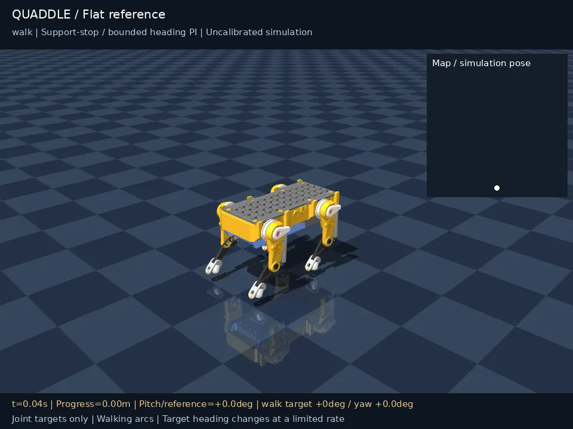

# 四足系列

围绕四足机器人的建模、控制、强化学习与多模态决策，提供从**单关节 PD 控制**到**整机步态、PPO 策略训练、网页实时仿真与语言视觉闭环**的完整实战项目。

## 🗂️ 项目总览 \{#projects}

| 分类 | 项目 | 简介 |
| :--- | :--- | :--- |
| 分章主线 | [从零到一搭建四足机器人](./cs123/intro) | 沿着 8 章主线，从 MuJoCo 执行器、正逆运动学、Pupper 建模走到开环步态、PPO 训练、LLM 控制与视觉追球 |
| 网页与多场景仿真 | [Petoi Quaddle 四足步行仿真](./quaddle-mujoco/) | 在浏览器里直接控制四舵机机器人行走与停止，学习闭环连杆适配、残差 PPO 训练与多地形实验分析 |
| AMD 专区旗舰 | [玩转 Pupper 四足机器人](/docs/practices/amd/pupper-control/intro) | 在 AMD ROCm 平台上完成 Pupper 强化学习速度跟踪策略（Locomotion）与视觉-语言-动作（VLA）闭环实验 |
| 跨仿真验证 | [Sim2Sim 验证](./sim2sim/placeholder) | 跨物理引擎策略迁移与一致性验证（施工中） |
| 真机部署 | [Sim2Real 指南](./sim2real-guide/placeholder) | 从仿真策略到真实四足硬件的标定、安全保护与部署流程（施工中） |

## 🎬 典型演示 \{#demos}

|  **[从零到一搭建四足机器人](./cs123/intro)** CS123 仿真版 · Walk / Pace / Bound / Gallop 步态对比 |  **[PPO 步态策略训练](./cs123/rl-gait)** MuJoCo + Stable-Baselines3 · 闭环平衡与速度跟踪 |  **[Pupper Locomotion · ROCm](/docs/practices/amd/pupper-control/locomotion)** 12 自由度残差策略 · 前进、转向与停止切换 |
| :---: | :---: | :---: |

### 从零到一搭建四足机器人 · 分章典型 GIF \{#cs123-gifs}

|  **[1. 执行器与 PD 控制](./cs123/pid-control)** 单关节位置闭环与 0.3 Hz 正弦跟踪 |  **[2. 正运动学](./cs123/forward-kinematics)** 单腿三自由度齐次变换与关节扫频 |  **[3. 逆运动学](./cs123/inverse-kinematics)** 末端轨迹反解与 Raibert 悬空踏步 |
| :---: | :---: | :---: |
|  **[4. 搭建四足机器人](./cs123/quadruped-mjcf)** Pupper v3 MJCF 建模、浮动基座与落地站稳 |  **[7. 语言控制](./cs123/llm-control)** LLM Function Calling 拆解多步动作序列 |  **[8. 视觉感知](./cs123/perception)** 机载相机目标检测 + RL 步态闭环追球 |

### Petoi Quaddle 四足步行仿真 · 场景预览 \{#quaddle-demos}

|  **[Quaddle 入门：网页实时仿真与残差 PPO](./quaddle-mujoco/)** 浏览器内直接运行 MuJoCo WebAssembly，控制行走、站立与暂停 |  **[Quaddle 多场景实验：结果与失败分析](./quaddle-mujoco/experiments)** 平地停走转向、上下坡、台阶与坑洼地形的实测回放与复盘 |
| :---: | :---: |

## 🧭 内容大纲 \{#outline}

### 1. 从零到一搭建四足机器人（CS123 仿真版） \{#cs123}

仿照 Stanford CS123 课程设计的中文全仿真主线，不依赖实体硬件即可跑通“控制—运动学—建模—步态—强化学习—语言与视觉”完整闭环。前 3 章同时提供浏览器端交互实验。

| 章节 | 内容 | 在线交互 |
| :--- | :--- | :--- |
| [0. 课程总览](./cs123/intro) | 课程定位、前置知识、环境要求与 6 周学习节奏 | — |
| [1. 执行器与 PD 控制](./cs123/pid-control) | 电机模型、减速比、Bang-Bang 与单关节 PD/PID 闭环响应 | [PD 交互实验](/cs123/pd-playground) |
| [2. 正运动学](./cs123/forward-kinematics) | 刚体位姿、齐次变换矩阵、DH / URDF 约定与 3-DoF 单腿 FK | [FK 交互实验](/cs123/fk-playground) |
| [3. 逆运动学](./cs123/inverse-kinematics) | 几何解析解、雅可比数值迭代与足端轨迹跟踪 | [IK 交互实验](/cs123/ik-playground) |
| [4. 搭建四足机器人](./cs123/quadruped-mjcf) | Pupper v3 URDF/MJCF 树状结构、浮动基座与站立参数扫描 | — |
| [5. 步态控制](./cs123/gait-control) | 相位调度、摆动/支撑相轨迹与 Trot / Walk / Pace / Bound / Gallop | — |
| [6. 策略训练](./cs123/rl-gait) | Gymnasium 环境封装、指数速度奖励设计与 PPO 闭环步态训练 | — |
| [7. 语言控制](./cs123/llm-control) | 工具 API 封装、Function Calling / ReAct 循环与语音指令接入 | — |
| [8. 视觉感知](./cs123/perception) | 机载相机挂载、HSV 检测、像素到方向角映射与追球闭环 | — |

### 2. Petoi Quaddle 四足步行仿真 \{#quaddle}

基于 Petoi 官方 Quaddle 模型，补充 MuJoCo 闭环连杆约束、被动扭簧与接触参数，支持直接在网页内实时交互运行。

| 篇章 | 内容 |
| :--- | :--- |
| [入门：让四足机器人走起来](./quaddle-mujoco/) | 网页实时 MuJoCo 仿真器、本地 `mjpython` 运行、无限棋盘地面渲染与 32 维残差 PPO 训练流程 |
| [多场景实验：结果与失败分析](./quaddle-mujoco/experiments) | 平地停走转向、3°/5° 上下坡、4 mm 下台阶、2 mm 上台阶、坑洼地形与跑步候选的对比视频及复跑命令 |

### 3. 玩转 Pupper 四足机器人（AMD 专区） \{#pupper-amd}

在《从零到一搭建四足机器人》的基础上，面向 AMD ROCm 平台展开强化学习运动控制与多模态具身智能实验。

| 篇章 | 内容 |
| :--- | :--- |
| [项目导览](/docs/practices/amd/pupper-control/intro) | 实验主线、环境边界与交付要求 |
| [Pupper Locomotion｜强化学习运动策略](/docs/practices/amd/pupper-control/locomotion) | ROCm + PyTorch + PPO 速度指令跟踪 `(vx, vy, wz)`、长训曲线与基准评测 |
| [Pupper VLA｜视觉-语言-动作智能](/docs/practices/amd/pupper-control/vla) | 串联相机感知、自然语言理解与底层运动技能接口，完成寻球导航任务 |
