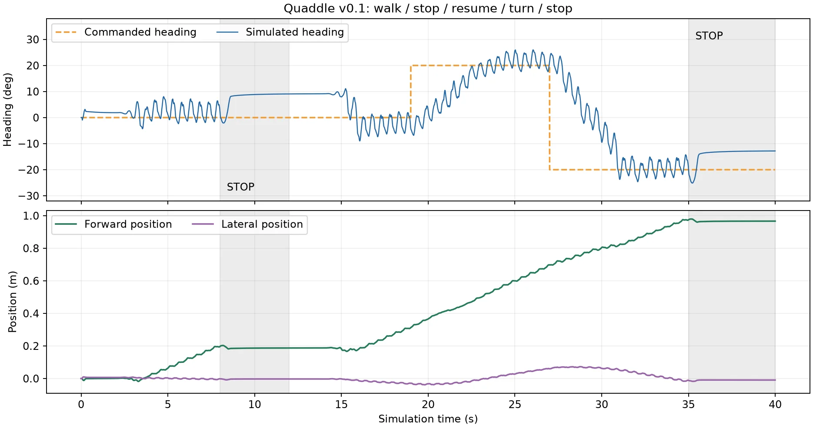

# Quaddle 多场景实验：结果与失败分析

四个舵机能让它走到哪里？先看哪些动作做到了，再看失败发生在哪里，最后自己复跑一次实验。首次使用请先完成[入门页的安装](./index.md#安装和运行)。

## 当前结果

**能展示：行走、停走转向、上下坡、下台阶、平缓坑洼。还需改进：上台阶、原始随机坑洼、跑步。**

v0.1 · 2026-11-10。“OK”只表示在所列仿真条件下通过，各场景使用独立配置。硬件尚未到货、模型未实测标定；这不是全场景通用策略或真机结果。

| 场景 | 动作 | 结果 | 原因 / 说明 |
| --- | --- | --- | --- |
| 平地 | 向前行走 | ✅ OK | 能持续行走，完成测试路线。 |
| [平地](#平地停走与转弯) | 停止、再起步、转向 | ✅ OK | 能停稳、再起步并转向；10组复测通过。 |
| 3° / 5° 上坡 | 沿坡向上走 | ✅ OK | 两种坡度均完成测试路线。 |
| 3° 下坡 | 沿坡向下走 | ✅ OK | 完成测试路线，姿态和关节速度合格。 |
| [4 mm × 3级台阶](#下台阶增加推进余量) | 下台阶 | ✅ OK | 调参后能走到终点，姿态和关节速度合格。 |
| [平缓坑洼（高差 ≤2 mm）](#坑洼地形与策略的区别) | 向前行走 | ✅ OK | 能通过平缓地形；不代表原始随机坑洼通过。 |
| [2 mm × 3级台阶](#上台阶换起点就走偏) | 上台阶 | ⚠️ 不稳定 | 正常起点能过；换起点后会走偏，6个新增条件均未通过。 |
| [随机坑洼（±3 mm）](#续训后仍未完成任务) | 向前行走 | ❌ 未通过 | 走得太慢、没到终点；续训后仍未通过。 |
| [平地](#跑步腾空不等于合格) | 跑步 | ❌ 未通过 | 跑速不足，且关节速度超限。 |
| 4 mm × 3级台阶 | 上台阶 | ❌ 未通过 | 推进不足、偏航超限；已暂停继续优化。 |

3°和5°上坡合并为一行，表中6行OK对应基础版7项任务。上坡从斜面上起步；平缓坑洼的高差限制同时包含内部相邻格与进出口。浅水近似、已知地图绕障不列入本版通过能力。

原始检查数据：[平地](./figs/experiments/flat.json)、[3°上坡](./figs/experiments/uphill3.json)、[5°上坡](./figs/experiments/uphill5.json)、[3°下坡](./figs/experiments/downhill3.json)、[4 mm上台阶](./figs/experiments/stairs-4mm.json)。其余数据在对应视频的详情中。

下方“原因”指实测未通过项；它不证明机构无法完成任务。所有视频来自实际物理回放，保留启动和失败过程。

## 看视频，比较改动前后

### 平地停走与转弯

**平地｜行走、停止、再起步、转向 · 当前版本**

<video controls playsInline preload="none" src={require('./figs/experiments/interaction.mp4').default} poster={require('./figs/experiments/interaction.webp').default} style={{width: '100%', maxWidth: 720}} />

能停稳、再起步并按指令转向。

<details>
<summary>测试条件与指标</summary>

视频为 40 秒标称序列；表中指标属于这一段视频。十组复测的最大段末误差为 8.583°、最大关节速度为 8.149 rad/s。

方法：反馈控制；前进：0.966 m；航向：6.42°（段末误差）；关节峰值：7.99 rad/s。[对应数据](./figs/experiments/interaction.json)。

</details>

停止时保持支撑姿态，再逐渐改变目标航向。十组有限条件复测通过；这是反馈控制，不是PPO。转弯是行走中的弧线，不是原地旋转。
### 下台阶增加推进余量

同一联合扰动下，旧配置没有走到0.72 m终点。步频增加6%、航向增益调整后通过。

**4 mm × 3级台阶｜下台阶 · 调整前**

<video controls playsInline preload="none" src={require('./figs/experiments/down-before.mp4').default} poster={require('./figs/experiments/down-before.webp').default} style={{width: '100%', maxWidth: 720}} />

没走到终点：0.705 m，目标 0.72 m。

<details>
<summary>测试条件与指标</summary>

4 mm × 3 级；初始航向 −3°、摩擦系数乘 0.9。

方法：周期步态；前进：0.705 m；航向：14.40°；关节峰值：8.94 rad/s。[对应数据](./figs/experiments/down-before.json)。

</details>

**4 mm × 3级台阶｜下台阶 · 调整后**

<video controls playsInline preload="none" src={require('./figs/experiments/down-after.mp4').default} poster={require('./figs/experiments/down-after.webp').default} style={{width: '100%', maxWidth: 720}} />

已走到终点，姿态和关节速度合格。

<details>
<summary>测试条件与指标</summary>

与左侧相同地形和初始条件。这里展示的是参数调整，不是 PPO 训练。

方法：周期步态；前进：0.738 m；航向：13.70°；关节峰值：8.94 rad/s。[对应数据](./figs/experiments/down-after.json)。

</details>
### 上台阶换起点就走偏

保持配置不变，只将初始航向改变+3°，通过结果就消失了。后续六个新增条件也全部未通过，因此2 mm上台阶只标“不稳定”。

**2 mm × 3级台阶｜上台阶 · 正常起点**

<video controls playsInline preload="none" src={require('./figs/experiments/stairs-nominal.mp4').default} poster={require('./figs/experiments/stairs-nominal.webp').default} style={{width: '100%', maxWidth: 720}} />

本段通过，但换起点或摩擦后仍会失败。

<details>
<summary>测试条件与指标</summary>

2 mm × 3 级；每级深 12 cm。标称通过不代表所有起点通过。

方法：接触协调；前进：0.910 m；航向：24.32°；关节峰值：8.92 rad/s。[对应数据](./figs/experiments/stairs-nominal.json)。

</details>

**2 mm × 3级台阶｜上台阶 · 起始航向 +3°**

<video controls playsInline preload="none" src={require('./figs/experiments/stairs-yaw.mp4').default} poster={require('./figs/experiments/stairs-yaw.webp').default} style={{width: '100%', maxWidth: 720}} />

走偏了：最大偏航 32.97°，要求小于 25°。

<details>
<summary>测试条件与指标</summary>

同一控制配置和台阶，只将初始航向改为 +3°。该失败回放按存档参数重新录制，未重新训练。

方法：接触协调；前进：0.724 m；航向：32.97°；关节峰值：9.59 rad/s。[对应数据](./figs/experiments/stairs-yaw.json)。

</details>
### 坑洼地形与策略的区别

两段使用同一个旧PPO，没有新增训练。原始地形独立随机生成±3 mm高度，相邻格最大跳变约5.76 mm；平缓地形将相邻格和进出口高差限制到2 mm以内，也改变了高度分布。

**随机坑洼（±3 mm）｜向前行走 · 旧 PPO**

<video controls playsInline preload="none" src={require('./figs/experiments/rough-original.mp4').default} poster={require('./figs/experiments/rough-original.webp').default} style={{width: '100%', maxWidth: 720}} />

走得太慢、没到终点：0.296 m，目标 1.04 m。

<details>
<summary>测试条件与指标</summary>

独立随机 ±3 mm 地形，相邻格高差最高约 5.759 mm。

方法：残差 PPO；前进：0.296 m；航向：22.26°；关节峰值：9.11 rad/s。[对应数据](./figs/experiments/rough-original.json)。

</details>

**平缓坑洼（相邻及进出口高差 ≤2 mm）｜向前行走 · 当前版本**

<video controls playsInline preload="none" src={require('./figs/experiments/rough-graded.mp4').default} poster={require('./figs/experiments/rough-graded.webp').default} style={{width: '100%', maxWidth: 720}} />

已走到终点；这块地形比原始随机坑洼更平缓。

<details>
<summary>测试条件与指标</summary>

内部相邻格及进出口高差 ≤2 mm；不是原始坑洼通关，也不能把变化全部归因于单一高度因素。

方法：残差 PPO；前进：1.449 m；航向：10.57°；关节峰值：8.93 rad/s。[对应数据](./figs/experiments/rough-graded.json)。

</details>
### 续训后仍未完成任务

对照上一节的原始坑洼视频：续训后前进距离约从0.296 m变为0.302 m，仍远未达到1.04 m目标。续训同时调整了环境和反馈，不能将差异全部归因于训练步数。

**随机坑洼（±3 mm）｜向前行走 · 续训后**

<video controls playsInline preload="none" src={require('./figs/experiments/rough-trained.mp4').default} poster={require('./figs/experiments/rough-trained.webp').default} style={{width: '100%', maxWidth: 720}} />

仍走得太慢、没到终点：0.302 m，目标 1.04 m。

<details>
<summary>测试条件与指标</summary>

从旧模型续训 16,384 步的 checkpoint；同时改变了训练环境和反馈配置，不能视为只增加训练步数的纯消融。

方法：残差 PPO；前进：0.302 m；航向：21.26°；关节峰值：9.43 rad/s。[对应数据](./figs/experiments/rough-trained.json)。

</details>
### 跑步腾空不等于合格

候选出现14个完整腾空区间，但均速约0.0456 m/s，低于0.1 m/s门槛；关节峰值约10.36 rad/s，高于10 rad/s限制。

**平地｜跑步 · 候选版本**

<video controls playsInline preload="none" src={require('./figs/experiments/running.mp4').default} poster={require('./figs/experiments/running.webp').default} style={{width: '100%', maxWidth: 720}} />

跑得不够快，且关节转得过快；有腾空也未通过。

<details>
<summary>测试条件与指标</summary>

本实验要求均速 ≥0.1 m/s、至少 3 段持续 ≥10 ms 的完整腾空，并通过其余物理检查。

方法：周期步态；前进：0.912 m；航向：9.29°；关节峰值：10.36 rad/s。[对应数据](./figs/experiments/running.json)。

</details>

## 自己复跑一个场景

先按[入门页](./index.md#安装和运行)下载模型。在 `codes/practices/quadruped/quaddle-mujoco/` 中安装包含PPO的依赖；这里使用 `.venv-rl`，与仅运行物理仿真的 `.venv` 区分。

```bash
uv venv --python 3.12 .venv-rl
uv pip sync --python .venv-rl/bin/python requirements-rl.lock
.venv-rl/bin/python baseline.py --verify-only
.venv-rl/bin/python baseline.py --case flat
.venv-rl/bin/python baseline.py --case stairs_down
# 重跑基础版七项；不包括上台阶实验
OPENBLAS_NUM_THREADS=1 OMP_NUM_THREADS=1 .venv-rl/bin/python baseline.py --case all
# Linux离屏录像；需要可用的EGL环境
MUJOCO_GL=egl .venv-rl/bin/python baseline.py --case interaction --video
```

先核对哈希，再看各场景输出中的检查项与回放。命令结束、模型保存都不等于任务通过。完整范围与输出位置见代码目录的 `BASELINE.md`、`baseline.py`；2 mm上台阶需要显式指定 `--case stairs_up_demo`。

## 我们怎么优化和训练

| 方法 | 本项目做了什么 | 结果 |
| --- | --- | --- |
| 步态调参 | 调整步频、摆幅、支撑与摆腿阶段 | 改善坡面和下台阶；上台阶仍对起点敏感 |
| 反馈控制 | 支撑姿态停止、有界航向积分、目标航向渐变 | 停走和转向十组条件通过 |
| 残差PPO | 在基准关节目标上学习小幅修正 | 旧策略能通过平缓坑洼，原始坑洼续训后仍失败 |

PPO的观测、奖励和更新原理见[入门页](./index.md#强化学习从固定步态到残差-ppo)。这里不要混用三种接口：入门示例32维、旧地形策略36维、课程版本60维。恢复策略时，环境、权重、归一化统计和动作缩放必须匹配。

### 跑一轮地形课程训练

课程版本增加地形、接触和历史信息。先从轻微坑洼开始，每16,384步保存策略及归一化统计并评估，通过当前级别的开发检查和独立条件门槛后才升级。低级地形通过不代表原始地形通过。

```bash
OPENBLAS_NUM_THREADS=1 OMP_NUM_THREADS=1 .venv-rl/bin/python check_curriculum.py
OPENBLAS_NUM_THREADS=1 OMP_NUM_THREADS=1 .venv-rl/bin/python train_curriculum.py \
  --scene rough --gamma .999 --chunks-per-level 2 --output outputs/curriculum/rough_g999
# 训练完成后，检查保存策略的观测与动作接口
.venv-rl/bin/python check_curriculum_policy.py \
  outputs/curriculum/rough_g999/level1_steps16384
# 再独立检查原始目标地形
OPENBLAS_NUM_THREADS=1 .venv-rl/bin/python evaluate_curriculum_target.py --arms rough_g999
```

查看训练目录中的 `progress.json`、各checkpoint的 `evaluation.json` / `gate.json` 和目标筛查报告 `target_screen.json`。`best_checkpoint`只是课程评分最好，并不保证原始任务通过。续训使用 `--resume` 指定兼容的版本2 checkpoint，折扣系数必须匹配；上面的新训练命令并不保证复刻下面续训案例的耗时和结果。

### 一笔实际续训用了多少资源

[这笔训练的元数据](./figs/experiments/continuation-metadata.json)记录了原始坑洼的一段CPU续训：新增16,384步，继承16,384步，总计32,768步；记录耗时约127秒，seed为43，60维观测，残差范围±0.25 rad。这只是一段续训的耗时，不是项目总耗时，也不能据此预测训练到成功需要多久。平缓坑洼展示使用旧策略，最终停走与台阶优化这一轮新增PPO步数为0。

<details>
<summary>继续实验前，先检查这些问题</summary>

- 起步就上仰：检查初始支撑姿态与启动阶段，别只看正式运动后的统计。
- 卡在台阶前：查看前后腿支撑与摆腿时序、接触力、目标追赶限制，再决定是否继续训练。
- 走远却偏航超限：同时检查任务距离和方向，不能只按距离选模型。
- 换地形才通过：保持权重不变做对照，明确收益来自地形还是策略。
- 训练结束仍失败：保留独立评估与失败回放，检查奖励是否鼓励停滞、滑行或跳动。

</details>

## 动手试一试

1. **先预测：** 同一台阶配置，只把起始朝向改为+3°，最先失败的是距离、偏航还是关节速度？看上台阶对照核验预测。
2. **只改一个变量：** 用下方命令改变坡度，保持配置不变。分别保存输出，比较完整启动阶段、距离和偏航，不覆盖上一次结果。
3. **设计验收：** 给“学会停走”写三项检查，再对照停止漂移、行走段前进距离与段末航向误差，解释为何总奖励不够。

```bash
.venv-rl/bin/python validate_walk.py --seconds 20 --slope-deg 3
# 先另存 outputs/walk_validation.json，再运行下一组
.venv-rl/bin/python validate_walk.py --seconds 20 --slope-deg 5
```

下面保留早期诊断过程，它们不是当前能力表；其中5°上坡的早期失败不与当前独立配置的通过矛盾。

<details>
<summary>展开早期坡面诊断、场景定义与浅水近似</summary>

## 换个地面，它还会走吗？

平地走通后，可以先做一个小实验：保持控制器不变，只改变摩擦或坡度。2026-11-09 在 Linux、Python 3.12.13、MuJoCo 3.16.0 上，**修正启动前**的基线复跑得到：

| 场景 | 指令行走时长 | 前进距离 | 最大航向偏差 | 检查结果 |
| --- | --- | --- | --- | --- |
| 默认平地 | 60秒 | 4.58 m | 12.84° | 通过 |
| 所有几何体统一摩擦0.6 | 12秒 | 0.92 m | 83.76° | 姿态、航向超限 |
| 所有几何体统一摩擦1.0 | 12秒 | 0.77 m | 44.76° | 横向偏离、航向超限 |
| 3°上坡 | 20秒 | 1.24 m | 19.29° | 机身触地、姿态超限 |
| 5°上坡 | 20秒 | 0.44 m | 31.44° | 触地、姿态、速度、航向、足端支撑未通过 |

默认平地不是“所有摩擦都设为0.8”；统一摩擦会覆盖全部几何体。上述结果是固定初始状态的单次确定性实验，详细检查与轨迹保存在源码的 `reports/ground_readiness_2026-11-09.json`，不能据此推断真机表现。

```bash
# 先检查实际碰撞平面的法线与机身初始姿态
.venv/bin/python check_terrain.py
# 平地与两组摩擦干预
.venv/bin/python validate_walk.py --seconds 60 --sensitivity
# 正角度沿机器人初始前方上坡；输出仍写入 outputs/
.venv/bin/python validate_walk.py --seconds 20 --slope-deg 3
MUJOCO_GL=egl .venv/bin/python render_demo.py --seconds 10 --slope-deg 3 --output uphill3
```

坡面实验的前进距离沿坡面计算，离地高度沿坡面法线计算。否则机器人沿坡升高，会被误判成抬高机身。当前航向反馈仍使用仿真世界坐标真值，还需要对照试验来判断反馈、步态和接触参数各自的影响。

试一试：先预测提高摩擦会让它更稳还是更容易转偏，再看录像与触地统计。只调一个变量，保留失败录像；“向前移动了”与“通过步行检查”是两个不同的结果。

### 一个具体修复：起步时为什么会抬头？

旧控制器启动时先保持舵机零位2秒，再从零位增加行走摆幅。零位在坡面上不是稳定支撑姿态，机身在正式行走前就已明显上仰；原来的行走统计又跳过了前2秒，容易漏掉这一阶段。

现在使用前腿 `0.2 rad`、后腿 `-0.4 rad` 的支撑偏置（应用各电机方向符号之前），用50毫秒平滑曲线开始建立支撑，仍受8 rad/s目标变化率限制，因此并非50毫秒内强行到位。保持支撑后，在原有1.5秒起步窗口内逐渐切换到周期步态。100 Hz控制更新现在也覆盖等待阶段；初始化已有平滑曲线，避免再叠加模式切换的350毫秒渐变而拖慢建立支撑。

新增检查覆盖完整的**前3.5秒（支撑+起步）**：相对坡面的最大绝对俯仰须小于15°，且机身不能触地。原有行走、力矩、速度、接触等门槛没有放宽。

| 场景 | 修复前/后起步最大俯仰 | 修复后完整检查 |
| --- | --- | --- |
| 平地60秒 | 9.95° → 3.84° | 通过，前进4.51m |
| 3°上坡20秒 | 40.35° → 3.93° | 通过，前进1.17m，无机身触地 |
| 5°上坡20秒 | 51.50° → 4.02° | 上仰和触地消除，但前进速度、足端支撑、连续前进仍未通过 |

角度均相对坡面，不能与相对水平的角度混用。这是对固定模型、初始状态和这几个开发用例的参数调试，尚非扰动测试或实机标定；统一摩擦0.6/1.0用例仍未全部通过。完整前后对照见源码 `reports/startup_fix_2026-11-09.json`，旧配置保留在 `reference/pre-slope-startup-gait.json`。

```bash
.venv/bin/python check_startup.py
# 修复后
.venv/bin/python validate_walk.py --seconds 20 --slope-deg 3
# 同一模型、同一坡度的修复前对照
.venv/bin/python validate_walk.py --seconds 20 --slope-deg 3 --config reference/pre-slope-startup-gait.json
```

比较时分别保存输出；两个命令会写入同名 `outputs/walk_validation.json`。录像已增加地面倾角、相对坡面俯仰和支撑/过渡/行走阶段标注，保留完整启动过程。

## 把周会里的环境做成一组可重复实验

`scenario_matrix.py` 提供9个场景，每个场景都可以分别运行行走和跑步候选，生成真实动力学录像、检查项和CSV轨迹。场景几何与控制结果分别记录，遇到失败也保留完整启动和回放。

| 场景名 | 本轮参数与任务 |
| --- | --- |
| `flat` | 默认平地，前进至少0.72m |
| `uphill3`、`uphill5` | 从3°/5°坡面上起步，沿坡前进至少0.72m |
| `downhill3` | 从-3°坡面上起步，下坡前进至少0.72m |
| `stairs_up`、`stairs_down` | 3级台阶，每级高4mm、深12cm；下台阶从最高平台起步 |
| `rough` | 固定seed=7生成±3mm起伏，包含低于起始平面的坑；穿过粗糙段到达1.04m |
| `avoid` | 6cm高障碍，已知地图A*规划、障碍膨胀9cm，闭环跟踪到1m目标附近 |
| `water` | 8mm浅水近似，经过水区并到达1.15m；参数见下文 |

台阶是按这个小机器人建立的探索档位，不代表已经能爬家庭楼梯。坡面任务从斜面初始状态开始，尚未包含平地进入坡面的折角。绕障使用仿真真值定位和已知地图，尚无视觉感知或在线建图。

```bash
# 先检查碰撞几何、路线净空和浅水受力方向
.venv/bin/python check_scenarios.py

# 单场景，不需要图形窗口
.venv/bin/python scenario_matrix.py --scene stairs_up --mode walk --seconds 20

# 9个场景 × 2种控制候选；Linux离屏录像需要EGL
MUJOCO_GL=egl .venv/bin/python scenario_matrix.py --scene all --mode both --seconds 20 --video --workers 2

# 打开生成的互动视频总览
.venv/bin/python -m http.server 8012 --bind 127.0.0.1 --directory outputs/scenario_matrix
```

最后在浏览器打开 `http://127.0.0.1:8012`。总览可以切换行走/跑步候选、播放各段回放和打开检查项。每组另有 `metrics.json`、`trajectory.csv`；视频保存为对应子目录中的 `video.mp4`。输出目录保留失败结果，命令正常结束只表示矩阵运行完成，是否通过须看结果表。每组为20秒运动指令加2秒启动；这些都是单一初态的确定性开发测试。

### 跑步怎么验收？

`run_attempt` 是经过小规模频率/相位筛选的周期控制候选，固定参数保存在 `reference/run-candidate.json`。目前筛选没有得到合格跑步，因此图表与录像使用“跑步候选”标记。

本轮保守采用有腾空相的验收：均速至少0.1m/s，至少3个完整的无地形接触区间，每段持续至少10ms，同时通过姿态、触地、任务目标、力矩和关节速度等检查。这不是所有动物/机器人跑步步态的通用定义；它用来阻止本实验把单纯提频、原地弹跳或摔倒中的离地误写成会跑。接触统计包含机身、下腿和脚轮；启动下落不计入跑步腾空段。

### 浅水近似里到底算了什么？

水区只在前方0.15–1.05m、横向±0.22m内施加环境力。四个足端与四个下腿采样点使用假设的等效球，半径分别为4.5mm与5mm；根据浸没球冠体积计算浮力，再按局部速度计算二次阻力：

$$
\mathbf F_b=-\rho V_{sub}\mathbf g,\qquad
\mathbf F_d=-\tfrac12\rho C_d A\,\frac{V_{sub}}{V}\,\lVert\mathbf v\rVert\mathbf v
$$

本轮取水密度1000kg/m³、阻力系数1，地面滑动摩擦另假设为0.55。每一步清除并重新计算这些力，报告阻力耗散、最大采样力和接触水的步数；水面几何不参与刚体碰撞，不能给机器人提供一块透明支撑板。

这些等效体积、阻力与湿地摩擦尚未标定，没有浪、飞溅、渗水、电气防护或流固耦合求解。浅水任务通过只适用于这些假设，真机涉水还需要厂商确认整机防护与使用条件。[MuJoCo流体近似说明](https://mujoco.readthedocs.io/en/3.3.6/computation/fluid.html)

试一试：只改台阶高度或水深，先预测哪个检查会最先失败；然后保留原模型与控制配置，观察触地、速度和轨迹。原有控制器读取仿真真值，接实机前仍要完成接口与状态估计适配。


</details>

<details>
<summary>展开停走与转向的实现记录</summary>

### 停走、转向与分场景基础版

2026-11-10 的 Python 基础版补上了支撑姿态停止、再次起步，以及 ±20° 范围内的行走转向。先试“走—停—再走—转弯—停”，再交换两个转弯的顺序：相同指令、不同动作历史，也可能暴露接触控制问题。

这次曾遇到两个具体失败：停止时关节归零，导致再次起步上仰；目标航向突然跨越 40°，导致反向转弯偏航。改为支撑姿态停止、有界积分补偿和每秒 10° 的目标航向过渡后，固定参数的十组复测通过。它们是指定条件的仿真检查，尚无真机结果；网页上方仍运行原控制器。



在源码目录安装依赖后，可运行：

```bash
.venv-rl/bin/python baseline.py --verify-only
.venv-rl/bin/python baseline.py --case interaction
.venv-rl/bin/python command_interaction.py --interactive
```

键盘 `W` 行走、`S` 停止、`A/D` 调整目标航向、`Q` 退出；这是行走转弯，不是原地旋转。无显示器时使用第一种回放方式；加 `--video` 并设置 `MUJOCO_GL=egl` 可以录制实际仿真。

基础版另包含平地、3°/5° 上坡、3° 下坡、4 mm 三阶下台阶，以及相邻格高差受限的平缓坑洼，使用各自的配置。**2 mm 三阶上台阶仍是实验项**：标称通过，但本轮没有找到同时适用于正常与 +3° 起步的新配置，六个新增条件也都未通过。因此它不在 `baseline.py --case all` 的通过清单里。

完整范围、验收方式和复跑命令见源码目录中的 `BASELINE.md`；`reference/baseline-v0.1.json` 固定了代码、模型、控制参数与旧 PPO 权重的哈希。本轮没有新增 PPO 训练。


</details>
