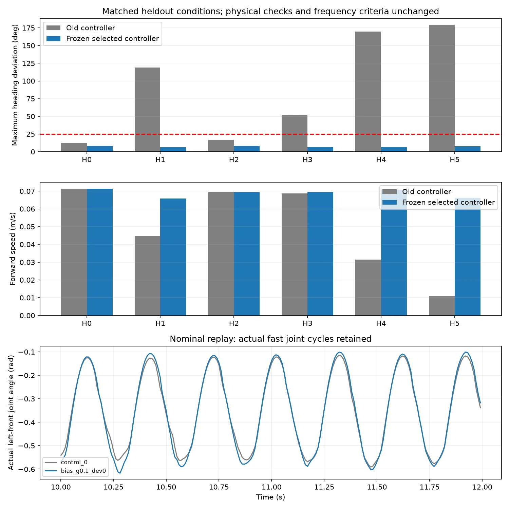

# Quaddle 优化进展与瓶颈：高频慢行之后

**动作可以更密，前进不必很快。** 2026-11-16的后续研究得到一个约3.34 Hz的仿真慢行候选。同一组六项扰动中，旧控制器2/6通过，新控制器6/6通过；它没有解决原始坑洼、连续上台阶或腾空跑。此前分场景结果见[多场景实验](./experiments.md)。

这是四关节反馈控制优化，没有新增PPO训练，没有修改默认步态或动力学，也没有真机验证。每项是运动20秒加启动2秒的固定条件回放；6/6不是统计意义上的100%成功率。

## 看实际动作与方向改善 \{#cadence}

<video controls playsInline preload="none" src={require('./figs/optimization/cadence-optimized.mp4').default} poster={require('./figs/optimization/cadence-optimized.webp').default} style={{width: '100%', maxWidth: 960}} />

视频为实际22秒原速回放，保留启动；不是加速播放。Hz指一条腿驱动关节每秒完整往返次数，不是四腿落脚次数之和，也不是100 Hz控制更新率。

| 标称指标 | 旧3.34 Hz候选 | 新候选 |
| --- | ---: | ---: |
| 前进均速 | 0.07025 m/s | 0.06953 m/s |
| 最大偏航 | 17.39° | 7.62° |
| 实际驱动关节峰值 | 8.929 rad/s | 8.929 rad/s |
| 实际主要动作频率 | 约3.34 Hz | 约3.34 Hz |

新候选的四腿在5–22秒各有57个明显角度峰；FFT主峰为3.352941 Hz，峰间隔估计约3.333333 Hz，与指令3.342608 Hz在采样分辨率内一致。实际关节角P95−P5为0.416–0.486 rad，保留明显往返动作。

### 纠偏改在哪里 \{#controller}

保持频率、基础摆幅和前后腿相位，改用小幅左右中位角差纠偏，关闭原来直接并入航向误差的横向位置项。控制器只写四个位置目标，不改机身状态、不施加推进外力。

```text
steering_profile = bias
heading_kp = 0.1
heading_kd = 0.03
steering_limit = 0.12 rad
lateral_kp = 0
frequency = 3.342608 Hz
```

保留原8 rad/s目标变化上限和实际关节10 rad/s检查。单独把横向位置反馈关闭，低摩擦条件仍偏航约179.91°；因此不能说只删除一个反馈项就解决了问题。大增益也不必然有效：一个后腿摆幅候选初筛通过，却在高摩擦条件出现61.68°偏航及10.703 rad/s超速。

### 冻结参数后再复测 \{#validation}

先在六项开发条件中选参，再冻结一个候选，在以下六项条件复测；旧控制器也运行完全相同的条件。新候选在开发条件和冻结复测中均6/6通过。

| 条件 | 旧方案最大偏航 | 新方案最大偏航 | 旧 / 新快步检查 |
| --- | ---: | ---: | --- |
| 航向−1.5°、摩擦×0.95 | 11.92° | 8.19° | 通过 / 通过 |
| 航向+1.5°、摩擦×1.05 | 119.09° | 6.50° | 未过 / 通过 |
| 横向位置−7.5 mm | 16.89° | 7.98° | 通过 / 通过 |
| 横向位置+7.5 mm | 52.27° | 6.96° | 未过 / 通过 |
| 摩擦×0.95 | 169.87° | 6.70° | 未过 / 通过 |
| 摩擦×1.05 | 179.27° | 7.80° | 未过 / 通过 |

六项新结果均速0.06579–0.07140 m/s、实际关节峰值最高9.090 rad/s；姿态、触地、闭环、力矩和外力检查通过。



这是航向保持优化，尚非精确路线跟踪。新候选仍有最高约7.2 cm横向偏移；第一项横偏还由旧方案约5.7 cm增至7.2 cm，并非所有指标同时改善。

## 哪些优化还没有通关 \{#bottlenecks}

| 场景 / 目标 | 本轮有证据的进展 | 当前瓶颈 |
| --- | --- | --- |
| 高频慢行 | 约3.34 Hz，匹配复测2/6→6/6 | 仅验证列出的短时条件；4–6 Hz能跟关节频率但仍偏航，不是可用行走档 |
| 2 mm单阶 | 受阻脚回撤修复一个边缘+15 mm的失败条件，偏航85.37°→20.53° | 改变边缘位置仍失败，不能说2 mm以内全能过 |
| 2 mm三阶 | 标称可过，部分扰动改善 | 固定恢复候选在含平地、台阶和坑洼的混合复测中仅4/10通过；还曾使一个旧通过条件退步，未全局采用 |
| 原始随机坑洼±3 mm | 明确了相邻格最高约5.759 mm突变及接触/航向问题 | 三张原始地图仍失败；平缓坑洼通过不能替代原任务 |
| 4 mm三阶上行 | 保留原失败证据 | 推进与偏航未解决，优化暂停；未证明机构不可行 |
| 原腾空跑目标 | 预测控制可在标称下同时限速并保留腾空：0.06011 m/s、9.938 rad/s、27段 | 仍达不到0.1 m/s；降低摩擦又可能超速，没有完整跑步通过结果 |
| 走→跑→减速→转弯→停稳 | 首轮PPO中走、转弯分段通过 | 跑、减速、停止分段未过，后续优化暂停 |

此前基础版已验证的平地、坡面、下台阶和平缓坑洼继续保留各自有限条件结论。**没有验证把本页高频配置直接搬到这些地形；不全局替换已有分场景控制。**

跑步专项PPO首轮131,072步、对照131,072步，均未得到原跑步通过结果；组合另训练32,768步，也未整体通过。最近的高频改善来自反馈控制优化，不能描述成PPO已经学会这些动作。此PR不包含上述checkpoint或完整训练重跑链路，只提供结果记录与高频控制复跑入口。

### 快步与腾空跑是两套判据 \{#criteria}

本页快步要求：指令≥3.3 Hz、四腿实测频率误差≤15%、每腿实际角度P95−P5≥0.12 rad、20秒前进≥0.1 m，并保留原姿态、机身触地、航向、关节速度、力矩、闭环及外力检查。不要求完整腾空或0.1 m/s。

原`run_attempt`仍要求均速≥0.1 m/s、至少3段已完成且各≥10 ms的无地形接触区间，以及其余原检查。脚本同时保存`cadence_pass`和原`result.passed`；新目标通过不能回填为原跑步通过。

### 模型还缺什么证据 \{#model-limits}

单腿一个驱动、其余连杆被动，不能独立指定膝关节或任意足端轨迹。当前弹簧是未标定的关节扭转近似，舵机、摩擦和接触也未实机标定；10 rad/s是项目验收阈值，不是测得的电机极限。现有失败不能证明硬件设计有问题，仿真通过也不能保证真机通过。

下一步应分开研究：高频慢行的长时间/组合指令验证；台阶进入边缘前的落脚与支撑时序；腾空跑的推进与限速联合优化。实机迁移前先做模型和接口标定，而非只加同配方训练步数。

## 自己复跑这组对照 \{#reproduce}

按[入门页](./index.md#安装和运行)安装Python依赖，并确认LFS网格已展开。在`codes/practices/quadruped/quaddle-mujoco`执行：

```bash
# 固定新旧配置，标称+六项复测；每个条件22秒，保留失败
OPENBLAS_NUM_THREADS=1 OMP_NUM_THREADS=1 .venv/bin/python evaluate_cadence.py --workers 3 --output outputs/cadence-review
# 只录新候选的标称视频；使用新目录以保留旧证据
MUJOCO_GL=egl .venv/bin/python evaluate_cadence.py --controller optimized --suite nominal --video --output outputs/cadence-video
```

输出含原物理检查、独立快步结果、关节采样与频率测量。脚本拒绝覆盖已存在的单项输出。`cadence_controller.py`和`reference/cadence-*.json`是实验入口；默认Python/网页步态均未替换。

原始研究记录及全部73次回合指标见源码`reports/optimization-2026-11-16.json`。运行环境Python 3.12、MuJoCo 3.16.0，记录来源提交`b0e5ec7`；模型SHA256为`10d1990f12c2dc79b739b67203422ff8a0090a01e424dacf780b9a03d6015b83`。确定性接触仿真对版本与数值变化敏感，复现时请比较完整检查与轨迹。

## 动手判断一次失败 \{#exercise}

1. 先对比`cadence_pass`与原`result.passed`，解释为何同一条轨迹可以“快步通过、跑步未过”。
2. 在独立输出目录只改初始航向或摩擦，检查偏航、实际频率和横向偏移哪一项先变化。
3. 用关节角波形判断4 Hz指令是否真的变成4 Hz动作，再讨论它是否能沿目标方向行走。指令频率、动作频率和前进速度分别测量。
