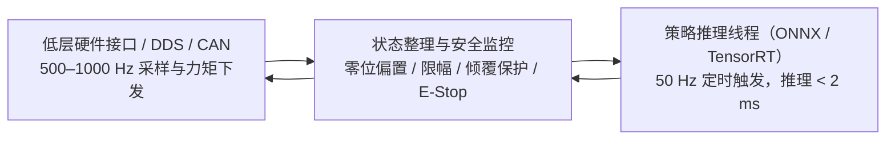

# Sim2Real 工程部署指南

Sim2Sim 验证通过后，策略与真实物理世界之间仍然存在 **Sim2Real Gap**：电机热衰减、通信抖动、传感器噪声、结构弹性与地面摩擦不确定性。本指南总结一套面向四足机器人的工程化 Sim2Real 落地与安全防护流程。

## 1. Sim2Real Gap 的五大来源与对策 \{#gap-sources}

| 差异来源 | 真机典型表现 | 训练期对策 | 部署期对策 |
| :--- | :--- | :--- | :--- |
| **执行器动力学** | 电机电流饱和、温升后扭矩下降、齿轮背隙与库仑摩擦 | 电机力矩限幅、PD 增益随机化、摩擦/转子惯量随机化（参见 BAM 模型） | 标定真实 `kp / kd`、严格按实机峰值限制指令变化率 |
| **通信与推理延迟** | 从采样到力矩生效存在 10–35 ms 环路延迟，引起腿部震荡 | 对观测或动作引入 1–3 步延迟随机化（`DelayedActuator`） | 固定实时推理线程优先级、记录端到端耗时分布 |
| **质量与质心偏差** | 加装电池、雷达或计算盒后重心前后/左右偏移 | 随机化机身与负载质量、惯量张量及 CoM 偏移 | 实测称重并更新 URDF/MJCF 惯性参数 |
| **IMU 与编码器误差** | IMU 安装倾角偏置、陀螺仪零偏、关节零位误差 | 观测注入噪声、IMU 安装角小幅随机旋转与编码器偏置 | 上电静态零偏标定、硬件限位机械校准 |
| **地面接触与摩擦** | 瓷砖打滑、地毯阻力大、碎石/门槛局部冲击 | 地面摩擦系数（如 `0.3–1.3`）与恢复系数随机化 + 随机外力推撞 | 防滑足垫维护、低摩擦地面下调最大指令速度 |

## 2. 真机实时部署软件架构 \{#deployment-architecture}

真机切忌把强化学习推理和电机通信写进无保护的阻塞循环，标准架构拆分为**三层解耦**：

- **有限状态机（FSM）**：至少包含 `Passive（阻尼保护）` → `FixStand（PD 缓慢起立）` → `Velocity（RL 策略接管）` → `E-Stop（紧急软切阻尼）` 四个状态（参考 [Go2 官方栈状态机](/docs/practices/amd/unitree-rl-mjx/sim2sim#closed-loop-run)）。
- **推理运行时选择**：优先在机载 CPU / NPU 上运行静态图 **ONNX Runtime**（关闭动态内存分配、固定单线程避免核间抖动）或 **TensorRT**，确保 50 Hz 控制周期（20 ms）下推理耗时稳定低于 2 ms，P99 抖动可控。

## 3. 五阶段安全上机流程（严禁跳步） \{#bringup-checklist}

每次更换新策略权重、修改观测代码或调整 PD 增益后，必须按顺序通过以下五关：

### 阶段 1：离线回放与数值对齐（Dry Run）
- 用一段真机录制的传感器日志（`rosbag` / CSV）离线喂给部署端程序，确认观测向量量级、符号与仿真分布一致，无任何 `NaN` / `Inf` 或异常跳变。

### 阶段 2：悬空吊装干跑（Air-Test）
- 将机器人吊离地面（四足悬空），人员手远离连杆夹点，备好物理急停开关。
- 依次切入 `FixStand`（确认 12 个关节缓慢平滑回到标称站姿，无反向猛甩）与 `Velocity`（给予极小前向指令，肉眼核对四条腿相位交替是否与仿真一致、无高频抖动）。

### 阶段 3：保护绳落地零速站立
- 系好上方安全保护绳（松弛但不阻碍正常站高），平地切入 `FixStand` 站稳后切入策略零速指令 `[0, 0, 0]`。
- 观察至少 30 秒：机身是否持续小幅高频震荡、电机温度与电流是否异常飙升、是否出现明显单向漂移。

### 阶段 4：低速平地闭环测试
- 将最大速度指令临时限幅到标称值的 **30%–50%**，依次测试直行、停稳、小幅转向和侧移，验证急停键能在 1 帧内将所有关节切回安全阻尼模式（`kd > 0, kp = 0`）。

### 阶段 5：渐进放开与抗扰验证
- 逐步恢复全速指令，在不同地面（胶垫、木地板、短绒地毯）及轻推机身条件下记录日志（命令速度、估计速度、关节电流、峰值温度、推理耗时），作为下一轮域随机化调参依据。

## 4. 常见真机故障快速诊断 \{#troubleshooting}

| 现象 | 最常见原因 | 排查动作 |
| :--- | :--- | :--- |
| **切入策略瞬间剧烈甩腿 / 趴地** | 关节映射表错位、符号取反或归一化统计量缺失 | 立刻断电/阻尼保护，回到阶段 1 逐关节打印 `qpos - default` 与 `action` |
| **站立时腿部高频嗡鸣抖动** | 实机控制延迟偏大、`kp` 过高或 `action_rate` 惩罚不足 | 降低实机 `kp` / 提高 `kd` 测试，或在训练中加大延迟随机化与动作平滑项 |
| **原地一直往某一侧歪着走** | IMU 安装倾角偏置、质心未居中或关节零位偏移 | 静止平地读取重力投影向量是否接近 `[0, 0, -1]`，重标关节零点与 IMU 偏置 |
| **在瓷砖上迈步打滑摔倒** | 训练摩擦范围过窄（偏高）或足端落脚切向速度过大 | 扩宽训练摩擦下限至 `0.3–0.4` 并适当提高 `foot_slip` 惩罚 |

## 关联基础与实战 \{#related}

- **前置理论**：[传感器标定与 sim2real](/docs/foundations/perception/sensor-calibration-sim2real) · [ODO、时间戳与状态估计](/docs/foundations/perception/odo-timestamps-state-estimation) · [CAN 与 MCU 通信](/docs/foundations/communication/can-mcu)
- **前置实战**：[四足 Sim2Sim 验证实战指南](/docs/practices/quadruped/sim2sim/placeholder) · [Unitree Go2 官方栈 Sim2Sim](/docs/practices/amd/unitree-rl-mjx/sim2sim) · [SO-101 真机安全测试](/docs/practices/robot-arm/data-collection/so101-lerobot-real)
