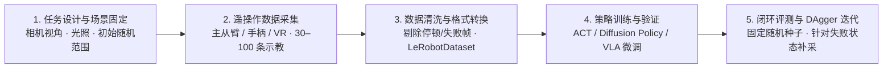

# 自定义任务模仿学习训练实战

相比从零写奖励函数做强化学习，**模仿学习（Imitation Learning）** 允许我们直接通过 30–100 条高质量人类遥操作示教，在单张消费级 GPU 上快速训练出能完成抓取、折叠、插拔等精细操作的策略。本章总结从零搭建自定义机械臂任务的完整工程闭环。

## 1. 端到端数据与训练工作流 \{#workflow}

## 2. 数据采集：决定上限的 80% 工程细节 \{#data-collection}

实测中，模仿学习效果不佳大多数不是模型太小，而是**示教数据一致性差**。采集自定义任务时务必遵守以下规范：

1. **视角与帧率锁定**：推荐至少 **1 路全局第三视角相机 + 1 路腕部第一视角相机**（腕部相机极大提升接触对准精度与空间泛化），所有图像与关节状态严格对齐至固定频率（如 `30 Hz` 或 `50 Hz`）。
2. **动作风格一致（避免多模态冲突）**：同一任务尽量由同一名操作员用统一策略完成——不要一会儿从左侧绕过、一会儿从上方直抓，否则纯 MSE 行为克隆会在两个模态间取平均，导致机械臂停在中间“发呆”。
3. **覆盖合理的初始扰动**：在目标物体的位置与朝向范围内均匀采样（例如 `±8 cm`、`±30°`），并在每条轨迹中自然包含少量“轻微偏位后的修正动作”，能显著缓解闭环部署时的累积误差。
4. **严格清洗脏帧**：剔除起手前长时间静止无动作帧、中途卡顿回退的轨迹以及未真正抓稳的失败回合。

## 3. 主流模仿学习算法选型对照 \{#algorithm-comparison}

| 算法范式 | 核心机制 | 优势 | 局限与适用场景 |
| :--- | :--- | :--- | :--- |
| **Vanilla BC（单步行为克隆）** | 单帧观测直接回归单步动作 | 结构极简、推理最快 | 极易受复合误差（Compounding Error）与多模态平均影响，仅适合极简短任务 |
| **ACT（Action Chunking with Transformers）** | CVAE + Transformer 一次预测未来 $K$ 步动作块 + Temporal Ensembling | **50 条示教即可高成功率收敛**、训练快、对消费级显卡友好 | 对极高维多模态分支表达弱于扩散策略；精细抓放、双臂交接首选 |
| **Diffusion Policy** | 条件去噪扩散模型生成动作序列分布 | 天然建模多模态动作分布、轨迹平滑、抗遮挡强 | 迭代去噪推理开销更高（需 DDIM 加速），对数据量与超参更敏感 |
| **预训练 VLA 微调（如 SmolVLA / $\pi_0$）** | 基于 VLM 预训练先验做动作微调 | 具备自然语言理解与跨物体视觉泛化能力 | 显存与部署算力要求高于轻量专有策略 |

## 4. 闭环评测与高频失败排查 \{#evaluation-debugging}

**训练 Loss 下降不等于闭环成功率高！** 必须在真实环境或仿真中按固定随机种子连续测试至少 20 回合，并记录分阶段成功率（接近 → 对准 → 闭合夹爪 → 抬起 → 放置）：

| 常见失败现象 | 核心原因 | 工程解法 |
| :--- | :--- | :--- |
| **机械臂移到物体旁边停住不动** | 示教数据包含过多“起手静止帧”或不同方向绕行的多模态冲突 | 裁掉静止前导帧、改用 ACT / Diffusion Policy 动作块并开启 Temporal Ensembling |
| **夹爪总是提前 1 cm 闭合或擦边抓空** | 缺少腕部近景视角、相机-状态时间戳不同步、或动作块过长 | 加装腕部相机、核对时间戳延迟、适当缩短执行步长（`n_action_steps`） |
| **训练位姿能成，物体移开 3 cm 就失败** | 初始物体分布覆盖太窄，出现 Covariate Shift | 扩大采样的空间网格，并对常见偏离状态做 10–20 条 **DAgger 式纠偏补采** |
| **换个光照或桌面背景立刻失效** | 视觉编码器过拟合背景纹理 | 启用随机裁剪/颜色抖动（ColorJitter）数据增强，或换用预训练视觉主干 |

## 5. 站内完整实战与理论入口 \{#hands-on}

- **动手复现 ACT 双臂操作**：[ACT 双臂操作训练实战（CUDA）](/docs/practices/vla/act) · [ACT（AMD ROCm）](/docs/practices/amd/vla-act)
- **数据格式与低成本真机采数**：[LeRobot 中文课程讲义](/docs/practices/robot-arm/data-collection/lerobot-course) · [SO-101 + LeRobot 真机教程](/docs/practices/robot-arm/data-collection/so101-lerobot-real)
- **进阶长时程后训练与理论底座**：[π₀.₅ + RECAP（LIBERO 复现）](/docs/practices/vla/recap) · [数据工程与模仿学习理论](/docs/foundations/rl-for-robotics/imitation-learning) · [ACT 原理精读](/docs/foundations/vla/act_action_chunking) · [Diffusion Policy 原理精读](/docs/foundations/vla/diffusion_policy)
