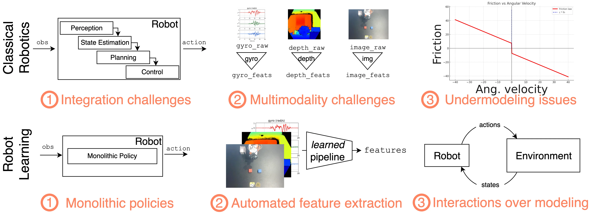

# 机械臂系列

围绕机械臂与双臂桌面操作，串联**物理仿真与连续控制（MuJoCo + DDPG）**、**模仿学习与视觉-语言-动作大模型（ACT + π₀.₅ RECAP）**，以及**开源工具链与低成本硬件部署（LeRobot + SO-101）**三条实战主线。

## 🗂️ 项目总览 \{#projects}

| 分类 | 项目 | 简介 |
| :--- | :--- | :--- |
| 仿真与连续控制 | [MuJoCo 仿真入门](./mujoco-arm-pick-place) | 搭建第一个 MuJoCo 物理环境，掌握 MJCF 模型加载与 Python 闭环控制接口 |
| 仿真与连续控制 | [DDPG 连续控制实验（3 篇）](./ddpg-mujoco/reacher-v5) | 用纯 PyTorch 单文件实现 DDPG，依次攻克 `InvertedPendulum`、`Reacher` 末端追踪与 `Pusher` 接触推物 |
| 模仿学习与双臂操作 | [ACT 双臂操作训练实战](/docs/practices/vla/act) | 基于 ALOHA Transfer Cube 示教数据完成 50k 训练、动作分块预测与 20 回合 MuJoCo 闭环评测 |
| AMD 专区实测 | [ACT 双臂操作训练｜AMD ROCm](/docs/practices/amd/vla-act) | 在 Radeon GPU 上以 BF16 完成 ACT 快速训练、断点续训、闭环评估与回放导出 |
| 长时程 VLA 复现 | [π₀.₅ + RECAP：LIBERO 复现](/docs/practices/vla/recap) | 基于 OpenPI 与 4,096 条 LIBERO rollout，跑通分布式价值头、优势标注与 ACP 策略微调 |
| 数据与算法讲义 | [LeRobot 中文课程讲义](./data-collection/lerobot-course) | 系统梳理经典机器人学瓶颈、`LeRobotDataset` 数据结构与端到端机器人学习工具链 |
| 真机部署 | [SO-101 + LeRobot 真机教程](./data-collection/so101-lerobot-real) | 完成 SO-101 机械臂串口连通、低风险回零安全检查与首次真机动作回放 |
| 工程扩展 | [ROS2 机械臂控制](./ros2-arm-control/placeholder) / [模仿学习训练](./imitation-learning/placeholder) | ROS2 控制链路接入与自定义遥操作采集训练（施工中） |

## 🎬 典型演示 \{#demos}

### 模仿学习与 VLA 双臂 / 桌面操作 \{#vla-demos}

|  **[ACT · ALOHA 双臂方块交接](/docs/practices/vla/act)** 50k 训练 · 100 帧动作块 · MuJoCo 20 回合评测 |  **[ACT · AMD ROCm 双臂操作](/docs/practices/amd/vla-act)** Radeon R9700 BF16 · 10k 快速收敛与闭环回放 |  **[π₀.₅ + RECAP · LIBERO 长时程操作](/docs/practices/vla/recap)** OpenPI 分布式价值预测 + ACP 优势条件微调 |
| :---: | :---: | :---: |

### MuJoCo 连续控制与 DDPG 机械臂基线 \{#ddpg-demos}

|  **[DDPG InvertedPendulum-v5](./ddpg-mujoco/invertedpendulum-v5)** Actor-Critic 连续动作空间最小可运行基线 |  **[DDPG Reacher-v5](./ddpg-mujoco/reacher-v5)** 2-DoF 平面机械臂末端实时追踪随机目标点 |  **[DDPG Pusher-v5](./ddpg-mujoco/pusher-v5)** 7-DoF 机械臂接触推物操作与稀疏奖励分析 |
| :---: | :---: | :---: |

### LeRobot 工具链与真机入门预览 \{#lerobot-demos}

|  **[LeRobot 中文课程讲义](./data-collection/lerobot-course)** Unit 0–2 完整中文整理：运动学、数据集设计与机器人学习范式 |  **[SO-101 + LeRobot 真机教程](./data-collection/so101-lerobot-real)** 从串口校验、安全回零到真实机械臂基础轨迹回放 |
| :---: | :---: |

## 🧭 内容大纲 \{#outline}

### 1. MuJoCo 仿真与 DDPG 连续控制 \{#mujoco-ddpg}

适合作为机械臂强化学习的第一站：所有 DDPG 脚本均为单文件纯 PyTorch 实现（约 330 行），便于对照公式逐行拆解 `ReplayBuffer`、目标网络软更新与探索噪声设计。

| 篇章 | 内容 |
| :--- | :--- |
| [MuJoCo 仿真入门](./mujoco-arm-pick-place) | MuJoCo 安装、MJCF 场景加载与 `mujoco.viewer` Python 交互控制 |
| [DDPG InvertedPendulum-v5](./ddpg-mujoco/invertedpendulum-v5) | 连续动作裁剪、TD 目标引导与 20k 步快速收敛验证 |
| [DDPG Reacher-v5](./ddpg-mujoco/reacher-v5) | 二维机械臂关节力矩控制、末端误差奖励与 GIF 录制导出 |
| [DDPG Pusher-v5](./ddpg-mujoco/pusher-v5) | 七自由度机械臂接触推物、多阶段奖励权衡与 250k 步基线对比 |

### 2. 模仿学习与 VLA 双臂 / 长时程操作 \{#vla-manipulation}

从经典的 CVAE + Transformer 动作分块策略（ACT），进阶到基于视觉-语言-动作基座模型（π₀.₅）的价值引导自我进化（RECAP）。

| 篇章 | 内容 |
| :--- | :--- |
| [ACT 双臂操作训练实战（CUDA）](/docs/practices/vla/act) | 50 条人类示教轨迹加载、100 帧 Action Chunking、bfloat16 训练与多回合成功率统计 |
| [ACT 双臂操作训练（AMD ROCm）](/docs/practices/amd/vla-act) | ROCm 独立依赖锁、Radeon R9700 BF16 训练吞吐实测、断点续训与闭环视频导出 |
| [π₀.₅ + RECAP：LIBERO 长时程复现](/docs/practices/vla/recap) | RLinf 数据校验、分布式价值头训练、优势标签生成、ACP 策略微调与 LIBERO 实时价值曲线可视化 |

### 3. LeRobot 数据工程与 SO-101 真机部署 \{#real-arm}

打通“数据集理解 → 工具链上手 → 真实机械臂安全上电执行”的最后一公里。

| 篇章 | 内容 |
| :--- | :--- |
| [LeRobot 中文课程讲义](./data-collection/lerobot-course) | Hugging Face Robotics Course Unit 0–2 中文重排：平面机械臂运动学、`LeRobotDataset` 时序结构与数据驱动方法演进 |
| [SO-101 + LeRobot 真机教程](./data-collection/so101-lerobot-real) | Ubuntu 环境配置、USB 串口与供电排查、Home 回零安全测试与真机动作回放清单 |
| [ROS2 机械臂控制](./ros2-arm-control/placeholder) | ROS2 控制器接口与机械臂真机执行链路（施工中） |
| [模仿学习训练](./imitation-learning/placeholder) | 自定义任务遥操作数据采集与端到端模仿学习闭环（施工中） |
