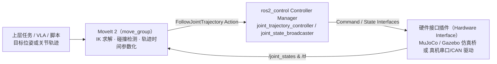

# ROS 2 机械臂控制实战

在实际机器人项目中，算法输出的目标位姿或动作块（Action Chunk）通常需要通过 **ROS 2 + `ros2_control` + MoveIt 2** 构成的标准化控制链路下发到仿真器或真实机械臂。本章梳理从模型描述到闭环执行的核心工程流程。

## 1. ROS 2 机械臂标准控制架构 \{#architecture}



各层职责清晰解耦：
- **URDF + `robot_state_publisher`**：定义连杆、关节限位与运动学树，持续发布 `/tf` 坐标变换；
- **SRDF + MoveIt 2**：定义规划组（Planning Group，如 `arm`、`gripper`）、禁用自碰撞对矩阵（ACM）与预定义命名姿态（如 `home`、`ready`）；
- **`ros2_control`**：统一抽象底层硬件为 `position / velocity / effort` 读写接口，使**同一套上层规划与策略代码无需修改即可在仿真与真机之间切换**。

## 2. 核心配置三件套 \{#config-files}

### ① 在 URDF 中声明 `<ros2_control>` 硬件接口

```xml
<ros2_control name="ArmHardware" type="system">
  <hardware>
    <!-- 仿真阶段可先用 mock_components/GenericSystem 或 gazebo/mujoco 插件，真机替换为驱动插件 -->
    <plugin>mock_components/GenericSystem</plugin>
  </hardware>
  <joint name="joint_1">
    <command_interface name="position">
      <param name="min">-3.14</param>
      <param name="max">3.14</param>
    </command_interface>
    <state_interface name="position"/>
    <state_interface name="velocity"/>
  </joint>
</ros2_control>
```

### ② 配置 `controllers.yaml`

```yaml
controller_manager:
  ros__parameters:
    update_rate: 100  # Hz

    joint_state_broadcaster:
      type: joint_state_broadcaster/JointStateBroadcaster

    arm_controller:
      type: joint_trajectory_controller/JointTrajectoryController

arm_controller:
  ros__parameters:
    joints: [joint_1, joint_2, joint_3, joint_4, joint_5, joint_6]
    command_interfaces: [position]
    state_interfaces: [position, velocity]
    allow_nonzero_velocity_at_trajectory_end: false
```

### ③ 通过 Python Action Client 下发平滑轨迹

不依赖 MoveIt 2 时，也可以直接向 `/arm_controller/follow_joint_trajectory` 发送带时间戳的轨迹点（适合连接学习型策略的动作块输出）：

```python
from control_msgs.action import FollowJointTrajectory
from trajectory_msgs.msg import JointTrajectoryPoint
from builtin_interfaces.msg import Duration

goal = FollowJointTrajectory.Goal()
goal.trajectory.joint_names = ["joint_1", "joint_2", "joint_3", "joint_4", "joint_5", "joint_6"]

pt = JointTrajectoryPoint()
pt.positions = [0.0, -0.4, 0.8, 0.0, 0.4, 0.0]
pt.time_from_start = Duration(sec=2, nanosec=0)
goal.trajectory.points = [pt]
```

## 3. 常见工程坑与排查命令 \{#debugging}

| 问题现象 | 排查命令 | 高频根因 |
| :--- | :--- | :--- |
| MoveIt 2 规划成功但机械臂不动 | `ros2 control list_controllers` | `arm_controller` 未激活，或 `moveit_controllers.yaml` 中的 Action 名称与控制器不一致 |
| 报错 `Invalid Trajectory: start point deviates` | `ros2 topic echo /joint_states --once` | 下发轨迹第 0 点与当前真实关节角偏差超过容忍阈值，或时间同步存在延迟 |
| RViz 模型散架或姿态全错 | `ros2 run tf2_tools view_frames` | `joint_state_broadcaster` 未发布、关节名拼写不匹配或缺少静态外参 `static_transform_publisher` |
| 机械臂抖动或撞击限位 | 检查 `update_rate` 与速度/加速度限幅 | 轨迹时间间隔过短、未做时间参数化（TOTG / Ruckig）或 URDF 限位大于实机物理限位 |

## 4. 配套理论与动手实战 \{#hands-on}

- **系统学习 ROS 2 与 MoveIt 2**：直接进入 [ROS 2 工程基础与 MoveIt 2 完整课程](/docs/foundations/robotics-and-ros2/intro)（第 8–11 章含 `tf2`、`URDF`、`MoveIt 2 基础` 与完整抓取规划综合项目，附 `codes/foundations/robotics-and-ros2/` 源码）。
- **低成本真机接线与安全上电**：配合 [SO-101 + LeRobot 真机教程](/docs/practices/robot-arm/data-collection/so101-lerobot-real) 实操串口标定、软限位保护与回零测试。
- **底层力矩与柔顺控制**：延伸阅读 [阻抗与力控](/docs/foundations/controllers/impedance-force-control) 与 [轨迹跟踪](/docs/foundations/controllers/trajectory-tracking)。
