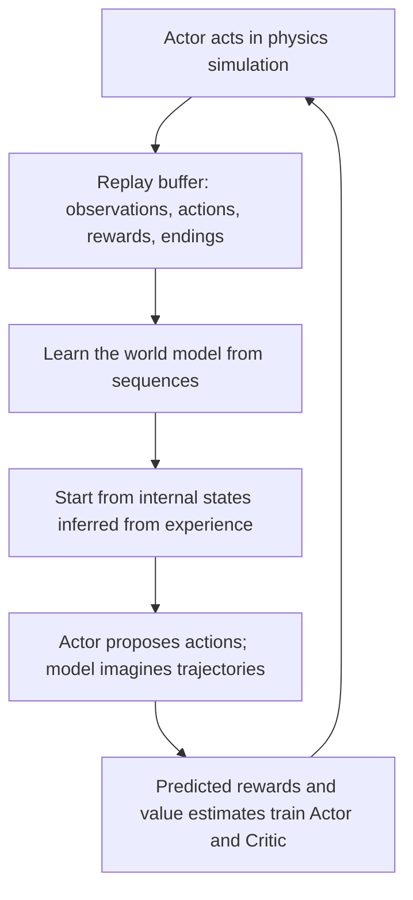
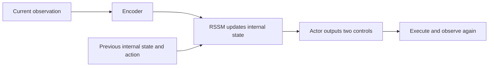

# DreamerV3 experiment: reach a target and hold

**Watch the arm on the right approach the red target, then remain nearby.** This is a physics replay of an actually trained policy for DMControl `reacher_easy`, using two-joint state observations.

## Watch: what did it learn? \{#watch}

<video controls playsInline preload="metadata" poster={require('@site/docs/foundations/world-model/figs/dreamerv3/reacher-comparison.webp').default} src={require('@site/docs/foundations/world-model/figs/dreamerv3/reacher-comparison.mp4').default} style={{width: '100%', borderRadius: 12}} />

**Left: random actions. Right: trained DreamerV3.** The panels share the same initial condition. These are the first 5 simulation seconds, played at **half speed** in roughly 10 seconds. Follow the **orange endpoint** of the yellow arm toward the **red target**. The labels embedded in the shared video are Chinese; panel order is the same in every language.

- **Reach:** the endpoint starts about 28.7 cm from the target center. It first earns reward at simulation time 0.66 s, approximately 1.32 s in the slowed video.
- **Hold:** little movement later is expected: remaining in the target region keeps earning reward. Constant motion is not the task.
- **Compare:** random actions can cross the target accidentally; purposeful approach and sustained occupancy are different.

This 1280×800 comparison replays the recorded actions with higher-resolution physics rendering. Joint positions, velocities and target-relative positions were checked at every step for the first 250 steps; maximum error was below `4e-7`. Actions were not edited. Initial condition 200 was selected in advance for recording, rather than chosen as the best of the final ten.

:::tip An exercise without a GPU
Pause near playback time 1.3 s: has the right arm entered the target region? Continue to distinguish passing through from holding. Then compare the clip with the full-episode metrics below.
:::

## Observations, actions and reward \{#task}

| Item | Configuration |
| --- | --- |
| Observation | Two joint positions, two velocities and a 2D endpoint-to-target vector: 6 values |
| Action | Two continuous joint control values |
| Reward | 1 inside the target region; 0 outside |
| Episode | 1000 control steps, 20 simulated seconds; maximum return 1000 |
| Objective | Reach early and remain in the target region |

**The agent does not see the video.** This experiment uses state inputs; MuJoCo provides physics and the video illustrates behavior. It is neither a visual-control experiment nor a hardware validation.

## Two networks, or one world model? \{#networks}

DreamerV3 is a model-based reinforcement learning algorithm. It has **three functional parts**, implemented by several neural modules:

| Part | Question | Modules in the pinned implementation |
| --- | --- | --- |
| World model | What is the current state, and what happens after an action? | Encoder `enc`, recurrent state-space model `dyn` (RSSM), observation decoder `dec`, reward head `rew`, continuation head `con` |
| Actor | Which action should be taken now? | `pol` |
| Critic | How much future return is expected? | `val`, with a slowly updated value target `slowval` |

The encoder extracts observation features. The RSSM combines them with history and the previous action, using both deterministic recurrent state and stochastic latent variables. Training also predicts observations, rewards and continuation. **One checkpoint can store all these modules; file count is not network count.**

## Training versus inference \{#training-inference}

### Training alternates interaction and learning \{#training-loop}

The world model learns from actual interaction sequences; Actor and Critic learn from imagined trajectories. Inaccurate predictions can mislead the policy, so independent physics evaluation remains necessary. **This experiment does not fully pretrain and freeze the world model before training the policy:** interaction and learning repeat throughout training.

### Inference fixes parameters but still uses part of the world model \{#inference-loop}

The actor does not simply receive raw observations, and the world model does not directly output actions. Critic, reward prediction and imagined trajectories mainly support training. The pinned implementation may compute auxiliary outputs during policy calls, but the decision path is encoding/state update followed by the Actor. Unlike MPC, it need not search many action sequences at each control step.

## Actual results \{#results}

One RTX 4090, one training seed (`0`), the author's small `dmc_proprio` model, and approximately **638,000 trainable parameters**. These are experiment measurements, not a hardware performance guarantee.

| Configuration | Environment steps | Training ratio | Mean return on the same 5 development initial states |
| --- | ---: | ---: | ---: |
| Round 1: pipeline check | 100,008 | 128 | 1.4 |
| Round 2: restore author DMC update ratio | 100,008 | 1024 | 734.6 |
| Round 2: continued training | 300,000 | 1024 | 969.0 |
| Random baseline | No training | — | 32.6 |

`train_ratio` measures training samples relative to new environment steps. **1024 does not mean 1024 optimizer updates per step or 1024 imagined future steps.** Round 2 took about five hours including the intermediate evaluation; final evaluation took additional time.

A further **10 new initial states**, evaluated for 1000 steps each:

| Metric | Random | Final policy |
| --- | ---: | ---: |
| Mean return | 11.7 | **954.8** |
| Mean target occupancy | 1.17% | **95.48%** |
| Lowest episode return | 0 | **851** |

Occupancy over the last 100 steps was 91%–100% for each case. This supports reaching and holding on these ten conditions, not arbitrary conditions, multiple training seeds, image inputs or hardware. Binary rewards make occupancy and return directly related; they are not independent evidence.

### Why retain the failed first round? \{#failed-run}

Checkpoint saving and finite losses did not imply success. Round 1 was worse than random on new initial states; four initial resets from training environments also returned zero. More updates helped at the same roughly 100,000-step budget in this single-seed comparison. The 300,000-step stage also changed the interaction budget, so gains cannot all be attributed to one factor.

| Symptom | Check first |
| --- | --- |
| Low return with finite losses | Reward-bearing experience and update budget |
| Good training logs, poor independent replay | Checkpoint, action wrappers, observations, reset and recurrent state |
| Video appears static | Resolution, speed, first arrival time and whether holding is the objective |
| Good reconstruction, poor control | Reward prediction, value estimates and policy learning |

## Reproduce and experiment \{#reproduce}

[Companion code and per-condition results](https://github.com/datawhalechina/dive-into-embodied-ai/tree/master/codes/foundations/world-model/dreamerv3-reacher) include the patch and independent evaluation script. Follow its README for setup and commands; watching the video requires no training GPU.

Pin the author source to `e01491fad6434b2245a3b8ca201dd7faedcc458c`. The patch adds environment seeding, experiment configuration and final checkpoint saving; it does not change algorithm losses. The tested combination was Python 3.11, JAX 0.4.33, DMControl 1.0.34 and MuJoCo 3.3.6. Training dependencies and GPU setup are separate from the website.

Change only `train_ratio` from 1024 to 128 while holding task, seed, model and environment budget fixed. Compare whole-episode return and final occupancy. Stronger conclusions require multiple training seeds, not a selected best replay.

## References and next steps \{#references}

- [Author project page](https://danijar.com/project/dreamerv3/): algorithm and paper.
- [Pinned Agent implementation](https://github.com/danijar/dreamerv3/blob/e01491fad6434b2245a3b8ca201dd7faedcc458c/dreamerv3/agent.py): the named modules.
- [World-model introduction](/docs/foundations/world-model/intro) and [survey map](/docs/foundations/world-model/survey-and-map).

Preserve this state-input baseline before moving to pixels or harder tasks.
