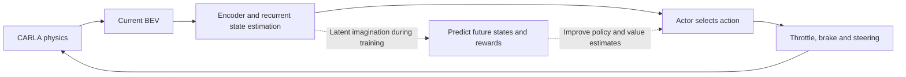

import Tabs from '@theme/Tabs';
import TabItem from '@theme/TabItem';

# CarDreamer intersection experiment: turning with cross traffic

An empty intersection is manageable. What changes when cross traffic is added to the same right turn? Compare two public checkpoints, then inspect predicted future BEV against the actual rollout.

Start with the [DreamerV3 reaching experiment](./2.dreamerv3-reacher.md). Here you will evaluate public checkpoints, distinguish actual interaction from imagined training, and inspect prediction limits visually. Watch driving outcomes, read the code, inspect forecasts, then change one variable. Training a driving policy from scratch is not required.

## Switch scenarios and inspect the behavior \{#watch}

**This run:** simple checkpoint / empty road: 3/3 reached; simple checkpoint / traffic: 1/3 reached and two collisions; medium checkpoint / traffic: 3/3 reached. These are actual closed-loop simulations with no new training.

| Scenario | Public checkpoint | Three-episode run | Interpretation |
| --- | --- | --- | --- |
| Empty right turn | simple | 3 reached, no collision | Basic turn under these conditions |
| Cross traffic, spawn spacing 8–16 m | simple | 1 reached, 2 collisions | Empty-road success does not establish traffic handling |
| Same traffic configuration | medium | 3 reached, no collision | Task-matched weights perform better in this small test |

Each video is the **first episode** of its group, selected in advance. Chase camera left, actual BEV input right.

<Tabs groupId="cardreamer-driving">
<TabItem value="empty" label="1. Empty intersection">

The simple checkpoint approaches, turns and follows the route out.

<video controls playsInline preload="metadata" poster={require('@site/docs/foundations/world-model/figs/cardreamer/poster.webp').default} src={require('@site/docs/foundations/world-model/figs/cardreamer/simple-audited.mp4').default} style={{width: '100%', borderRadius: 12}} />

</TabItem>
<TabItem value="transfer" label="2. Add traffic">

The same simple checkpoint faces crossing vehicles. A collision with `vehicle.audi.etron` was recorded. The video and sensor establish contact, not responsibility.

<video controls playsInline preload="metadata" poster={require('@site/docs/foundations/world-model/figs/cardreamer/traffic.webp').default} src={require('@site/docs/foundations/world-model/figs/cardreamer/traffic-transfer.mp4').default} style={{width: '100%', borderRadius: 12}} />

</TabItem>
<TabItem value="matched" label="3. Matched checkpoint">

The medium checkpoint completes this traffic episode without manually added braking rules or altered policy actions.

<video controls playsInline preload="metadata" poster={require('@site/docs/foundations/world-model/figs/cardreamer/traffic-matched.webp').default} src={require('@site/docs/foundations/world-model/figs/cardreamer/traffic-matched.mp4').default} style={{width: '100%', borderRadius: 12}} />

</TabItem>
</Tabs>

Each group has three consecutive episodes, fixed seed `2024`, a separately started CARLA instance and the same road/configuration. This is not multi-seed robustness testing; traffic trajectories are not guaranteed identical across policies. Time below 0.2 m/s is 0.3–0.8 seconds including startup, so **reliable stopping and yielding has not been established**.

We use CARLA 0.9.15 **Town03_Opt**, while the author specifies Town03. The OpenDRIVE hashes match, but full scene equivalence is unproven. No real-car validation has been performed.

## What does the car observe? \{#observation}

| View | Source | Purpose |
| --- | --- | --- |
| HD chase camera | CARLA rendering | Shows vehicle motion; not a policy input |
| `birdeye_wpt` | Simulator ground-truth BEV with roads, vehicles, route and visible background-vehicle waypoints | Actual visual input of the public policy |
| World-model predictions | Learned latent dynamics and decoder | Exported from saved latent states and actions; see prediction videos above |

This is not front-camera-only driving. Ground-truth BEV and route information reduce perception complexity and make the control pipeline easier to study. Real-camera input requires additional perception, training and validation.

## Where is the world model used? \{#method}

CarDreamer supplies driving tasks and a Dreamer-style model/training implementation. We reproduce its `right_turn_simple.ckpt` and `right_turn_medium.ckpt`; the reaching checkpoint cannot directly control a car.



During training the world model learns dynamics, rewards and continuation from environment interactions. Actor and Critic learn using imagined trajectories. At evaluation time observations and history update the latent state, and the Actor produces actions. **This evaluation does not perform online MPC trajectory search at every step.**

## Code comparison: where do PPO and Dreamer learn? \{#code}

**Separate upstream training from this evaluation.** These excerpts explain how the public implementation trains. This run only loaded checkpoints, executed policies and exported forecasts; it performed no training updates. Links point to the pinned source.

| Stage | Typical PPO training | Dreamer training here |
| --- | --- | --- |
| Environment interaction | Collect observations, actions and rewards in the physical simulator | Also collect interactions, stored in replay |
| Learn dynamics | No separately trained transition model | Train a world model on actual sequences |
| Policy update targets | Rewards, values and advantages from actual trajectories | Predicted rewards and values along imagined trajectories |
| Challenges | Interaction cost, exploration and optimization | Also exploiting errors in the learned model |

**1. Actual interaction trains the model.** The [training loop](https://github.com/ucd-dare/CarDreamer/blob/160132436aeda1de54956f9910e56f3970a565aa/dreamerv3/embodied/run/train.py#L61-L81) stores `tran` in `replay`, samples sequences and calls `agent.train()`. The [update entry point](https://github.com/ucd-dare/CarDreamer/blob/160132436aeda1de54956f9910e56f3970a565aa/dreamerv3/agent.py#L71-L79) trains the world model before the behavior:

```python
# Agent.train(): excerpt from the pinned upstream source
state, wm_outs, mets = self.wm.train(data, state)
context = {**data, **wm_outs["post"]}
start = tree_map(lambda x: x.reshape([-1] + list(x.shape[2:])), context)
_, mets = self.task_behavior.train(self.wm.imagine, start, context)
```

`wm.train()` updates the encoder, RSSM, image decoder, reward and continuation heads. `post` is an internal state corrected using actual observations; it supplies imagination starting points. The [model loss](https://github.com/ucd-dare/CarDreamer/blob/160132436aeda1de54956f9910e56f3970a565aa/dreamerv3/agent.py#L160-L187) combines observation/reward/continuation prediction losses and latent-dynamics constraints. The environment defines the reward target; the model learns to predict it.

**2. The policy tries actions inside the model.** The [imagination loop](https://github.com/ucd-dare/CarDreamer/blob/160132436aeda1de54956f9910e56f3970a565aa/dreamerv3/agent.py#L189-L206) alternates Actor actions and predicted RSSM states:

```python
# WorldModel.imagine(): excerpt
start["action"] = policy(start)

def step(prev, _):
    prev = prev.copy()
    state = self.rssm.img_step(prev, prev.pop("action"))
    return {**state, "action": policy(state)}
```

There is no CARLA step or next real BEV here. Compare PPO data collection, `next_obs, reward, ... = env.step(action)`: the next-state source changes from the physical simulator to learned `img_step()`. PPO may reuse a collected batch for several updates; using actual trajectories does not mean running a new simulation for every gradient update.

**3. Predicted rewards train Actor and Critic.** The [task behavior](https://github.com/ucd-dare/CarDreamer/blob/160132436aeda1de54956f9910e56f3970a565aa/dreamerv3/behaviors.py#L10-L26) scores imagined states using the world-model reward head:

```python
# Greedy.__init__(): predicted rewards for imagined trajectories
rewfn = lambda s: wm.heads["reward"](s).mean()[1:]
```

[ImagActorCritic.train()](https://github.com/ucd-dare/CarDreamer/blob/160132436aeda1de54956f9910e56f3970a565aa/dreamerv3/agent.py#L294-L305) generates imagined trajectories, updates the Actor, then trains the Critic. Continuous actions here default to Actor gradients through the differentiable model. This step optimizes Actor parameters; the world model has its own optimizer. Training alternates actual interaction, model learning and imagined behavior learning, rather than freezing the model forever after one training phase.

**4. Execution still uses actual observations.** The [policy entry point](https://github.com/ucd-dare/CarDreamer/blob/160132436aeda1de54956f9910e56f3970a565aa/dreamerv3/agent.py#L47-L69) corrects the internal state with the current image before selecting an action:

```python
# Agent.policy(): observation correction, then action selection
embed = self.wm.encoder(obs)
latent, _ = self.wm.rssm.obs_step(
    prev_latent, prev_action, embed, obs["is_first"]
)
task_outs, task_state = self.task_behavior.policy(latent, task_state)
```

`obs_step()` receives actual image features; `img_step()` does not. The distinction is observation correction versus prediction without the next observation. The forecast video below separately supplies recorded future actions to RSSM and decodes predicted images. It is an offline diagnostic, not Actor training or online MPC.

<details>
<summary>Code-reading question: what if actual interaction is removed and imagination runs forever?</summary>

The model receives no fresh evidence to correct errors. A policy may discover actions whose rewards the model overestimates. Higher imagined returns do not guarantee better CARLA driving. Model-based training still needs physical-simulator evaluation; driving outcomes and forecast images are complementary checks.

</details>

## Inspect what the world model predicts \{#prediction}

BEV in the driving videos is simulator truth. The following videos show **model predictions**: actual future left, prediction center, absolute image error amplified 4× right. Switch between empty road and traffic to see where predictions drift.

<Tabs groupId="cardreamer-prediction">
<TabItem value="empty" label="Empty-road prediction">

<video controls playsInline preload="metadata" poster={require('@site/docs/foundations/world-model/figs/cardreamer/prediction.webp').default} src={require('@site/docs/foundations/world-model/figs/cardreamer/prediction-simple.mp4').default} style={{width: '100%', borderRadius: 12}} />

</TabItem>
<TabItem value="traffic" label="Traffic prediction">

<video controls playsInline preload="metadata" poster={require('@site/docs/foundations/world-model/figs/cardreamer/prediction-traffic.webp').default} src={require('@site/docs/foundations/world-model/figs/cardreamer/prediction-traffic.mp4').default} style={{width: '100%', borderRadius: 12}} />

</TabItem>
</Tabs>

Three windows were fixed in advance: at simulation **2 / 6 / 10 seconds**, use the latent state filtered from observations so far and predict **20 steps / 2 seconds**. Playback is 0.5×, roughly four seconds per window. Native BEV is 128×128, enlarged for viewing.

- The model receives the **recorded actions actually executed** during the window, with no future images. This is offline action-conditioned forecasting.
- Driving actions still come from the Actor; these videos are not online search over candidate routes.
- RSSM prediction samples are stochastic. We export one sample per window, without estimating uncertainty.

| Mean normalized RGB pixel MAE over fixed windows (lower is better) | Model | Hold current frame |
| --- | --- | --- |
| Empty / simple, 9 windows | 0.0251 | 0.0896 |
| Traffic / simple, 9 windows | 0.0512 | 0.0922 |
| Traffic / medium, 9 windows | 0.0337 | 0.0953 |

Errors use RGB values in 0–1 and include all preselected windows, including collision episodes. Road pixels dominate: **low mean pixel error does not establish accurate vehicle positions or collision prediction.** Each checkpoint contains both world model and policy, so driving differences cannot be attributed solely to forecasting accuracy.

## Make the experiment auditable \{#engineering}

The runner checks for an empty scene, cleans up and audits after every episode, logs collision partners and saves partial records. All nine episodes completed driving and forecasting, with empty post-cleanup scenes. Camera and BEV use matching simulator frame IDs; 3–10 missing frames per video are omitted while simulation timestamps remain visible, so playback is slightly shorter.

The original Town03 still crashes in the Vulkan pipeline. Town03_Opt runs after rebuilding its problematic traffic-manager cache; see the code README. Client timeout was increased from 20 to 60 seconds; none of these nine episodes timed out. This does not establish the root cause of the earlier timeout.

Earlier four-success/one-system-timeout results and reused-scene collisions remain debugging records, excluded from this batch. The two failures in this batch are retained.

## What counts as success? \{#evaluation}

| Check | Criterion |
| --- | --- |
| Destination | Environment `destination_reached`: at most three route waypoints remain |
| No collision | `is_collision`, observed collision and independent sensor all stay clear |
| Stay on route | `out_of_lane` does not trigger; this is a waypoint-distance threshold, not lane-marking detection |
| No timeout | Neither `time_exceeded` nor evaluator truncation occurs |

Count success only when destination is reached and all failure flags are false. Keep model/task parameters fixed and save consecutive episodes instead of selecting attractive clips. Report termination reasons, steps and video per episode; reward is supplementary.

The upstream collision check uses the latest observation and can lag by one frame. Passing a finite evaluation only supports those simulation conditions. Additional traffic seeds and collision checks near termination are needed.

## Reproduce the experiment \{#reproduce}

Pinned versions: CarDreamer `160132436aeda1de54956f9910e56f3970a565aa`, CARLA 0.9.15, Python 3.10, Town03_Opt, tasks `carla_right_turn_simple` / `carla_right_turn_medium` (the author uses Town03). Follow the [author setup instructions](https://github.com/ucd-dare/CarDreamer) for dependencies and offscreen rendering, and obtain the [public right-turn checkpoint](https://huggingface.co/ucd-dare/CarDreamer/tree/main/CarDreamer_checkpoints).

The new `experiment.py` completed three groups of three episodes, forecasts and cleanup audits. Follow the code README for dependencies, `eval-compat.patch` and a dedicated Town03_Opt server. Each group starts a separate server; the runner requires no existing vehicles or sensors.

```bash
# Start CARLA in a separate terminal on an unused port.
./CarlaUE4.sh -RenderOffScreen -nosound -carla-port=22000 -benchmark -fps=10

python experiment.py --source /path/to/CarDreamer \
  --checkpoint /path/to/right_turn_simple.ckpt \
  --output results/traffic --port 22000 --task carla_right_turn_medium --episodes 3 --seed 2024
```

Outputs include each episode’s `replay.mp4`, terminal flags, `collisions.json`, `scene-after-cleanup.json`, `trajectory.npz`, three `forecast-*.npz` files and `forecasts.json`. Render the three-panel forecast below (system FFmpeg required). See the [code README](https://github.com/datawhalechina/dive-into-embodied-ai/tree/master/codes/foundations/world-model/cardreamer-right-turn) for all three groups and checkpoint hashes. The display camera is separate from policy input; actions are not manually altered. Load trusted checkpoints only.

```bash
python render_forecasts.py results/traffic/episode-00 --output prediction-traffic.mp4
```

## Three exercises \{#exercise}

1. Predict whether empty-road weights can handle traffic before watching, then inspect collision records.
2. Pause a forecast window at +1 second. Compare prediction, truth and the frozen-frame baseline; which regions dominate error?
3. Change only the traffic seed and report every episode. Three same-seed episodes are not three independent seeds.

This chapter provides an inspectable public-checkpoint demo and prediction export. Before training a new policy, fix the task, acceptance criteria and evaluation seeds.
