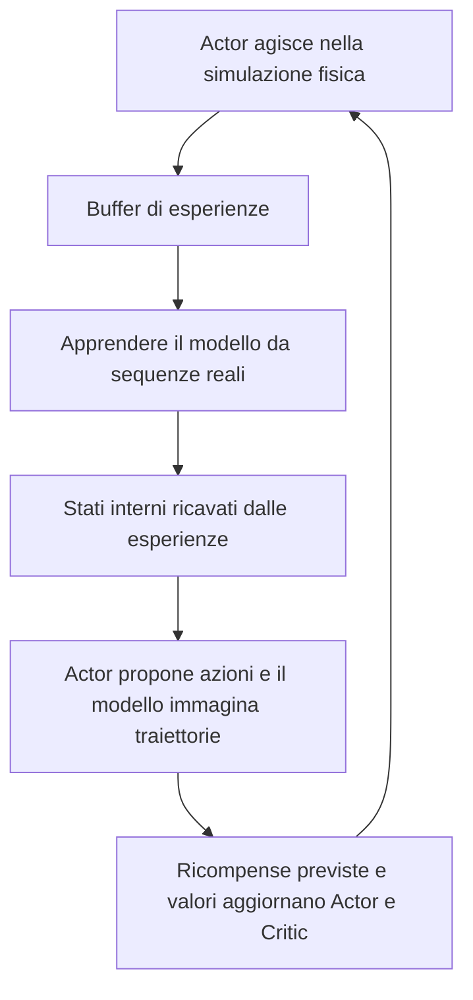
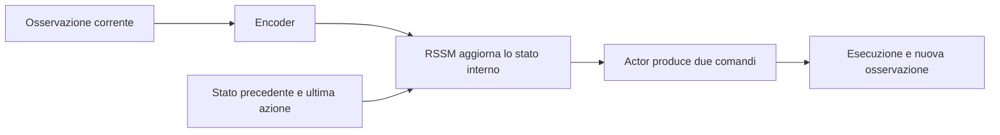

# Esperimento DreamerV3: raggiungere un bersaglio e mantenerlo

**Il braccio a destra si avvicina al bersaglio rosso e rimane nelle vicinanze.** È una riproduzione fisica di una policy realmente addestrata su DMControl `reacher_easy`, con osservazioni di stato di due giunti.

## Video: che cosa ha imparato? \{#watch}

<video controls playsInline preload="metadata" poster={require('@site/docs/foundations/world-model/figs/dreamerv3/reacher-comparison.webp').default} src={require('@site/docs/foundations/world-model/figs/dreamerv3/reacher-comparison.mp4').default} style={{width: '100%', borderRadius: 12}} />

**Sinistra: azioni casuali. Destra: DreamerV3 addestrato.** Stessa condizione iniziale; i primi 5 secondi simulati sono riprodotti a **metà velocità**, in circa 10 secondi. Segui l'**estremità arancione** del braccio giallo verso il **bersaglio rosso**. Le etichette incorporate nel video condiviso sono in cinese; l'ordine dei pannelli rimane identico.

- **Raggiungere:** la distanza iniziale dal centro è circa 28,7 cm. La prima ricompensa arriva a 0,66 s simulati, circa 1,32 s nel video rallentato.
- **Mantenere:** muoversi poco dopo l'arrivo è coerente con il compito: rimanere nella regione bersaglio continua a produrre ricompensa.
- **Confrontare:** anche azioni casuali possono attraversare il bersaglio; arrivarci intenzionalmente e restarci è diverso.

Il confronto 1280×800 riproduce le azioni salvate con rendering fisico ad alta risoluzione. Posizioni, velocità e vettore verso il bersaglio sono stati confrontati passo per passo per i primi 250 passi: errore massimo inferiore a `4e-7`. Le azioni non sono state modificate. La condizione 200 era prestabilita per la registrazione, non scelta come migliore tra le dieci finali.

:::tip Esercizio senza GPU
Metti in pausa intorno a 1,3 s: il braccio destro è entrato nella regione bersaglio? Prosegui per distinguere un attraversamento dal mantenimento. Confronta poi il video con le metriche dell'intero episodio.
:::

## Osservazioni, azioni e ricompensa \{#task}

| Elemento | Impostazione |
| --- | --- |
| Osservazione | Due posizioni articolari, due velocità e vettore 2D verso il bersaglio: 6 valori |
| Azione | Due comandi articolari continui |
| Ricompensa | 1 nella regione bersaglio, 0 fuori |
| Episodio | 1000 passi di controllo, 20 secondi simulati; ritorno massimo 1000 |
| Obiettivo | Arrivare presto e rimanere nella regione |

**Il modello non vede il video.** Usa lo stato numerico; MuJoCo fornisce la fisica e il video mostra il comportamento. Non è una verifica del controllo visivo o di un robot reale.

## Due reti o un solo modello del mondo? \{#networks}

DreamerV3 è un algoritmo di apprendimento per rinforzo basato su modello. Ha **tre parti funzionali**, implementate mediante più moduli neurali:

| Parte | Domanda | Moduli della versione fissata |
| --- | --- | --- |
| Modello del mondo | Qual è lo stato e cosa succede dopo un'azione? | Encoder `enc`, modello ricorrente RSSM `dyn`, decoder `dec`, testa della ricompensa `rew`, testa di continuazione `con` |
| Actor | Quale azione scegliere? | `pol` |
| Critic | Quanto ritorno futuro aspettarsi? | `val`, con obiettivo aggiornato lentamente `slowval` |

L'encoder estrae caratteristiche; RSSM le combina con la storia e l'azione precedente usando uno stato ricorrente deterministico e variabili latenti stocastiche. Durante l'addestramento si predicono anche osservazioni, ricompense e continuazione. **Un checkpoint può contenere tutti i moduli: il numero di file non è il numero di reti.**

## Addestramento e inferenza \{#training-inference}

### Addestramento: interazione e apprendimento alternati \{#training-loop}

Il modello apprende dalle interazioni effettive; Actor e Critic dalle traiettorie immaginate. Previsioni sbagliate possono ingannare la policy: serve una valutazione fisica indipendente. **Non si completa e congela prima il modello per poi addestrare una sola volta la policy:** il ciclo continua ad aggiornare le parti.

### Inferenza: parametri fissi, ma parte del modello rimane necessaria \{#inference-loop}

Actor non riceve semplicemente osservazioni grezze e il modello non produce direttamente le azioni. Critic, previsione della ricompensa e traiettorie immaginate servono soprattutto all'addestramento. La versione fissata può calcolare uscite ausiliarie, ma la catena decisionale è codifica/aggiornamento dello stato → Actor. A differenza di MPC, non occorre cercare molte sequenze a ogni passo di controllo.

## Risultati effettivi \{#results}

Una RTX 4090, un seed di addestramento (`0`), configurazione piccola `dmc_proprio`, circa **638.000 parametri addestrabili**. Sono misure dell'esperimento, non garanzie sulle prestazioni hardware.

| Configurazione | Passi ambiente | Rapporto di addestramento | Ritorno medio sugli stessi 5 stati iniziali di sviluppo |
| --- | ---: | ---: | ---: |
| Prima prova del processo | 100.008 | 128 | 1,4 |
| Seconda prova, rapporto DMC dell'autore | 100.008 | 1024 | 734,6 |
| Seconda prova proseguita | 300.000 | 1024 | 969,0 |
| Azioni casuali | Nessun addestramento | — | 32,6 |

`train_ratio` misura i campioni di addestramento rispetto ai nuovi passi ambiente. **1024 non significa 1024 aggiornamenti dell'ottimizzatore per passo, né 1024 passi futuri immaginati.** La seconda prova ha richiesto circa cinque ore, inclusa la valutazione intermedia; quella finale richiede tempo aggiuntivo.

Ulteriori **10 nuovi stati iniziali**, ciascuno valutato per 1000 passi:

| Metrica | Casuale | Policy finale |
| --- | ---: | ---: |
| Ritorno medio | 11,7 | **954,8** |
| Occupazione media del bersaglio | 1,17% | **95,48%** |
| Ritorno minimo per episodio | 0 | **851** |

Negli ultimi 100 passi, ogni caso rimane nel bersaglio per il 91%–100% del tempo. Questo sostiene il successo sulle dieci condizioni, non su condizioni arbitrarie, più seed, immagini o hardware. Con ricompensa binaria, occupazione e ritorno sono direttamente collegati: non sono prove indipendenti.

### Perché conservare la prima prova fallita? \{#failed-run}

Checkpoint e loss finite non significano successo. La prima prova era peggiore del caso; anche quattro stati iniziali degli ambienti di addestramento davano ritorno zero. Più aggiornamenti hanno aiutato a parità di circa 100.000 passi in questo confronto con un solo seed. A 300.000 passi cambia anche il budget di interazione: non si può attribuire tutto a un singolo fattore.

| Sintomo | Primo controllo |
| --- | --- |
| Ritorno basso, loss finite | Esperienze con ricompensa e budget di aggiornamenti |
| Buoni log, riproduzione scarsa | Checkpoint, wrapper delle azioni, osservazioni, reset e stato ricorrente |
| Video apparentemente statico | Risoluzione, velocità, tempo di arrivo e obiettivo di mantenimento |
| Buona ricostruzione, scarso controllo | Ricompensa prevista, valore e apprendimento della policy |

## Riproduzione ed esercizio \{#reproduce}

[Codice e risultati per condizione](https://github.com/datawhalechina/dive-into-embodied-ai/tree/master/codes/foundations/world-model/dreamerv3-reacher): patch, valutazione indipendente e README con comandi. Per guardare il video non serve una GPU di addestramento.

Versione dell'autore: `e01491fad6434b2245a3b8ca201dd7faedcc458c`. La patch aggiunge seed, configurazione e salvataggio finale, senza modificare le loss. Combinazione verificata: Python 3.11, JAX 0.4.33, DMControl 1.0.34, MuJoCo 3.3.6. Ambiente GPU e dipendenze di addestramento sono separati dal sito.

Modifica solo `train_ratio` da 1024 a 128 mantenendo compito, seed, modello e budget invariati. Confronta ritorno completo e occupazione finale. Per conclusioni più forti occorrono più seed, non il video migliore.

## Riferimenti e passi successivi \{#references}

- [Pagina dell'autore](https://danijar.com/project/dreamerv3/): algoritmo e articolo.
- [Implementazione Agent fissata](https://github.com/danijar/dreamerv3/blob/e01491fad6434b2245a3b8ca201dd7faedcc458c/dreamerv3/agent.py): moduli citati.
- [Introduzione](/docs/foundations/world-model/intro) e [mappa della letteratura](/docs/foundations/world-model/survey-and-map).

Conserva questa base con input di stato prima di passare a immagini o compiti più difficili.
