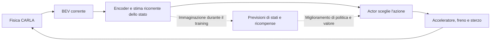

import Tabs from '@theme/Tabs';
import TabItem from '@theme/TabItem';

# CarDreamer: svolta a destra con traffico trasversale

La stessa svolta è semplice a un incrocio vuoto: che cosa cambia aggiungendo traffico trasversale? Confrontiamo due checkpoint pubblici e le previsioni del modello con il BEV futuro reale.

Prima leggere l’[esperimento DreamerV3 di raggiungimento](./2.dreamerv3-reacher.md). Qui si valutano checkpoint pubblici, si distinguono interazioni e training immaginato e si osservano i limiti predittivi. Guardare i risultati, leggere il codice, confrontare le previsioni e cambiare una variabile. Non serve addestrare da zero una politica di guida.

## Cambia scenario e osserva il comportamento \{#watch}

**Risultati di questa prova:** simple senza traffico 3/3 a destinazione; simple con traffico 1/3 e due collisioni; medium con traffico 3/3. Simulazioni reali a ciclo chiuso, senza nuovo addestramento.

| Scenario | Checkpoint pubblico | Tre episodi | Interpretazione |
| --- | --- | --- | --- |
| Svolta senza traffico | simple | 3 arrivi, nessuna collisione | Svolta di base nelle condizioni provate |
| Traffico trasversale, distanza di generazione 8–16 m | simple | 1 arrivo, 2 collisioni | Il successo a strada vuota non garantisce la gestione del traffico |
| Stessa configurazione di traffico | medium | 3 arrivi, nessuna collisione | Pesi del compito corrispondente migliori in questo piccolo test |

Ogni video mostra il **primo episodio** del gruppo, scelto in anticipo. A sinistra la telecamera, a destra il vero BEV della politica.

<Tabs groupId="cardreamer-driving">
<TabItem value="empty" label="1. Incrocio vuoto">

Il checkpoint simple si avvicina, svolta e segue il percorso.

<video controls playsInline preload="metadata" poster={require('@site/docs/foundations/world-model/figs/cardreamer/poster.webp').default} src={require('@site/docs/foundations/world-model/figs/cardreamer/simple-audited.mp4').default} style={{width: '100%', borderRadius: 12}} />

</TabItem>
<TabItem value="transfer" label="2. Aggiungi traffico">

Lo stesso checkpoint incontra veicoli trasversali. È stata registrata una collisione con `vehicle.audi.etron`: video e sensore confermano il contatto, non la responsabilità.

<video controls playsInline preload="metadata" poster={require('@site/docs/foundations/world-model/figs/cardreamer/traffic.webp').default} src={require('@site/docs/foundations/world-model/figs/cardreamer/traffic-transfer.mp4').default} style={{width: '100%', borderRadius: 12}} />

</TabItem>
<TabItem value="matched" label="3. Pesi corrispondenti">

Il checkpoint medium conclude questo episodio senza regole di frenata aggiunte manualmente né azioni modificate.

<video controls playsInline preload="metadata" poster={require('@site/docs/foundations/world-model/figs/cardreamer/traffic-matched.webp').default} src={require('@site/docs/foundations/world-model/figs/cardreamer/traffic-matched.mp4').default} style={{width: '100%', borderRadius: 12}} />

</TabItem>
</Tabs>

Tre episodi consecutivi per gruppo, seed fisso `2024`, istanze CARLA separate e stessa strada/configurazione. Non è un test di robustezza con più seed; le traiettorie del traffico non sono garantite identiche tra politiche. Il tempo sotto 0,2 m/s è 0,3–0,8 secondi, inclusa la partenza: **non dimostra arresto e precedenza affidabili**.

Usiamo CARLA 0.9.15 **Town03_Opt**, mentre gli autori usano Town03. Gli hash OpenDRIVE coincidono, ma l'equivalenza completa delle scene non è provata. Nessun test su auto reale.

## Che cosa osserva l'auto? \{#observation}

| Vista | Origine | Uso |
| --- | --- | --- |
| Telecamera HD che segue l'auto | Rendering CARLA | Mostra il movimento; non è un ingresso della politica |
| `birdeye_wpt` | BEV da verità del simulatore: strade, veicoli, percorso e waypoint visibili dei veicoli circostanti | Ingresso visivo della politica pubblica |
| Previsioni del modello del mondo | Dinamica latente appresa e decoder | Esportate dagli stati latenti e dalle azioni; vedere i video sopra |

Non si tratta di guida basata soltanto sulla telecamera frontale. Il BEV e il percorso riducono la complessità percettiva. Passare a immagini reali richiede ulteriori componenti percettive, addestramento e verifica.

## Dove interviene il modello del mondo? \{#method}

CarDreamer offre compiti di guida e un'implementazione in stile Dreamer. Riproduciamo `right_turn_simple.ckpt` e `right_turn_medium.ckpt`; il checkpoint del braccio non può controllare direttamente un'auto.



Durante il training, il modello apprende dinamica, ricompense e continuazione dalle interazioni. Actor e Critic apprendono dalle traiettorie immaginate. Durante la valutazione, osservazioni e storia aggiornano lo stato latente, da cui l'Actor produce azioni. **Non viene eseguita una ricerca online MPC a ogni passo.**

## Confronto del codice: dove imparano PPO e Dreamer? \{#code}

**Distinguere training degli autori e valutazione corrente.** Gli estratti spiegano il training pubblico. Questa prova ha soltanto caricato checkpoint, eseguito politiche ed esportato previsioni, senza aggiornare pesi. I collegamenti indicano la versione fissata.

| Fase | Training PPO tipico | Training Dreamer qui |
| --- | --- | --- |
| Interazione | Osservazioni, azioni e ricompense dal simulatore fisico | Interazioni conservate nel replay |
| Dinamica appresa | Nessun modello di transizione addestrato separatamente | Modello del mondo appreso da sequenze reali |
| Aggiornamento della politica | Ricompense, valori e vantaggi delle traiettorie effettive | Ricompense e valori previsti sulle traiettorie immaginate |
| Difficoltà | Costo delle interazioni, esplorazione e ottimizzazione | Anche sfruttamento degli errori del modello |

**1. Le interazioni addestrano il modello.** Il [ciclo di training](https://github.com/ucd-dare/CarDreamer/blob/160132436aeda1de54956f9910e56f3970a565aa/dreamerv3/embodied/run/train.py#L61-L81) salva `tran` nel `replay`, campiona sequenze e chiama `agent.train()`. L'[aggiornamento](https://github.com/ucd-dare/CarDreamer/blob/160132436aeda1de54956f9910e56f3970a565aa/dreamerv3/agent.py#L71-L79) addestra prima il modello e poi il comportamento:

```python
# Agent.train(): excerpt from the pinned upstream source
state, wm_outs, mets = self.wm.train(data, state)
context = {**data, **wm_outs["post"]}
start = tree_map(lambda x: x.reshape([-1] + list(x.shape[2:])), context)
_, mets = self.task_behavior.train(self.wm.imagine, start, context)
```

`wm.train()` aggiorna encoder, RSSM, decoder, teste di ricompensa e continuazione. `post` è lo stato corretto con le osservazioni effettive e fornisce i punti di partenza dell'immaginazione. La [loss del modello](https://github.com/ucd-dare/CarDreamer/blob/160132436aeda1de54956f9910e56f3970a565aa/dreamerv3/agent.py#L160-L187) combina previsioni di osservazioni, ricompensa e continuazione con vincoli sulla dinamica latente. Il bersaglio della ricompensa resta definito dall'ambiente.

**2. La politica prova azioni nel modello.** Il [ciclo immaginato](https://github.com/ucd-dare/CarDreamer/blob/160132436aeda1de54956f9910e56f3970a565aa/dreamerv3/agent.py#L189-L206) alterna azioni dell'Actor e stati previsti da RSSM:

```python
# WorldModel.imagine(): excerpt
start["action"] = policy(start)

def step(prev, _):
    prev = prev.copy()
    state = self.rssm.img_step(prev, prev.pop("action"))
    return {**state, "action": policy(state)}
```

Qui non avanza CARLA e non arriva la prossima BEV reale. Nel campionamento PPO, `next_obs, reward, ... = env.step(action)` ottiene lo stato dal simulatore fisico; qui lo produce `img_step()`. PPO può riusare lo stesso batch per più aggiornamenti, senza una nuova simulazione per ogni gradiente.

**3. Ricompense previste per Actor e Critic.** Il [comportamento del compito](https://github.com/ucd-dare/CarDreamer/blob/160132436aeda1de54956f9910e56f3970a565aa/dreamerv3/behaviors.py#L10-L26) valuta gli stati immaginati con la testa di ricompensa:

```python
# Greedy.__init__(): predicted rewards for imagined trajectories
rewfn = lambda s: wm.heads["reward"](s).mean()[1:]
```

[ImagActorCritic.train()](https://github.com/ucd-dare/CarDreamer/blob/160132436aeda1de54956f9910e56f3970a565aa/dreamerv3/agent.py#L294-L305) genera traiettorie, aggiorna l'Actor e poi il Critic. Per azioni continue il default propaga gradienti attraverso il modello differenziabile per aggiornare l'Actor. Il modello ha un ottimizzatore separato. Il training alterna interazioni, apprendimento del modello e comportamento immaginato; non congela il modello per sempre dopo una sola fase.

**4. L'esecuzione usa ancora osservazioni effettive.** La [politica](https://github.com/ucd-dare/CarDreamer/blob/160132436aeda1de54956f9910e56f3970a565aa/dreamerv3/agent.py#L47-L69) corregge lo stato con l'immagine corrente prima dell'azione:

```python
# Agent.policy(): observation correction, then action selection
embed = self.wm.encoder(obs)
latent, _ = self.wm.rssm.obs_step(
    prev_latent, prev_action, embed, obs["is_first"]
)
task_outs, task_state = self.task_behavior.policy(latent, task_state)
```

`obs_step()` riceve caratteristiche dell'immagine reale; `img_step()` no. Sono correzione tramite osservazione e previsione senza la prossima osservazione. Il video seguente fornisce separatamente azioni future registrate a RSSM e decodifica gli stati previsti. È una verifica offline, non training dell'Actor né MPC online.

<details>
<summary>Domanda sul codice: cosa succede eliminando le interazioni e immaginando per sempre?</summary>

Il modello non riceve nuovi dati per correggersi. La politica può trovare azioni di cui il modello sovrastima la ricompensa. Rendimenti immaginati maggiori non garantiscono guida migliore in CARLA. Servono valutazioni nel simulatore fisico; risultati di guida e immagini previste sono verifiche complementari.

</details>

## Osserva le previsioni del modello del mondo \{#prediction}

Il BEV nei video di guida è verità del simulatore. Qui invece vediamo **previsioni del modello**: futuro reale a sinistra, previsione al centro, errore assoluto amplificato 4× a destra. Cambia tra strada vuota e traffico per vedere dove la previsione diverge.

<Tabs groupId="cardreamer-prediction">
<TabItem value="empty" label="Previsione senza traffico">

<video controls playsInline preload="metadata" poster={require('@site/docs/foundations/world-model/figs/cardreamer/prediction.webp').default} src={require('@site/docs/foundations/world-model/figs/cardreamer/prediction-simple.mp4').default} style={{width: '100%', borderRadius: 12}} />

</TabItem>
<TabItem value="traffic" label="Previsione con traffico">

<video controls playsInline preload="metadata" poster={require('@site/docs/foundations/world-model/figs/cardreamer/prediction-traffic.webp').default} src={require('@site/docs/foundations/world-model/figs/cardreamer/prediction-traffic.mp4').default} style={{width: '100%', borderRadius: 12}} />

</TabItem>
</Tabs>

Tre finestre fissate in anticipo: ai secondi **2 / 6 / 10** della simulazione, lo stato latente dalle osservazioni precedenti viene proiettato per **20 passi / 2 secondi**. Riproduzione a 0,5×, circa quattro secondi per finestra. Il BEV nativo è 128×128, ingrandito.

- Il modello riceve le **azioni registrate realmente eseguite**, senza immagini future: previsione offline condizionata dalle azioni.
- Le azioni di guida provengono dall'Actor; il video non rappresenta ricerca online fra percorsi alternativi.
- RSSM usa campionamento stocastico. Un solo campione per finestra, senza stima dell'incertezza.

| MAE medio normalizzato dei pixel RGB (minore è meglio) | Modello | Immagine corrente immobile |
| --- | --- | --- |
| Strada vuota / simple, 9 finestre | 0.0251 | 0.0896 |
| Traffico / simple, 9 finestre | 0.0512 | 0.0922 |
| Traffico / medium, 9 finestre | 0.0337 | 0.0953 |

RGB nell'intervallo 0–1, tutte le finestre prefissate, inclusi gli episodi con collisione. La strada occupa molti pixel: **un piccolo errore medio non dimostra posizioni dei veicoli o collisioni previste correttamente.** Ogni checkpoint include modello e politica: non si può attribuire tutta la differenza di guida alla precisione predittiva.

## Rendere l'esperimento verificabile \{#engineering}

Il programma verifica la scena iniziale vuota, pulisce e controlla dopo ogni episodio, registra gli oggetti delle collisioni e salva dati parziali. Tutti i nove episodi hanno completato guida e previsioni, con scena vuota dopo la pulizia. Telecamera e BEV sono abbinati per ID: mancano 3–10 fotogrammi per video, saltati mantenendo i tempi simulati visibili, quindi il filmato è leggermente più breve.

Town03 originale continua a bloccarsi nella pipeline Vulkan. Town03_Opt funziona dopo la ricostruzione della cache del traffic manager; vedere il README del codice. Il timeout client passa da 20 a 60 secondi; nessuno dei nove episodi è andato in timeout. Non prova la causa del precedente problema.

I precedenti quattro successi e un timeout, insieme alle collisioni della scena riutilizzata, restano dati diagnostici separati. I due fallimenti della nuova serie sono conservati.

## Quando la svolta è riuscita? \{#evaluation}

| Controllo | Criterio |
| --- | --- |
| Destinazione | `destination_reached`: restano al massimo tre waypoint |
| Nessuna collisione | Nessun `is_collision`, segnale osservato o evento del sensore indipendente |
| Rispetto del percorso | `out_of_lane` non si attiva; è una soglia di distanza dai waypoint, non un rilevatore delle linee di corsia |
| Nessun timeout | Né `time_exceeded` né interruzione anticipata del valutatore |

Il successo richiede destinazione raggiunta e tutte le condizioni di fallimento false. Conservare episodi consecutivi con parametri fissi, senza selezionare soltanto i filmati migliori. Riportare motivi di terminazione, passi e video; la ricompensa è un indicatore aggiuntivo.

Il controllo collisioni originale usa l'ultima osservazione e può avere un ritardo di un fotogramma. Una valutazione finita vale soltanto per quelle condizioni simulate. Servono altri seed del traffico e verifiche delle collisioni vicino alla terminazione.

## Riproduzione \{#reproduce}

Versioni fissate: CarDreamer `160132436aeda1de54956f9910e56f3970a565aa`, CARLA 0.9.15, Python 3.10, Town03_Opt, compiti `carla_right_turn_simple` / `carla_right_turn_medium` (gli autori usano Town03). Seguire le [istruzioni degli autori](https://github.com/ucd-dare/CarDreamer) e scaricare il [checkpoint pubblico](https://huggingface.co/ucd-dare/CarDreamer/tree/main/CarDreamer_checkpoints).

Il nuovo `experiment.py` ha completato tre gruppi di tre episodi, previsioni e controlli di pulizia. Il README spiega dipendenze, `eval-compat.patch` e server Town03_Opt dedicato. Riavviare il server per ogni gruppo; non devono esserci veicoli o sensori già presenti.

```bash
# Avviare CARLA in un altro terminale, su una porta libera.
./CarlaUE4.sh -RenderOffScreen -nosound -carla-port=22000 -benchmark -fps=10

python experiment.py --source /path/to/CarDreamer \
  --checkpoint /path/to/right_turn_simple.ckpt \
  --output results/traffic --port 22000 --task carla_right_turn_medium --episodes 3 --seed 2024
```

Gli output comprendono `replay.mp4`, cause di terminazione, `collisions.json`, `scene-after-cleanup.json`, `trajectory.npz`, tre file `forecast-*.npz` e `forecasts.json` per episodio. Il comando seguente crea il video a tre pannelli (richiede FFmpeg di sistema). Il [README del codice](https://github.com/datawhalechina/dive-into-embodied-ai/tree/master/codes/foundations/world-model/cardreamer-right-turn) riporta tutti i gruppi e gli hash. La telecamera è separata dalla politica; nessuna azione viene modificata manualmente. Usare solo checkpoint attendibili.

```bash
python render_forecasts.py results/traffic/episode-00 --output prediction-traffic.mp4
```

## Tre esercizi \{#exercise}

1. Prima del video, prevedi se i pesi senza traffico saranno sufficienti; poi controlla i registri delle collisioni.
2. Ferma una previsione a +1 secondo. Confronta previsione, verità e immagine immobile: quali regioni dominano l'errore?
3. Cambia soltanto il seed del traffico e registra tutti gli episodi. Tre episodi con lo stesso seed non sono tre seed indipendenti.

Questo capitolo offre una demo verificabile di checkpoint pubblici e l'esportazione delle previsioni. Prima di nuovo training, fissare compito, criteri e seed di valutazione.
